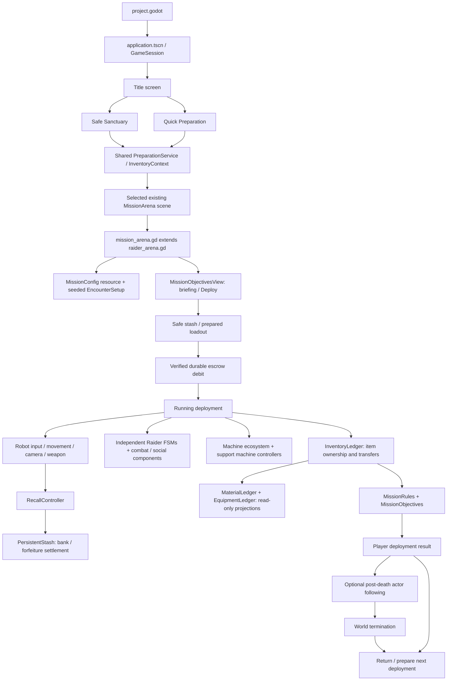
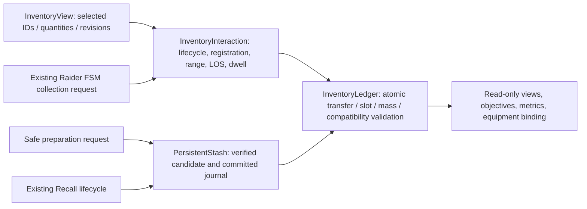
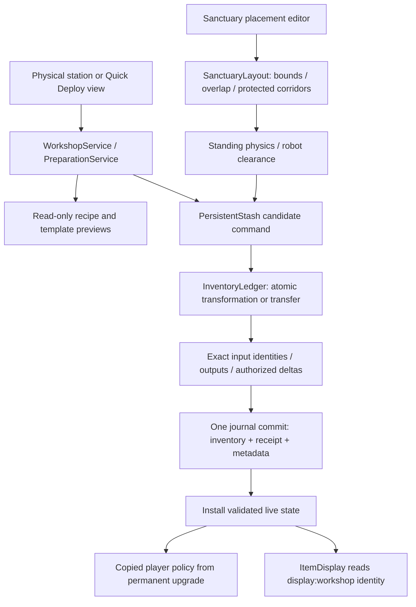

# Game code flow and ownership

Repository guide, checked **2026-10-27**. Stage Z is accepted, including usability/scroll corrections. **AA-1–AA-5 is implemented for director play-testing; later AA features remain gated.** Stage Z replaces independent material/equipment balances with one common inventory owner. Paths below are relative to the repository root.

## Start here



This is a responsibility/data-flow overview, not a strict call graph. Actors and their signals feed the arena, accounting and rules throughout the deployment. Player failure and world termination are distinct; not every result enters spectating.

The engine entry is [project.godot](../../project.godot): `run/main_scene` points to [application.tscn](../../scenes/application/application.tscn). Its GameSession child owns application transitions, one PersistentStash connection and the active inventory binding; there is no gameplay autoload. SceneSlot holds either title, safe Sanctuary, Quick Preparation or an existing arena. The arena continues to coordinate deployment simulation. Explicit standalone arena launches remain supported.

## Scene hierarchy versus script inheritance

The default scene inherits other scene presets. Those layers supply geometry/markers and configuration overrides; they are **not separate running missions**:

```text
asset_recovery_arena.tscn                 compact contract / standalone; scenario_index = 16
└─ refined_extraction_arena.tscn
   └─ personality_encounters_arena.tscn
      └─ emergent_encounters_arena.tscn
         └─ mission_arena.tscn            attaches mission_arena.gd
            └─ test_arena.tscn            foundational arena structure
```

The root script has a separate, shorter inheritance chain:

```text
scripts/gameplay/mission_arena.gd
└─ scripts/gameplay/raider_arena.gd
   └─ Node3D
```

The explicit expanded-world scene, [expanded_salvage_complex.tscn](../../scenes/levels/expanded_salvage_complex.tscn), assembles its own larger geometry and uses **the same mission script**, with `expanded_asset_recovery.tres` as its configuration override. It is not the project default. The graybox comparison inherits that expanded scene and switches its processing-art presentation flag.

```text
Arena root (mission_arena.gd)
├─ Geometry                              static collision + environment visuals
│  └─ expanded world modules             yard / processing / storage / perimeter
├─ NavigationRegion3D                    mesh baked from collision geometry
├─ Robot                                 scenes/player/robot.tscn
├─ Overlay                               mission/debug/results presentation
├─ Authored markers                      salvage, entries, exits, cover, patrols, dock
└─ Runtime children                      Raiders, machines, loot, system/view components
```

## Deployment lifecycle

1. `mission_arena.gd._ready()` selects a `MissionConfig` override or indexed preset, resolves seeded encounter placement where configured, sets enabled features and enters briefing mode when required.
2. Its base `raider_arena.gd._ready()` creates one InventoryLedger with material/equipment facades, finite typed sources in Z-enabled missions, optional flare, Recall/stash, machine and social systems; bakes navigation; connects actor/player events; and installs objective, observer and spectator components. These objects belong to the arena scene.
3. The briefing UI remains responsive while deployment processing is disabled. **Deploy** durably debits a Z prepared loadout to escrow before enabling simulation; mounted gear then enters player ownership. A short activation barrier publishes navigation and static collision before entry validation. Scheduled Raider entries then pass navigation/physical-clearance checks; actors receive finite IDs, profiles and references to shared authorities.
4. Physics ticks advance movement, AI, shots, Recall and scheduling. Events such as collection requests, damage, death, pickup and extraction route through their responsible owners. Views refresh from accepted state.
5. Recall settles carried loot through ledgers and persistent stash receipts. Mission rules classify the deployment; objective results close independently of subsequent world activity. Death fails the player irreversibly and settles forfeiture once.
6. Where configured, surviving AI continues after death while restricted spectating follows eligible actors. World completion/deadline separately shuts down actors and seals relevant authorities.
7. Restart/scenario replacement creates a fresh arena scene. The mission controller preserves the selected level/configuration/seed as appropriate, disposes objective subscriptions and ends metrics capture; persistent stash is loaded by the new deployment.

The main integration points are [mission_arena.gd](../../scripts/gameplay/mission_arena.gd) and [raider_arena.gd](../../scripts/gameplay/raider_arena.gd). Start with their `_ready()`, `_physics_process()`, `finish_mission()`, `terminate_player()`, `stop_world_actors()` and `restart_mission()` methods when tracing a lifecycle defect.

## Who owns each system

| System | Main files | Responsibility |
| --- | --- | --- |
| Scenario, configuration and entry scheduling | `scripts/gameplay/mission_arena.gd`, `mission_config.gd`, `encounter_setup.gd`, `encounter_layout.gd`; `resources/missions/` | Select scenario, resolve a reproducible layout, admit bounded arrivals |
| Shared arena integration | `scripts/gameplay/raider_arena.gd` | Wire systems/signals, instantiate actors/drops, validate requests, select available scene objectives, coordinate lifecycle |
| Mission outcome and world lifetime | `scripts/gameplay/mission_rules.gd` | Deployment success/failure and separate world-running/finished policy |
| Objective evaluation | `scripts/gameplay/mission_objectives.gd`, `mission_objective_definition.gd` | Read authoritative events/totals, credit objectives and freeze player results |
| Common item ownership and transfers | `scripts/gameplay/inventory_ledger.gd`, `item_definition.gd`, `item_catalog.gd`, `inventory_rules.gd`; `resources/items/`, `resources/inventory/` | Sole live owner of records, quantities, slots, mass, equipment and terminal transitions; per-type/cohort conservation |
| Material/equipment compatibility | `scripts/gameplay/material_ledger.gd`, `equipment_ledger.gd` | Queries and accepted-event interfaces over the same InventoryLedger; no independent balances |
| Loot access and generation | `scripts/gameplay/inventory_interaction.gd`, `world_loot.gd`, `loot_table.gd`; `scenes/loot/` | Common physical access checks, read-only registered views and one-time seeded finite manifests |
| Player inventory permissions and presentation | `scripts/player/player_interaction_mode.gd`, `equipment_binding.gd`, `scripts/presentation/inventory_view.gd` | Mode permissions, ownership-derived existing weapon enablement, event-driven paged Controls |
| Recall and durable inventory | `scripts/gameplay/recall_controller.gd`, `persistent_stash.gd` | Channel eligibility/progress, banking/forfeiture coordination, idempotent durable receipts |
| Death flares and bounded responses | `scripts/gameplay/flare_director.gd`, `flare_config.gd` | Finite response tickets, equipment integration and live-population/budget limits |
| Player physics | `scripts/player/robot_controller.gd` | CharacterBody3D velocity, movement, jump, boost and body orientation |
| Raider physics and decisions | `scripts/ai/raider.gd` | One authoritative actor FSM, navigation/recovery and physical movement |
| Raider combat | `scripts/ai/raider_combat.gd`, `raider_combat_profile.gd` | Combat recommendations, aim, cover, commitment/escape policy and shot requests; does not replace the Raider FSM |
| Relationships and social decisions | `scripts/gameplay/raider_relations.gd`, `social_encounter.gd`; `scripts/ai/raider_social.gd`, `raider_betrayal.gd` | Directed attitudes, eligible targets, expiring allied reports and conditional betrayal |
| Machines | `scripts/gameplay/machine_ecosystem.gd`, `machine_awareness.gd`; `scripts/ai/support_machine.gd` | Create independent ground/flying participants, finite components, patrol/combat and expiring shared knowledge |
| Shot resolution and health | `scripts/gameplay/shot_executor.gd`, `weapon_definition.gd`; `scripts/components/health.gd` | Cadence, physical raycasts/damage, authoritative health and death events |

Physical loot objects (`world_loot.gd` and legacy `material_drop.gd` / `equipment_drop.gd`) represent ledger state and enable interactions. Their meshes do not create additional inventory. Mission policy does not become another material counter. Allied/neutral/hostile attitudes do not imply identical current objectives or a permanent squad.

## Player input, camera and combat path

```text
Keyboard / mouse
  └─ RobotInput                         device state → movement/aim/fire/interact intent
     ├─ RobotCamera                     look signal → yaw/pitch; camera-relative direction
     │  └─ Pitch / SpringArm3D / Camera3D
     ├─ RobotController                 intent + camera basis → velocity / move_and_slide
     ├─ HitscanWeapon                   fire intent + camera ray → aim point
     │  └─ ShotExecutor                 muzzle ray / cadence → eligible Health damage
     └─ Arena / RecallController        interaction intent → validated recovery / Recall

Health / accepted shot / transfer events
  └─ feedback components + HUD           presentation only
```

[robot.tscn](../../scenes/player/robot.tscn) assembles these components. `robot_input.gd` owns device translation and input permissions; `robot_camera.gd` owns orbit, pitch limits and camera direction. The robot's CharacterBody3D owns physics. `hitscan_weapon.gd` adapts player aiming to the same `ShotExecutor` used by armed AI. Weapon data lives under `resources/weapons/`.

## Raider decision flow

```text
Scene + finite actor ID + profile/resources + ledger reference
  └─ Raider: perception / decision interval
     ├─ observed threats and eligibility
     ├─ RaiderCombat: armed personality / cover / firing recommendations
     ├─ RaiderSocial / RaiderBetrayal: reports and conditional opportunities
     └─ existing central state transition
        ├─ select / scavenge / recover cargo
        ├─ engage / take cover / reposition / investigate
        └─ flee / extract / stranded / terminal
           └─ navigation + local steering → CharacterBody3D physics
```

[raider.tscn](../../scenes/raiders/raider.tscn) provides the body, NavigationAgent3D, health, placeholder visuals and reactions. Runtime components receive callbacks from the arena for salvage, exits and target eligibility. Profile resources in `resources/enemies/` supply personality/combat tuning. The existing FSM remains authoritative even when components suggest a different action. Collection/extraction/death signals request ledger-backed transfers through arena integration.

During Checkpoint W review, a small `scripts/ai/raider_threat_monitor.gd` component was added beside the existing FSM. It measures actual sight continuity and the accepted report-investigation deadline. Raider compares observation priority with its current action before replacing a route; combat still evaluates personality and survival. The monitor cannot transition actors, write velocity, select loot or settle ownership. See the [action-commitment correction](../development/reports/stage_w_raider_action_commitment.md).

## Spectator ownership

Both spectator modes use [spectator_camera.gd](../../scripts/presentation/spectator_camera.gd) for camera mechanics. Permissions and mode lifecycle remain separate:

- `scripts/debug/developer_spectator.gd`: debug-only free movement, inspection and optional follow; F1 toggles it.
- `scripts/gameplay/post_death_spectator.gd`: player-facing restricted follow/cycling after irreversible deployment failure.
- `scripts/player/robot_camera.gd`: normal player camera when neither spectator controller owns the active view.

Only one camera is current. The robot stays physically present; spectator transforms are not target/perception positions, movement or accounting inputs. Post-death observation does not revive the player or reopen settled results.

## Assets and presentation

```text
assets/environment/source/              editable .blend; .gdignore blocks direct import
  └─ tools/art_pipeline/                 guarded build / source export / import setup / audit
     └─ assets/environment/exports/     explicit .glb + tracked import settings
        └─ scenes/environment/          reusable visual wrapper scenes
           └─ processing_facility_art.tscn
              └─ expanded_salvage_complex.tscn

assets/environment/textures/            original shared wear/roughness maps
  └─ resources/materials/environment/   external shared Godot material resources
```

`scripts/presentation/environment_art_view.gd` switches old/new visuals for comparison. Accepted explicit structural colliders, rather than imported decorative meshes, supply physics and navigation geometry. The [art pipeline guide](../art_pipeline/README.md) describes units, origins, materials, export/reimport and validation. Blender is required for source authoring, not runtime.

`scripts/presentation/` and player feedback components display mission briefing/results, damage/hits, loot/actor cues, traversal and deployment effects. `scripts/debug/deployment_metrics.gd` observes authoritative events for optional bounded diagnostics. Presentation/diagnostics do not own actor decisions or inventory.

## Actor visual production (Stage W)

Existing player/Raider scenes now add `Visuals/ActorVisual`; machine construction adds the same adapter under its existing visual root. `scripts/presentation/actor_visual.gd` instantiates a visual wrapper from `scenes/characters/visuals/`, reads actual motion/accepted shots and chooses cosmetic appearance independently of gameplay RNG. Gameplay muzzle markers remain siblings of the imported model.

`assets/characters/source/` contains four editable Blender models; `exports/` supplies explicit GLBs. One 20-bone Raider rig imports six clips and bounded wardrobe meshes. Machines use named rigid articulation pivots. The original art tools support an explicit actor mode while preserving static environment mode. See the [actor production guide](../art_pipeline/actors.md).

`death_tumble.gd` retains its existing cosmetic body/physics/lifetime but can now request a clean skinned/animated visual copy. This copy survives actor deletion, contains no gameplay components and cannot release loot or settle a deployment. Primitive fixtures remain available through the arena's `production_actor_visuals` presentation flag. There is no new actor controller or animation-driven movement.

## Repository map and maintenance

| Folder | Purpose |
| --- | --- |
| `scenes/levels/` | Playable scenes, diagnostic presets, environment assembly |
| `scenes/player/`, `scenes/raiders/`, `scenes/loot/` | Reusable gameplay scene composition |
| `scripts/gameplay/` | Integration, rules, accounting, lifecycle and shared combat/services |
| `scripts/player/`, `scripts/ai/` | Player/AI intent, controllers and actor components |
| `scripts/components/`, `scripts/presentation/`, `scripts/debug/` | Shared health/reactions, views/effects, developer observation |
| `resources/` | Mission, personality, weapon and material definitions |
| `assets/`, `tools/art_pipeline/` | Editable art, runtime exports and authoring tools |
| `tests/` | 50 active automated regression suites; see the [test index](../../tests/README.md) |
| `tests/archive/` | Retired-test location; currently no obsolete suites identified |
| `docs/development/` | Supplied ledgers, approved plans, delivery/acceptance records and evidence |
| `.godot/` | Ignored engine cache, temporary test saves/probes and generated outputs |

Use the [development index](../development/README.md) to distinguish delivered, accepted and future scope. Historical preset scenes and older-stage tests remain supported references; names alone do not establish that they are unused. Godot `.gd.uid` files belong with their scripts and are tracked metadata, not extra executable tests.

## Stage X presentation branch

`RaiderArena` creates one `MissionPresentation`. Existing visual setup registers player, scheduled Raiders and machines. Actual `ShotExecutor.fired` and the additive collision snapshot feed `WeaponFeedback`; Health feeds `ActorDamageFeedback`. Imported `ActorVisual` still owns recoil/locomotion, and `DeathTumble` still owns the one cosmetic corpse. New effects have no physics or gameplay command authority. The root owns bounded transients, spatial/interface players and a listener following the existing active camera. Ledgers/objectives supply deduplicated confirmation edges. AmbientFeedback scenes supply optional local sound and particles in the compact and expanded missions. See the [presentation guide](../presentation/README.md) for limits, audio assets and inspection controls.

## Stage Y static environment branch

The explicitly launched expanded scene instances four inherited art wrappers over the accepted geometry modules. `environment_art_view.gd` selects production or graybox visuals; the original static bodies, navigation inputs and gameplay markers remain authoritative. `salvage_complex_dressing.tscn` adds noninteractive surface staging outlines. These are independent of live stock counts and mission outcomes.

`EnvironmentMeshBatch` binds an imported environment GLB `PackedScene` and a static transform array to a shared `MultiMesh` once at readiness or source-change notification. It has no per-frame work, actor references, input or gameplay RNG. No Blender/source generation runs in gameplay. The GLB/materials remain the mesh/surface authority. See the [Y report](../development/reports/stage_y_world_population.md) and [asset workflow](../art_pipeline/README.md) for placement limits and import validation.

The approved Y refinement adds `Geometry/StagingClusters`: three authoritative static bodies with matching graybox meshes/shadow proxies, plus one common eleven-instance pallet batch spanning those bodies and the original LowCrates volume. Navigation still bakes the existing Geometry group; original colliders/markers stay exact. The service art wrapper selects a separate procedural ground mesh or the original graybox floor. Its shared static ShaderMaterial also covers the processing overlay, with no input, time, displacement, RNG or accounting work. Utility connections extend existing instance arrays. See the [refinement report](../development/reports/stage_y_environment_refinement.md) for the exact approved footprints and evidence.

## Stage Z inventory transfer flow



Only InventoryLedger changes live item ownership. PersistentStash writes verified snapshots of that ownership and operation history. A journal receipt is evidence, not an additional spendable inventory. MaterialLedger and EquipmentLedger retain old call surfaces for supported reference presets, which use unbounded legacy content rules through the same transfer engine. They do not own duplicate counters or item dictionaries.

Normal/expanded missions opt in via MissionConfig. Source generation uses a separate digest-seeded loot stream; opening a source never generates items. Authored cache locations retain the existing stock routes, but contents and dropped loot require direct observation. Raiders remember a completed empty-cache search until fresh sight discovers contents there; threat/report timing and their single FSM remain unchanged.

I opens live inventory or safe preparation. PlayerInteractionMode owns device permissions across briefing, gameplay, inventory, developer view, post-death and results. RobotController continues physical movement/gravity/braking while inventory suppresses intents. EquipmentBinding derives weapon availability from a compatible primary mount and current permissions. Other mounts remain data-only in Z. Normal post-death followers cannot transfer items.

Version 2 preserves safe stash/prepared/escrow/quarantine records, stable identities, provenance and a committed sequence/hash chain. Preparation transfers and Deploy debit commit before publication. Recall returns player items durably before success; death/abandon forfeits once. An unresolved crash forfeits escrow once on next attachment. Unknown definitions remain quarantined, oversized migrations refuse expansion, and broken/newer histories block spending. See the [Z report](../development/reports/stage_z_hybrid_inventory.md) for limits, test coverage and manual review.

## Stage AA application and safe preparation branch

```text
application.tscn
├─ SceneSlot: one active title / sanctuary / quick preparation / deployment
├─ Overlay: shared station and preparation interfaces
└─ GameSession: transitions + one profile connection + dependency injection
```

`GameSession` opens an isolated-or-real explicitly configured `profile_path` once, attaches a home InventoryLedger and migrates the application profile to v3. `PersistentStash.bind_inventory()` hands the existing verified profile to a fresh staged arena ledger without reopening disk or running abandonment recovery. The outgoing ledger is sealed; it cannot spend the copied checkpoint. Return reconstructs a fresh home ledger from the settled persistent projection. No old world is unsealed.

`Sanctuary` owns only local walking/station/navigation modes, original workshop geometry and player input/camera permissions. `StationRegistry` validates registration, availability, range/LOS and capsule-clear reachable anchors. Physical E and quick Tab navigation invoke the same station entry. The robot scene is inherited from the existing actor, with combat/damage disabled and a sanctuary-only elevated/zoomable camera. There are no mission timers, hostile actors, reinforcement controllers or home upkeep.

`PreparationService` routes inventory, compatible equipment and desired-template commands through the existing durable candidate transaction. `InventoryContext` supplies either safe preparation or the arena's physical loot access to the same InventoryView. Templates contain definition requests, not item ownership; the single `prepared` container reserves actual items. ContractDefinition wraps the two existing normal scenes/configurations; no new objective engine is added. Unknown/missing template entries remain inspectable.

`GameSession.deploy()` stages scene/nav/static-body readiness with participants inert, blocks inventory access during staging, commits the kit as an unstarted attempt, marks it running durably, then calls existing deployment activation. A cancelled/unstarted attempt refunds the same identities; a running crash keeps Z's loss rules. The result builder factors MissionObjectives' existing evaluator, and PersistentStash commits its frozen result under the same receipt as banking/forfeiture. A failed Recall write can be followed by play or death, so only irreversible failure previews are frozen. Post-death observation retains existing permissions and autonomous world continuation until Return.

Normal startup supports v3 metadata and a byte-preserving v2 backup; the same loader still validates historical v2 journal entries and v1 migration. Standalone legacy launch behavior remains available. `snapshot()` remains the legacy material/equipment projection; `home_snapshot()` and `deployment_snapshot()` provide read-only application metadata. PersistentStash alone writes disk. Recipes, functional upgrades, placement and item displays are **not implemented at AA-5**.

In an app-managed deployment, R/summary return routes through GameSession. F-key scenario selection displays a notice rather than silently abandoning cargo; use the explicit standalone diagnostic scenes for those presets. Escape during gameplay opens an abandonment confirmation; cancelling restores input and suppresses held fire. Inventory Escape closes that overlay first. Live world simulation continues while UI is open.

See the [AA-5 delivery and manual checklist](../development/reports/stage_aa_playable_loop.md). That gate was accepted; the AA-9 extension and handoff guides are linked below.


## Stage AA completion: workshop, layout and display

AA-5 was accepted and continuation approved. The remainder is implemented for final director review. This section supersedes the early checkpoint's unavailable-feature notes above.



RecipeDefinition explicitly allows the four small recipes and Cargo Rack I's installation cost. InventoryLedger validates recipe debits/credits against original supply and creates output provenance. Persistent projection rebases retained quantities at scene boundaries; durable profile operation receipts retain the transformation record. Fabrication planning accounts for shared/reserved ingredients and validates the resulting kit on a private ledger. It never mutates the live inventory or silently crafts.

UpgradeDefinition derives copied rules for prepared, escrow and deployed player containers after load/binding. Shared player defaults and Raider rules remain unchanged. Layout metadata owns at most eight snapped poses; runtime colliders/visuals reconstruct from it. Preview has no ownership or save effect. One fixed display reserves the original item/stack in `display:workshop`, validates its metadata reference and returns it without merging away its identity. Presentation reads these facts rather than minting another item.

The [extension guide](extension_guide.md), [technical-debt register](technical_debt.md) and [final delivery](../development/reports/stage_aa_sanctuary_gameplay_loop.md) provide exact extension points, tests, measured limits and acceptance checks.
