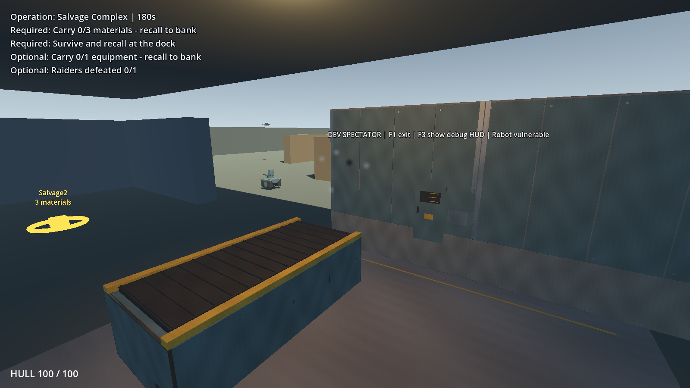
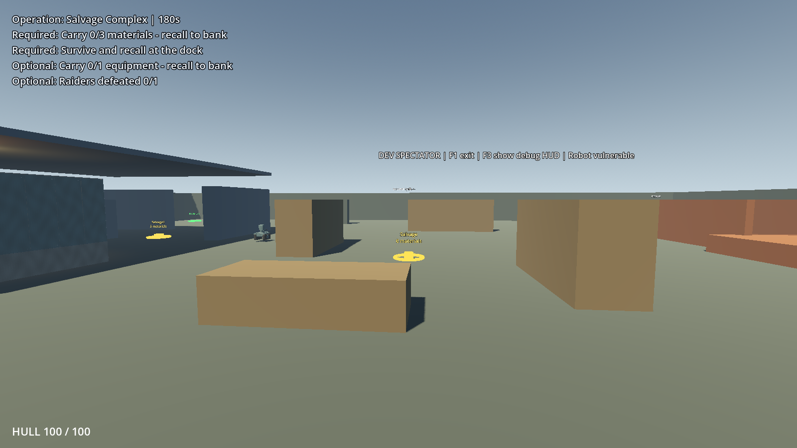
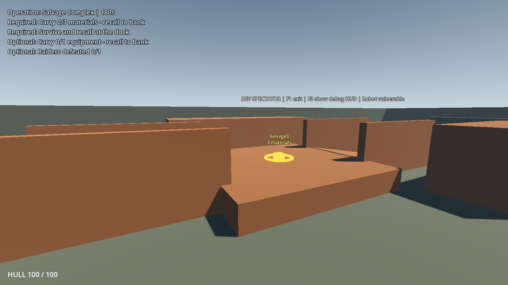
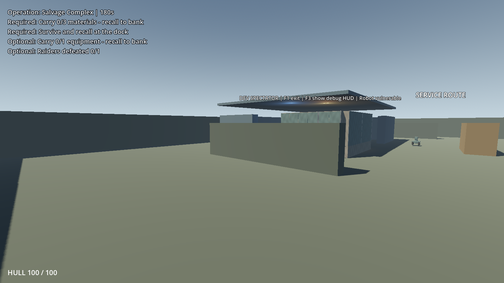

# Stage Y environmental audit baseline

Recorded **2026-10-25**, before any Stage Y model or placement work. The director accepted Stage X and supplied the Y planning ledger plus four zone references. See the [world-population proposal](../../plans/phase_7_stage_y_world_population_plan.md).

## What was inspected

Read the accepted U/X reports, current expanded scene and four environment modules, mission/layout resources, navigation/actor setup, art visibility and Blender/export/import/audit tools. The attached Y ledger is archived byte-for-byte at `../../ledgers/phase_7_stage_y_world_population.md`. No commit, reset, discard or publication was performed.

Runtime inventory confirms:

- 72 × 64 m floor, 33 box collision shapes, four zones and one static-collider navigation bake with 0.5 m radius / 2 m height.
- 41 visible Geometry meshes: six imported instances confined to ProcessingFacility and 35 primitives. Of these, 36 have shadow casting enabled. Eleven distinct active material resources are used by Geometry (including inline primitive materials); the imported library uses six shared foundations. Counts exclude actors, loot/HUD, root marker rings and transients.
- Processing: 18 visible meshes / 10 bodies; Yard: 4 / 4; Storage: 10 / 10; Service: 9 / 9. Processing alone has production models. The roof underside is 1.35 m above existing wall tops; that limitation requires an explicit geometry decision if corrected.
- Original library: eight source-backed exports, 5,412 triangles, six materials, two 1024² textures. Fresh `audit_assets.py` verifies hashes, dimensions, static exports, UVs and material references without regenerating art.
- Both layouts, all six possible stock positions, entrances/exits/dock/cover and patrol markers were inspected. Both layouts pass existing navigation validation; all six stock candidates pass support/reachability and capsule-clearance queries. Fourteen material units remain conserved.

## Evidence and validation

| Artifact | Meaning |
| --- | --- |
| `sources_before.json`, `source_verification.json` | 427 runtime/scene/resource/asset/test/tool entries captured before inspection and unchanged afterwards. No new runtime/asset files. Original user work retained. |
| `regression/validation.json` and logs | Fresh editor import plus all 39 active suites: all complete with exit 0 and zero test failures. Thirty-two accelerated suites retain ObjectDB/resource shutdown diagnostics; none reports another error category. These diagnostics remain a documented Stage X limitation, not a clean-shutdown claim. |
| `inventory_headless.json` | Final ordinary-rate runtime inventory, source/physical contracts, current material/shadow counts and two layout results. Material counts use actual resource identities, not a merged empty path for inline resources. |
| `inventory_headless.log.txt` | Initial accelerated inventory passed assertions but reproduced shutdown diagnostics. |
| `inventory_native.log.txt` | Final ordinary-rate inventory: passed, clean output. |
| `inventory_Windows.json`, `inventory_forward.log.txt` | Two-layout Forward+ world inspection, clean output. Earlier inventory schema lacks the later material/shadow counters; the native headless inventory supplies those. |
| `screenshots/87017_*.png`, `screenshots/87018_*.png` | Before captures: overview and processing/yard/storage/service views for both layouts, visually inspected. These show existing X, not a Y concept/render or completed dressing. |
| `performance/*.json`, logs, `performance_validation.json` | Matched 30-second maximum-initial-population bay/overview measurements, no implementation changes. Both complete cleanly with caps/conservation valid. |
| `probes/*.txt` | Read-only ignored inventory and measurement script copies. They are evidence, not active game components or additional regression suites. |

Frame samples: bay median/p95 4.179/5.437 ms, worst 32.612 ms; overview 4.182/5.538 ms, worst 20.016 ms. Both peak at 387 draws, 143,020 rendered primitives and 120,538,624 texture bytes. Scene-ready samples are 440.645/451.682 ms. Hardware: i7-14700HX / RTX 4060 Laptop, Godot 4.7.2 Standard, Forward+, 1600 × 900. Raw CPU monitors and memory are retained; frame intervals are not GPU-profiler timings. Rare stalls and existing WAV shutdown issues remain open observations.

The audit deliberately uses both constructed physical regression scenarios and static inspection. It does not claim a manual player walkthrough, art acceptance or proof of future decorated-world behavior. Proposed models, density, placement, new regression coverage and budgets require director approval before implementation. No new Blender asset or world prop was created.

## Before views (west layout)

Processing:

Yard:

Storage:

Service:

