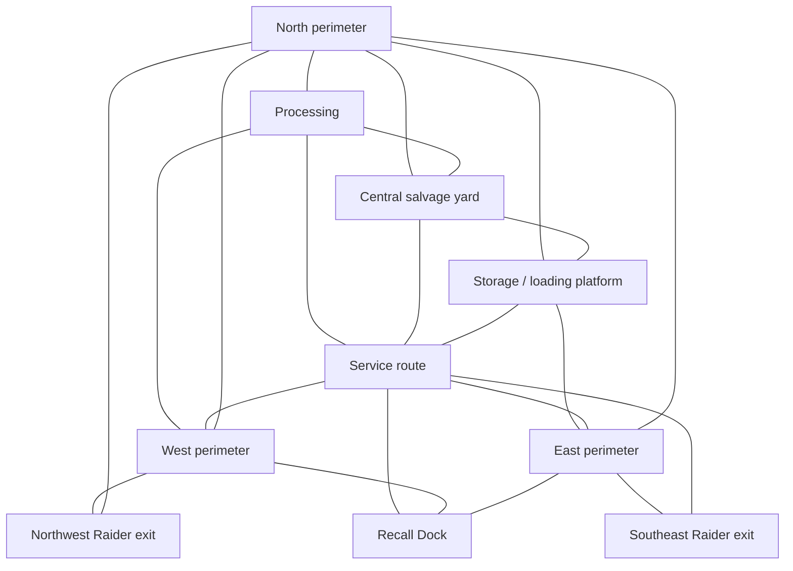

# Stage U: world-expansion architecture and layout proposal

Prepared **2026-10-21**. **Approved, implemented and accepted at Checkpoint U on 2026-10-21.** The director explicitly accepted Stage T, including its decision-stability follow-up, on this date. This proposal follows the [supplied Stage U ledger](../ledgers/phase_7_stage_u_world_expansion.md). The proposal below is retained as approved scope; the [delivery report](../reports/stage_u_world_expansion.md) records implementation and validation. Default routing is unchanged; no Git commit is included.

## Verified starting point

Normal startup is `asset_recovery_arena.tscn`, scenario 16, with the Stage S briefing and objectives. Its inheritance chain reaches `mission_arena.tscn` and `test_arena.tscn`; `mission_arena.gd` extends `raider_arena.gd`. The original test floor is 32 × 32 m; Mission scales it to 48 × 48 m with walls centered at ±23.5 m. The current space already has cover, a narrow passage and a ramp/platform. Scaling this entire scene would also stretch cover, corridors and marker separations; author a new environment instead.

The accepted [T delivery](../reports/stage_t_full_gameplay_integration.md) and [decision follow-up](../reports/stage_t_raider_decision_followup.md) are the baseline. The final follow-up passed **31 suites**, editor parsing/import, Forward+ regression/startup and two natural 1× deployments. In those final 87017/87018 observations, all five Raiders extracted, both machines died, world resolution occurred at **111.18 s**, 30/32 shots occurred, navigation recovery count was zero, and 14 materials were conserved (13 extracted, one ground). North assessed but did not commit betrayal. Earlier T delivery observations are historical and differ; do not use their committed-betrayal counts as a guarantee for this version.

Those samples establish working mechanics, not an ideal encounter curve, human travel comfort or sustained performance. Original T peak-population graphical checks retained 539 frame samples over about 2.5 simulated seconds on the local RTX 4060 Laptop/i7-14700HX: p95 frame intervals 5.729 ms without metrics and 5.520 ms with metrics. They predate the steering follow-up and are short local measurements. Re-measure the accepted compact version alongside U rather than treating these as a production budget.

Git contains extensive accepted uncommitted P–T work. Preserve it. The accepted T follow-up source manifest identifies 221 runtime/resource/test files independently of HEAD. Planning performs no reset, staging, commit or publication.

## Existing-world dependencies and migration

| Current authority / implementation | Verified assumption | Proposed U treatment |
| --- | --- | --- |
| `mission_arena.gd::_ready()` | Chooses from a static CONFIGS array by scenario index; resolves encounter before parent initialization | Add one optional typed mission-config override, default null. U supplies its own resource before the existing initialization path. Existing presets continue using CONFIGS. |
| `EncounterSetup.resolve()` / `EncounterLayout` | Authored salvage-marker paths and patrol groups; moves root Salvage views before ledger initialization; exactly three stock sites and two machine routes | Reuse this path with U-specific authored layouts, three sites and two routes. No runtime terrain generation or extra resource sources. |
| `raider_arena.gd::_ready()` | Direct root paths Robot, Overlay, Salvage/2/3, NavigationRegion3D; existing dependent presentation hooks | Preserve the root contract. Environment modules own geometry only; root owns mission-facing markers and views. Validate required nodes before resolving the configuration. |
| Mission entry and extraction setup | Root RaiderSpawns contains named entries; root Extraction/Extraction2 are the only enumerated Raider exits | Keep those names and two exits. Config uses existing spawn names and marker validation. No generalized exit framework is needed. |
| RecallController / objective initialization | Root RecallDock, shared stash, flare equipment support and required extraction | Relocate the marker only. Reuse briefing, objectives, same banking/forfeiture and post-death world rules. |
| Navigation initialization | One synchronous bake from grouped collision geometry; agent radius 0.5, height 2.0, actor path-height offset 0.5 | Retain one region and one bake initially. Include module collision children under navigation_geometry. Bake after all geometry/markers exist; admit actors only after map synchronization/validation. |
| Entry / ground / patrol validation | Support rays, capsule clearance, closest nav point ≤0.6 m and paths to objectives/exits | Keep these checks and add complete U marker/path checks. Raised markers must agree with physical surface and baked height; do not loosen tolerances to hide errors. |
| Raider movement/combat | Walk 3 m/s, flee 4.5 m/s, 1.5 s low-progress watchdog; explicit cover/Peek pairs and reservations | Keep FSM, steering, response timing and cover policy. Author full-width routes, valid cover/peek surfaces and bounded alternate paths. Test actual physics, not path existence alone. |
| SupportMachine | Ground guard follows NavigationAgent; flying scout travels straight between route points and collides with geometry; guard sees 12 m, scout 20 m | Keep scout legs outdoors and clear at altitude, not through roofs. Ground route crosses two useful junctions. Check entire segments, not only endpoint clearance. Scout is an unarmed spotter; guard is armed. |
| Machine component release | Uses nearest nav surface and subtracts existing 0.5 m offset | Test platform/roof-edge deaths for accessible finite drops. Keep scout over reachable ground to avoid ambiguous stacked surfaces. |
| Restart / scenario switching | `select_scenario()` reloads a hardcoded scene from index; would silently send U back to compact Asset Recovery | Preserve explicit current mission scene/config identity for replay and next-seed replacement. Reference hotkeys still deliberately load their original scene/config. No global singleton. |
| Player/camera/spectators | Physical CharacterBody movement, shoulder ray + SpringArm, shared spectator camera with separate permissions; no level-coordinate clamp found in examined camera code | Reuse unchanged; review walls, ceilings, ramps, distant target following and post-death continuation. Camera position is never an AI input. |
| Collision conventions | Environment defaults to layer 1, Raider layer 1/mask 3, robot layer 2/mask 1, support machines layer 2/mask 3; weapon-specific masks distinguish eligibility | Preserve current masks exactly. Do not reinterpret layer 1 as geometry-only or introduce a layer migration with this map. Keep cosmetic meshes nonblocking unless intentionally authored as cover. |

## Proposed footprint and connectivity

Start at **72 × 64 m**, x = −36…36, z = −32…32, ground y = 0. This is twice the current Mission floor area, before obstacles. North is −z. Coordinates below are initial authoring targets, subject to collision/navigation checks during the approved build. Do not increase size to meet a numerical target if useful activity becomes too sparse.

| Area | Approximate extent / landmark | Gameplay and connections |
| --- | --- | --- |
| Central salvage yard | x −12…12, z −10…10; low scrap bays | Six-unit stock, intermittent full occluders and low cover. Four approaches; clear traversal lanes rather than a bowl exposing every entry. |
| Processing facility | x −30…−14, z −14…10; open-sided roof/partition block | Three-unit stock. North and south doors plus east yard opening, no mandatory dead-end room. Short sightlines and cover/peek pairs. |
| Storage/shipping | x 14…30, z −14…10; container rows | Three-unit stock. Offset rows permit a short exposed approach and longer covered flank. Loading platform at y +1 m, ramp about 6 m long and ≥4 m wide. It has a second ramp exit; no jump-only AI objective. |
| Service route | x −26…26, z 14…22; offset screens | West–east concealed link connecting both facilities and yard. Ordinary clear lanes ≥4 m; short optional 3 m pinch has a wider bypass and no stock/cover reservation in its mouth. No permanent corridor trap. |
| Exterior perimeter | North band z −28…−20 and west/east outer lanes | Wider, more exposed alternate connection and arrival access. Break uninterrupted cross-map LOS with staggered blocks. No single loop is required to reach every site. |
| Extraction approaches | Southwest/southeast routes plus service/yard junction | Recall Dock around (0, 26); Raider exits around (−30, −25) and (30, 25). Each has two physically separate approaches, not two doors feeding one mandatory choke. |



This is a route graph, not a promise of minimum-risk AI route planning. Existing actors choose objectives/exits by their accepted scoring and follow valid navigation paths; U does not add a tactical route selector. Graybox contrasts use restrained zone colors, silhouette blocks and small landmark labels; detailed machinery and decorative clutter are deferred. Keep the interior roof high enough for the player camera; test actual camera compression. The scout's air route stays outside roofs and away from the platform.

## Encounter geography and initial configuration

Use a U-only copy of Asset Recovery's mission resource with the same required/optional objectives, briefing, Recall Dock, social rules, Q profiles, 180 s deadline, five initial Raiders at **0/0/35/70/105 s**, live cap five, two machines and at most two flare responders. Keep **6/3/3 stock + two installed components = 14 materials**, with no bonus stock or gear. Original salvage remains Raider-only; player recovers drops. Keep awareness, health, weapon values and personality policies unchanged for the first comparison.

Author two seeded arrangements using existing EncounterLayout fields: west-processing emphasis and east-storage emphasis. Shift permitted entries, stock marker choices and patrol routes within the same topology; retain current personality mix and independent relationships. Early allies should have intersecting access to stock and one shared machine threat, with separate escape options. Rivals enter through a different approach that can intersect the yard or cargo routes. R3 retains neutral competition. This permits existing cooperation/betrayal/hostility, never proximity-triggered relations or scripted winners.

Do not spread five actors evenly around the perimeter. Concentrate useful objectives in a connected core roughly 40 × 32 m. Peripheral space provides alternate traversal, not a second empty map. Position later arrivals within approximately 20–30 m of a plausible site, rather than making the 105 s arrival cross the entire footprint. A nominal 60 m unobstructed walk takes 20 s at current Raider speed; turns, tasks, combat and retreat add time. Measure real travel before extending the deadline. Player speed remains 7 m/s with accepted jump/boost.

The guard circuit intersects processing/yard and yard/storage entrances; it does not cover all stock simultaneously. Scout legs cross outdoor yard/perimeter approaches at roughly y 3.5 m. Shared threat expiry and visual occlusion remain unchanged. Keep paths toward both exits, useful full cover and visible exposure breaks so existing pursuit can lose LOS and finish bounded searches. No population increase compensates for empty geography.

## Scene and configuration design

Proposed files after approval:

```text
scenes/levels/expanded_salvage_complex.tscn  # Same mission_arena.gd
scenes/levels/environment/
  salvage_yard.tscn
  processing_facility.tscn
  storage_area.tscn
  service_perimeter.tscn
scenes/presentation/arena_overlay.tscn     # Extract existing static Overlay once
resources/missions/expanded_asset_recovery.tres
resources/missions/u_encounter_west.tres
resources/missions/u_encounter_east.tres
tests/expanded_world_test.gd
```

New root composes WorldEnvironment/Sun, grouped Geometry containing four module instances, one NavigationRegion3D, existing Robot scene, shared Overlay, root Salvage/2/3 views, root Extraction/Extraction2, RecallDock, RaiderSpawns, CoverPoints with Peek children, and layout/patrol marker groups. Retain any existing controller-required compatibility nodes until validation proves otherwise. Modules do not own ledgers, actor spawning, machine AI or objectives. Keep their transforms explicit; prefer unit scale for collision and navigation authoring.

Extract the existing static Overlay subtree as a reusable PackedScene and instance it in compact and U scenes with the same node names/paths, properties and layout. Runtime objective/spectator/recall presentation remains composed by existing scripts. This small compact-scene edit avoids maintaining a second HUD copy; it requires compact GUI-flow regression. Do not reparent the entire accepted level hierarchy or scale its inherited physics objects. Reuse existing player scene and environment settings; original compact geometry, markers and resources remain available.

Limit shared gameplay edits to `mission_arena.gd` configuration selection/replacement identity and necessary fail-fast contract validation. Extend EncounterSetup's validation only for demonstrated missing U checks. Root cover markers continue to work with existing reservations. New nested marker paths already fit EncounterLayout; no level registry or world framework is proposed.

Initial selection is explicit: `godot --path . res://scenes/levels/expanded_salvage_complex.tscn`. Leave the default compact Asset Recovery unchanged during Checkpoint U. Document the exact launch command; avoid assigning another overloaded F-key. Replay and next seed must stay in U, while deliberate diagnostic-preset switching still works. Default promotion can be decided at acceptance.

## Build order, risks and evidence gates

1. **Capture accepted compact reference:** verify source hashes, re-run parsing, 31 suites and representative compact observations. Measure time-to-first contact, intervals of activity, collection/exit times, unresolved objectives and performance with identical observer/settings. Record fresh logs; archived evidence is not a new run.
2. **Minimal scene/config seam:** share Overlay, add optional config override and preserve replacement scene identity. Exercise S GUI, early/full extraction, death/follow, restart, seed advance and reference switching before adding geometry.
3. **Topology blockout:** floor, walls, four modules, complete route loop and low platform. Bake once and validate every spawn/site/exit/dock/cover/peek/guard point; test alternate routes by blocking a selected corridor in a controlled fixture. Do not ship a runtime blocker mechanism.
4. **Place finite activity:** author two layouts and outdoor scout/ground guard routes. Run physical long-distance scavenging/extraction, head-on passage, retreat and cover firing before any geography adjustment.
5. **Compare seeded deployments:** use at least 87017–87021 and repeat one seed in compact and U at 1×. Label natural observers separately from controlled fixtures. Record seed, selected layout, positions and configuration hashes; a seed reproduces setup, not guaranteed frame-identical physics/winners. Correct geography first if contact is sparse, routes stall or 180 s regularly truncates ordinary work. Do not change schedule and weapons alongside geography.
6. **Checkpoint U:** full validation, performance comparison, screenshots and manual checklist; stop for review. No Stage V, commit or publication.

| Risk | Required evidence / response |
| --- | --- |
| Expansion dilutes activity | Compare contact/engagement gaps and accessible scavenging windows across seeds; move cover, approaches or stock within the core before increasing population. Quiet periods alone are not failures. |
| More congestion or aim/pursuit oscillation | Preserve both P combat follow-ups and T decision stability; actual multi-body movement at interior corners, ramp mouths, loot and exits. Require progress or bounded documented recovery. |
| Bake cost or disconnected navigation | Record startup/bake/map-ready times; endpoint/path and physical tests on ramp and alternate connections. Retain single region unless measurements show a concrete need to change it. |
| Flying route intersects a roof / component unreachable | Sweep route segments and run real patrol circuits; destroy scout near transitions and physically recover its allocated drop. Avoid stacked walkable roofs in initial blockout. |
| Restart silently returns to compact / duplicate initialization | Assert scene/config/seed identity, fresh actors/relations/budget, single camera and single ledgers across replay and seed changes. |
| New draw/physics cost | Sequential paired compact/U Forward+ 1600×900 runs, same hardware/settings/warmup; sustained natural and controlled peak-five-plus-two runs. Report median/p95/max frame time, physics/process monitors, memory and teardown/restart. Separate headless simulation throughput from rendering. Investigate sustained >20% p95 regression or repeated >33 ms frames as review triggers, not a claim of cross-hardware certification. |

## Validation and manual acceptance

Preserve all 31 suites. New coverage should use existing integration helpers and isolated ignored saves, not duplicate controllers. Check: U load and briefing gate; one ledger of each type; supported collision-clear spawns; nav connectivity for all layout markers/exits; two alternate important connections; ground patrol legs and unobstructed scout flight; actual remote collection/exit dwell; unreachable objective recovery; ramp ascent/descent and no bypass through walls; cover/peek LOS and valid physical shots; hostile/allied/neutral interactions under arranged conditions; bounded arrivals/flare tickets; every accepted transfer conserved; player banking/forfeiture exactly once; post-death target switching and ongoing distant AI; U replay/seed identity; compact preset switching and GUI parity.

Run Godot 4.7.2 editor parsing/import, all prior and new suites, bounded headless **deployed** simulations and Forward+ startup/active play flows. Inspect warnings and errors, not just exit status. Preserve generated probes/logs under ignored `.godot/`, archive chosen results/source identities in development baselines, and track new script UIDs. Do not modify real stash during validation. No tests or engine runs have been newly performed for this documentation-only proposal.

Director review should traverse all areas and both platform ramps; scavenge/intercept/extract normally; follow distant Raiders and inspect narrow passages; compare passive same/different seeds; witness conditional social opportunities without requiring outcomes; die and follow machines/Raiders through extraction; then replay and return to compact Asset Recovery. Judge readable landmarks, useful alternate routes, travel cost, camera comfort, encounter density and whether movement remains fluid. Automated path coverage cannot establish these qualities.

**Approval requested:** the 72 × 64 m topology, four geometry modules, one-region navigation, same-population/stock/timing initial comparison, minimal config/replay seam and shared Overlay extraction. The [Stage U ledger](../ledgers/phase_7_stage_u_world_expansion.md), section 20, says: “Stop for director approval before implementing the expanded level.” The director subsequently approved this proposal. Construction and validation are recorded in the delivery report; The director subsequently accepted Checkpoint U after successful manual play-testing.
