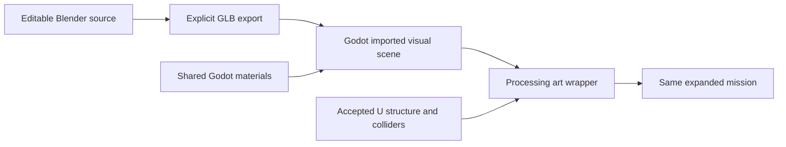

# Stage V: environment production pipeline and processing-bay proposal

Prepared **2026-10-21**. **Approved, implemented, validated and accepted at Checkpoint V on 2026-10-22.** See the [delivery report](../reports/stage_v_environment_art.md) for actual assets, validation, acceptance and retained refinement checks. The original approved proposal below is retained as scope history. Checkpoint U is accepted. This proposal implements the planning assignment in the [director's Stage V ledger](../ledgers/phase_7_stage_v_environment_art.md), informed by the subsequently attached reference images and the accepted [U delivery report](../reports/stage_u_world_expansion.md). It does not authorize Stage W, commits, publication or full-world art replacement.

## Recommendation and visual brief

Use **grounded industrial realism with restrained stylization**: plausible construction, readable mechanical forms, weathered surfaces and functional utility routing. The environment supplies context; robots, Raider choices and interactions carry the humor. Favor strong proportions and readable materials over small noisy details.

Four distinct reference subjects were visible in the director's attachments; repeated copies of the processing photograph do not imply additional requirements:

| Reference | Adopt | Keep outside this initial pass |
| --- | --- | --- |
| Container warehouse / shipping | Corrugated panels, locking hardware, purposeful loading lanes, limited safety-yellow markings and material color variation | Giant container stacks, forklifts, cranes, mirror-wet floors and the saturated night-lighting setup |
| Salvage yard | Recognizable dismantled machinery, localized rust, heavy steel, wear concentrated at joints and contact surfaces | Car crusher, excavator, forest scenery, terrain production and large loose scrap piles |
| Older processing hall | Structural rhythm, industrial equipment masses, plinths, visibly functional conduit and restrained yellow accents | New catwalk levels, stairs, deep pits, structural enlargement and inaccessible overhead gameplay space |
| Maintenance corridor | Organized cable supports, galvanized steel, concrete, cabinets, purposeful access and clear route markings | Filling passage widths with dense brackets, opening new service tunnels or adding working doors |

The earlier linked image URLs were not retrievable, but the later attached images were inspected directly. These are composition/material references, not licensed asset sources. Do not extract their textures, copy branding, or reuse Rust meshes. The archive records the visual brief; it does not claim image ownership or redistribute those images.

Palette: concrete gray, muted blue-gray painted machinery, exposed/galvanized steel and localized brown-orange oxidation; safety yellow identifies genuine edges/access zones. Retain existing loot/exit signaling and actor colors. Avoid covering the facility uniformly in rust, turning every pipe into decoration, or making all yellow surfaces appear collectible. Keep floors predominantly dry. A maintained electrical cabinet inside a worn industrial shell is intentional variation.

## Repository and tooling assessment

- Stage U's runtime is `expanded_salvage_complex.tscn`, using the existing `mission_arena.gd` and a U-only MissionConfig. Default startup remains compact Asset Recovery. Art does not need a mission-controller change or new scenario index.
- Geometry is already composed from four files under `scenes/levels/environment/`: salvage yard, processing, storage and service/perimeter. Each uses BoxMesh visuals, explicit BoxShape3D collision and inline StandardMaterial3D resources. No `.blend`, `.glb`, `.gltf`, production texture collection, `assets/` pipeline or `tools/` pipeline was found outside archived development evidence.
- `Geometry` is the `navigation_geometry` source group. The one NavigationRegion3D parses collision geometry; it uses agent radius 0.5 m and height 2 m. Current navigation bakes once during setup. Decorative mesh changes should not alter the bake input or add a bake operation.
- **Blender 4.5.10 LTS** was verified with `blender --version`. The local wrapper points to `C:\Program Files\Blender Foundation\Blender 4.5\blender.exe`. Pin this tested version in production records; keep machine-specific executable paths out of source scripts. Godot remains **4.7.2 Standard / Forward+**.
- The accepted U manifest identifies **232** runtime/resource/test files. Existing uncommitted P–U work must be preserved; HEAD is not the complete accepted baseline. There are **32 accepted regression suites**. U acceptance and the prior results are historical evidence, not a fresh V validation run.
- U's paired local overview measurement was p95 **5.594 ms**, 30 seconds, 1600×900 on RTX 4060 Laptop/i7-14700HX; repeat static bake **14.87 ms**. This is neither a production art budget nor a measurement of the processing interior's draw calls, triangles or texture memory. Capture those missing metrics before art changes after approval.

## Geometry classification and protected state

| Existing objects | Classification | V treatment |
| --- | --- | --- |
| Processing WestWall, NorthWest/NorthEast, SouthWest/SouthEast, EastNorth/EastSouth | Gameplay structure, collision and navigation-dependent occlusion | Keep each StaticBody3D, Shape resource, transform and solid envelope. Replace only its visual child in the selected bay. |
| Processing Partition | Full cover: 1 × 3 × 8 m, centered at (−23, 1.5, −3) | Keep footprint and occlusion. Retain root Processing cover at (−25, 0, −3) and its Peek offset (0, 0, 10). Detail must not obstruct either position or the shot around its corner. |
| Processing WorkBench | Existing low solid obstacle, 4 × 1.2 × 2 m at (−18, 0.6, 3) | Dress as an enclosed conveyor/sorting-machine base matching that solid envelope. Do not substitute open legs under a surface that still has solid box collision. |
| Processing Roof | 17 × 0.3 × 25 m at (−22, 5.5, −2) | Retain ceiling and its collision. Initial roof work is surface/edge treatment; no deep new truss extending into camera/flight space. |
| Global floor and boundaries | Shared structure and navigation-dependent collision | No floor elevation change. A small visual floor patch/material treatment can mark the bay; it must not add a collider or create z-fighting. |
| Storage platform, two ramps and side rails; other yard/service cover | Accepted physical movement/cover geometry | Leave unchanged. In particular preserve U's rail correction that prevented diagonal ramp-side entry. |
| RaiderSpawns, EncounterSites, Salvage views, exits, RecallDock, patrol groups | Authoritative gameplay locations and presentation | Preserve positions, identities, stock, schedules and routes. Both U stock placements in processing, at (−19, 0, −7) and (−26, 0, 5), remain accessible and visible. |
| Labels, rings and primitive actors | Development/interaction presentation | Retain for this stage. Art does not remove debug inspection or redesign pickup UI/characters. |
| Current meshes/materials and environment | Replaceable presentation with important alignment | Inline primitive materials are useful references, not a finished asset library. Preserve lighting outside the local demonstration and retain an explicit U graybox comparison. |

The processing facility has high walls and a roof, but not the multi-storey scale of the reference hall. Do not enlarge it to reproduce that photograph. Level dimensions and route widths remain accepted gameplay constraints.

## Demonstration area and scene integration

Develop the **processing east/south work bay and its immediate entry**, roughly x −23…−14, z 1…10, with boundary surface treatment where needed. This is a limited section of the existing processing facility, not the whole map or an entirely new room.

The visible story is a **partially dismantled sorting station**: a solid equipment base/conveyor, an inset control cabinet, an orderly cable/pipe feed terminating at that equipment, painted structural bays and a marked service area. Keep a clean route through the bay and clear access to nearby salvage. No moving belt, interactive switches, new resource sources or new machine role.

Use a presentation-only `processing_facility_art.tscn` that instances the accepted processing scene and changes only selected visual children/adds a `Visuals` subtree. The art wrapper preserves all original collision and node names. The normal expanded scene replaces its processing-module reference with that wrapper after the pilot succeeds. Other world modules and mission settings remain unchanged.

Keep an explicit `expanded_salvage_complex_graybox.tscn` reference using the original processing module, same mission script/config and the same markers. Prefer a minimal inherited override of the same expanded root rather than copying its gameplay hierarchy. Validate that inherited module replacement works cleanly before relying on it; if it does not, use one shared level composition with an explicit visual-only selection, not a duplicate mission controller. This is a bounded comparison aid, not a parallel world framework.



## Source, export and import contract

**Proposed standard:** `.blend` is editable source; `.glb` glTF 2.0 is the checked-in runtime interchange file. Godot recommends glTF, while direct `.blend` importing invokes Blender and therefore adds a Blender installation dependency. Explicit exports let someone run/reimport the game without Blender. [Godot supported-format documentation](https://docs.godotengine.org/en/stable/tutorials/assets_pipeline/importing_3d_scenes/available_formats.html).

After approval, establish this one directory layout:

```text
assets/environment/
  source/                         .gdignore here; source still tracked in Git
    structures/*.blend
    machinery/*.blend
    props/*.blend
    materials/                    editable procedural/bake source
  exports/
    structures/*.glb
    machinery/*.glb
    props/*.glb
  textures/                       shared authored PNG maps
  asset_manifest.json             source/export paths, dimensions, limits, provenance
scenes/environment/
  modules/                        visual wrappers
  props/                          reusable visual scenes
scenes/levels/environment/
  processing_facility_art.tscn
resources/materials/environment/  shared .tres resources
tools/art_pipeline/               Blender export/check scripts
docs/art_pipeline/                verified workflow and manual QA
```

Retain original `.blend` and authored textures plus scripts/parameters; exported meshes are not the only editable copy. Track GLBs, `.glb.import` settings, material resources and script UIDs. Existing `.gitignore` excludes `.godot/` and `builds/`, not `assets/environment/exports/`; these authored runtime meshes must be tracked. Exclude Blender backup/temp files narrowly, keep compiled imports/build outputs ignored, and do not introduce LFS automatically for this small library.

Use snake_case semantic names such as `industrial_wall_4m`, `control_cabinet` and `painted_steel_bluegray`. Source, exported basename and wrapper should share that identity. Avoid filenames such as final_v2; Git and manifest hashes identify revisions. Keep material-slot and exported node names stable. No importer-special collision/navigation suffixes in visual assets.

### Scale and coordinates

- Metric units, **1 Blender unit = 1 m**. Structural placement grid 1 m, detail snaps 0.1 m; accepted geometry is not resized to fit that grid.
- Apply object rotation and scale before export; asset root has unit scale, no negative determinant and no hidden correction transform. Export only the asset collection/selection, not cameras, lights, scene rulers or reference objects.
- Blender uses Z up; export with glTF **+Y up** conversion. Proposed service/front convention is Blender +Y → Godot −Z. Verify an asymmetric marked pilot's orientation in Godot; do not add an unexplained extra 90-degree rotation to each instance.
- Wall bays: bottom-center origin at their solid footprint; x is wall width in Godot. Cabinets/bins: floor-contact center; beam segments: end origin on their length axis. Record the origin convention per family rather than forcing every asset to share one unsuitable pivot.
- Root transforms stay predictable; local offsets within an assembly are allowed. Compare imported AABBs against declared dimensions and actual actors. Use real mesh dimensions, not scale compensation in Godot wrappers.
- UV0 is required even for initial flat-color assets. Establish tileable shared UV scale around 512 px/m with a 1K texture representing a nominal 2 m repeat; seams and visible density are reviewed at gameplay distance. UV2/lightmaps are unnecessary until a measured lighting need arises.

### Materials and reimport

Use simple Principled BSDF materials in Blender as preview/export slot definitions. Runtime appearance belongs to shared Godot StandardMaterial3D resources, assigned through Advanced Import Settings **Use External**. Godot documents external remapping and warns that changing source material names breaks those associations; preserve names and test reimport rather than editing generated import-cache scenes. [Godot material/import workflow](https://docs.godotengine.org/en/stable/tutorials/assets_pipeline/importing_3d_scenes/advanced_import_settings.html).

Initial import contract: Node3D root, scale 1, no animation, generated physics/navmesh disabled, no automatic collision suffixes, tangents available where normal maps are used, and back-face culling for closed opaque parts. Start without a custom importer or hand-authored LOD system. Record actual settings supported by installed Godot 4.7.2 during the pilot; current online documentation does not substitute for that test. Normal maps and any packed roughness/metallic maps must be verified in-engine before wider production.

Keep authored lighting in Godot. Imported scene instances contain visuals only; wrappers do not add physics bodies, NavigationRegion3D, gameplay scripts or actor groups. Stable external material paths survive export updates. Do not re-extract a separate copy of the same base material for every new asset.

## Small initial library

Approve **eight exported assets**, with this order. Dimensions below are Godot-space width/height/depth targets where applicable; exact audit tolerances are recorded in each manifest entry.

| Asset | Intended use | Initial triangle guide, after triangulation |
| --- | --- | --- |
| `industrial_wall_4m` | First pipeline pilot, 4 × 4 × 1 m solid reinforced wall bay; cladding over a credible thick base/service chase | 400–1,200 |
| `industrial_wall_2m` | Same construction, 2 × 4 × 1 m; combines with 4 m piece to fit accepted 6/8/24 m segments | 300–900 |
| `steel_column_4m` | Structural detail, integrated into existing wall envelope | 150–600 |
| `steel_edge_beam_4m` | Reusable wall/roof-edge detail contained in existing structure | 150–600 |
| `control_cabinet` | Approx. 0.8 × 1.6 × 0.4 m, recognizable recessed/inset wall-mounted enclosure | 800–2,000 |
| `sorting_conveyor_base` | 4 × 1.2 × 2 m enclosed equipment body replacing WorkBench's visual mass | 1,500–3,500 |
| `utility_run_2m` | Plausibly supported conduit/pipe feed, fitted into wall/structure envelope | 250–1,200 |
| `scrap_bin` | Approx. 1 × 0.8 × 0.8 m; proves salvage/storage form and repeated material use | 700–1,800 |

These are category-specific authoring guides, not universal acceptance limits. A plain beam does not need the conveyor's budget. Focus geometry on silhouette, rounded edges and readable hardware; use material detail for tiny bolts/dents. The bin may stay in an asset-inspection scene if no legitimate collision-compatible placement exists in the demonstration bay. It is not permission to put a large non-colliding prop on a route. Floor/roof base surfaces can retain their simple geometry with improved shared material response; a new floor kit, containers, stairs, guardrail kit, crane and miscellaneous debris are deferred.

The first wall must pass export/import, marked scale/orientation, material remap and source-edit/reimport checks **before** multiplying the library. Blender scripts may parameterize wall widths, beam lengths and repetitive supports. Save editable geometry/modifiers and parameters; scripts must not overwrite a manually edited `.blend` without an explicit rebuild invocation. Ordinary edits can be exported independently of procedural generation.

## Shared materials and texture strategy

Start with six foundations: **concrete, blue-gray painted steel, weathered bare steel, galvanized steel, rubber and safety yellow**. Derive restrained wear/color variations from shared maps/resources rather than unique asset texture sets. Paint and rust are predominantly nonmetallic; exposed metal uses metallic response. Suggested initial roughness ranges are 0.55–0.85 for worn paint, 0.4–0.8 for bare steel and 0.8–1.0 for concrete, subject to neutral-light review.

Prefer original tileable 1K albedo/roughness maps; add normal maps only where the comparison shows useful surface relief. No photoreal texture set per prop, glass/transparent grille material, pervasive emissive lighting or custom shader framework. Use explicit UVs and shared resources. Procedural Blender node networks must be baked to supported shared textures when their appearance cannot survive export; saving a complex node graph alone does not prove Godot material parity.

Original Blender geometry and original generated/painted/baked materials require a provenance entry. No marketplace download or third-party texture purchase is proposed. If later external assets are useful, document source/license before incorporating them.

## Collision, cover and navigation preservation

Retain accepted U colliders as the sole physical representation. Hide/replace a primitive's Mesh child only when the visible replacement covers the same gameplay-solid envelope. Keep full occluders visually solid; avoid perforated panels, transparent-looking mesh and open machine legs over solid collision. Conversely, do not put apparently solid new structures outside collision and allow bullets through them. Millimetre-scale bevels/surface relief are reviewed as detail, not permission for material silhouette changes.

Cabinets, columns and utility runs in the demonstration must fit within existing wall/structure envelopes; recess them when needed. No door opening, new silhouette that blocks a clear peek, platform enlargement or overhead beam below the accepted ceiling. If a good asset cannot fit, leave it in the library and propose a separate structural revision rather than silently changing navigation or collision.

Snapshot collider type, dimensions, transforms, layers and masks; gameplay marker transforms; stock/config hashes; and navigation bake settings before edits. Compare those after art instancing. Confirm imported visuals introduce zero new physics/navigation nodes. Normal mission initialization retains its current bake, but neither asset import nor decorative edits trigger an additional rebake or change bake-source collision. Use the same path/physical regressions to verify that presentation has not altered occlusion or clearance.

## Lighting and readability

Keep the accepted sun, sky and outdoor ambient settings initially: the root uses directional energy 1.2, shadows enabled and ambient energy 0.65. Add at most two modest local industrial fill lights for the demo, initially without shadows, only if the roofed view needs them. Model lamp housings inside existing structure envelopes. Use neutral/warm interior light against daylight without deep black corners or bright bloom hiding actors.

Do not imitate the reference warehouse's night lighting or the processing photograph's extreme contrast. No fog, wet-floor reflection feature, SDFGI, lightmap workflow or post-processing overhaul in the first pass. Review targets in shade, under the roof and from normal shoulder camera and spectator angles. Source Blender preview renders do not establish in-game readability.

## Implementation sequence after approval

1. **Baseline:** verify accepted U hashes and fresh 32-suite validation; capture fixed bay/interior/exterior/spectator views plus fresh draw-call/triangle/material/texture and frame-time measurements. Preserve isolated saves.
2. **Pilot:** build the marked 4 m wall in Blender 4.5.10, save source, export GLB, import into Godot 4.7.2, assign shared material, instance twice and verify scale/front/pivot. Edit source visibly, export to the same path and confirm both instances update without lost materials or wrapper repairs. Perform a clean-import check in an isolated project/work directory, not by deleting the user's `.godot` folder.
3. **Pipeline documentation/checks:** commit-ready source/export organization, manifest, explicit export script, validation script and verified instructions under `docs/art_pipeline/`. Test ordinary manual source edits as well as generated geometry. Pipeline failure stops asset multiplication until corrected.
4. **Library:** create the remaining seven reusable assets, shared materials and limited original textures. Inspect imported dimensions, triangle/material counts, UVs, normals, applied transforms, resource paths and provenance. No full-map dressing.
5. **Demo:** add the visual wrapper and limited bay art; retain graybox comparison. Validate cover shots, entry/retreat routes and camera clearance before any local lighting changes. Recheck lighting separately so material and lighting defects remain distinguishable.
6. **Checkpoint V:** archive sources/exports, manifest, settings, pipeline instructions, screenshots, full regression and performance comparisons. Stop for director review; no Stage W or commit/publication without separate instruction.

## Performance and regression plan

Compare original U graybox and V presentation **with identical mission, seed, actors, camera transforms, resolution, renderer and optional-metrics setting**. Run sequentially after background validation ends. Use both a close processing camera and whole-world spectator view, warmup, 30-second windows, and normal/arranged peak-five-Raider/two-machine cases; record actual population because actors may die or leave. Report median/p95/max frame intervals, draw calls, rendered primitives, unique material resources, texture/video memory where available, physics/process monitors, initial load and navigation timings. GPU triangle/memory metrics unavailable through a particular headless/backend must be reported as unavailable, not zero.

Initial review triggers, not universal engine limits: sustained p95 frame-time increase above 20%, repeated >33 ms frames, a repeatable new physics/navigation cost despite unchanged collision, or more than about 40 additional visible draw calls from the small bay. Aim for shared surfaces (usually 1–3 per asset), roughly ≤25k unique triangles across the first library and a modest shared texture footprint (initial additional GPU texture target around 16 MiB, measured after Godot import). If exceeded, inspect duplication, material surfaces, shadows and texture sizing before adding complexity. Do not introduce an elaborate LOD system or MultiMesh merely to meet a speculative number.

Preserve all **32 accepted suites**, including U physical long-distance collection/ramp traversal, blocked-door retreat, cover/peek shooting, social conflict, banking/forfeiture, spectating and replay. Extend coverage for concrete asset failures:

- Blender source/export manifest integrity, applied scale/rotation, expected bounds/origin/front, UV presence, missing images/materials, mesh complexity and forbidden generated collider/nav nodes.
- Repeat export/reimport and clean import; compare semantic geometry/material/transform results rather than assuming GLB files are byte-identical across exporter revisions.
- Exact preservation of U collision/markers/config, visual surface alignment and blocked/valid shots at dressed cover. Use real movement and shots through the demonstration; unchanged ledger tests alone cannot prove visual cover alignment.
- Player camera entering/exiting the bay, low-angle/ceiling/shoulder clearance, developer spectator and post-death follow; normal objectives, extraction, failure, stash receipts and restart.

Run editor parsing/import, bounded headless deployed simulation, full regression and Forward+ startup/active GUI checks. Scan logs as well as exits; retain the known legacy extraction audio cleanup warning separately if it recurs. Saves/probes/caches remain ignored. No pixel-perfect image test is proposed. Manual review must judge believable proportions, material consistency, target readability, apparent versus physical cover, lighting and the usefulness of the documented source-edit/export/reimport cycle.

## Original approval boundary (satisfied)

Approval is requested for **the grounded visual direction, Blender 4.5.10 → explicit GLB → Godot workflow, eight-asset library, six shared material foundations, limited processing-bay demonstration and unchanged U collision/navigation/gameplay**. This is documentation-only planning: the Blender executable/version and repository were inspected, but no pilot asset, export/import round trip, new engine regression or production visual result is claimed.

The supplied Stage V ledger, section 21, states: **“Stop for director approval before creating production assets.”** Production assets and expanded-world changes remain pending that approval. No skill or additional inferred approval flow is involved.
