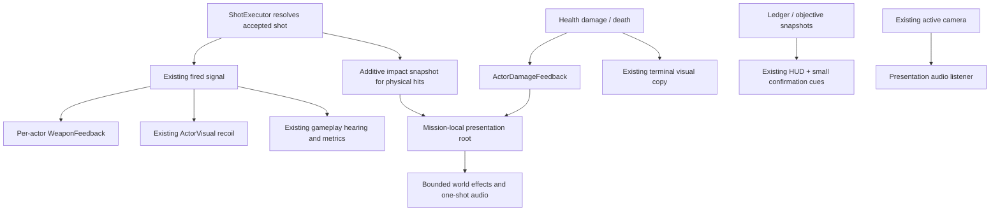

# Stage X: combat feedback, spatial audio and industrial atmosphere

Prepared **2026-10-23**. **Approved by the director, including the recommended flinch/muzzle ownership correction; implemented and accepted at Checkpoint X on 2026-10-25.** The proposal and audit findings below are retained as scope history. See the [delivery report](../reports/stage_x_combat_audio_atmosphere.md) for implementation and validation. Existing user work is preserved; no commit or publication is authorized.

## Direction and scope

Improve the accepted extraction experience through short directional discharge/impact cues, readable actor reactions, spatial sound and an inhabited industrial environment. Preserve the original models, fixed authored muzzle paths, geometry, cover, mission rules and independent actor decisions. The flying scout remains an unarmed observer.

Use the supplied images as references for priorities and composition, without copying their artwork, characters or branding:

- Combat: an identifiable firing origin, a short directional discharge, impact streaks aligned to the actual collision, and clear confirmation of damage. Keep silhouettes and the reticle readable during simultaneous fire. Large persistent fireballs and flying body parts are outside this pass.
- Environment: warm task lights against cooler structural fill, depth in the processing bay and localized dust/steam. The existing daylight yard remains navigable and readable; a wholesale dark/night conversion is not proposed.
- Machine damage: brief armor sparks and electrical/mechanical responses. Low-health smoke may read existing Health; destruction follows the one authoritative death event. No damage decals requiring new state, dismemberment or ragdoll.
- Raider combat: consistent firing direction and impacts, existing recoil/cover choices made easier to see. “Visible suppression” means presentation of accepted shots and current reactions, without a suppression meter or new AI behavior.

## Repository audit

The default entry remains `project.godot` → `scenes/levels/asset_recovery_arena.tscn` → inherited `refined_extraction_arena.tscn` / `mission_arena.tscn` → `test_arena.tscn`. The separate expanded mission is `scenes/levels/expanded_salvage_complex.tscn`, including V's `processing_facility_art.tscn`. Both use `mission_arena.gd` and the existing `raider_arena.gd` composition. Dedicated diagnostic presets remain supported.

| Area / authoritative implementation | Implemented and reusable now | Stage X gap or constraint |
| --- | --- | --- |
| `ShotExecutor.try_fire_at()`; player `HitscanWeapon` adapter | Cooldown/eligibility, physical muzzle ray and damage; `fired(origin, endpoint, damaged_target)` occurs only after accepted resolution. It already feeds AI hearing, metrics and presentation. | Event lacks collision presence, normal and a reliable surface hint. A miss endpoint must never be treated as a surface impact. Preserve `fired` signature, timing and existing listeners. |
| `scripts/player/combat_feedback.gd` | Crosshair, actual-damage hit marker, short tracer, muzzle mesh/light, independent procedural shot/hit audio. | Player shot is non-positional. Muzzle/tracer construction is separate from enemy equivalents. No resolved surface impacts. |
| `raider_feedback.gd`, `support_fire_feedback.gd` | Raider 3D rifle sound/red tracer; guard green tracer; independent cargo/alert display. | Guard has no discharge sound/muzzle flash. Raider sound is a simple generated tone. Ownership/limits are scattered. |
| `ActorVisual` and four visual wrapper scenes | Accepted-shot recoil, imported Raider aim/fire layers, movement/rotor/wheel presentation and private appearance/materials. | Reuse these; do not add a second recoil/locomotion controller or animation-driven firing. |
| `Health`, `HitReaction`, `PlayerDamageFeedback` | Accepted damage/one-time death; warm mesh flash/squash, player hull display, border/directional warning and damage sound. | HitReaction scales a parent containing the Raider's authoritative muzzle: see the explicit decision below. Machine damage lacks coherent world presentation. |
| `DeathTumble` / `ActorVisual.create_death_visual()` | One bounded cosmetic physics body and clean terminal skin/animation subtree. Authoritative death/loot never wait for it. | Add bounded light/smoke/audio around this existing result; do not spawn a second corpse or duplicate death handling. |
| `death_flare.gd`, `deployment_effect.gd` | Spatial procedural flare chirp/beacon; short CPU-particle arrival dust/ring. FlareDirector separately owns escalation. | Reuse effect ownership patterns and audio routing; playback must never call hearing or reinforcement logic. |
| Mission/objective view, Recall, ledger transfer signals | Briefing/debrief, objective state, recovery notices, channel progress and immutable results already exist. | Small confirmation cues at accepted edges; no notification per refresh and no duplicate settlement logic. |
| Mission lighting and V bay | Procedural sky, sun (energy 1.2/shadows), ambient energy 0.65; two unshadowed local bay lights and original PBR materials. | No authored ambience, fog/ambient particles or audio category buses. Preserve visibility and physical contracts. |
| `actor_inspection.tscn` / `actor_inspection.gd` | Original six previews, 0–6 views, rotate and pause; no gameplay actors or ledgers. | Add repeatable cosmetic demonstrations using the same presenters, without fake gameplay Health/weapons. |
| Shared spectator camera and existing mode owners | One active camera, independent developer free camera and restricted post-death follow; world can continue after player death. | Spatial listening must follow the active camera while perception continues to use actors only. |

Runtime inspection confirms **Godot 4.7.2** and only the **Master** audio bus. No shared audio bus layout or audio asset library exists. W's audio was synthesized separately inside the player, Raider, player-damage and flare scripts. The accepted [W delivery](../reports/stage_w_actor_visual_production.md) and [action-commitment correction](../reports/stage_w_raider_action_commitment.md) establish 36 passing suites and document intermittent `AudioStreamWAV` / `AudioStreamPlaybackWAV` shutdown leaks. Those warnings were not actor/skeleton leaks; Stage X must address audio lifetime deliberately.

### Approval decision: the existing flinch moves the real muzzle

A fresh isolated probe applied one ordinary damage point to a frozen production Raider. `HitReaction` set `Visuals.scale` to `(1.08, 0.9, 1.08)`. Although `RifleMuzzle.position` stayed unchanged, its world position moved **0.130939 m**. The marker is a child of this scaled root. The ledger remained conserved. This is an existing W behavior, not an X implementation.

**Recommendation:** isolate flinch/deformation below the gameplay-facing Visuals/muzzle seam, preserving authored marker transforms and primitive fixtures. New damage presentation must operate on cosmetic descendants. This is a small ownership correction, but shots taken during the old flinch can change: strict frame-for-frame W firing-origin equivalence cannot be promised if it is corrected.

**This exception needs explicit director approval with the proposal.** If approved, deliver and document it first, with a regression proving that damage/recoil cannot move the authored muzzle or collider. Establish the corrected baseline before X-effects-on/off comparisons. Compare W and corrected baseline separately and disclose any changed shots/outcomes; do not attribute that difference to particles or hide it by retuning AI. If the exception is declined, retain the current HitReaction behavior and defer this fix; X additions must introduce no further drift. No AI, weapon-definition or mission-rule change is proposed in either case.

## Proposed composition and event flow



No autoload, global event bus, alternative FSM or parallel mission framework. One scene-local `MissionPresentation` owns transient world effects, one-shot spatial audio, audio-listener binding and debug counters. It exposes no gameplay command API and never calls damage, hearing, actor transition, pickup, extraction or settlement methods.

1. **Keep the existing `fired` event.** Move its duplicated world discharge/tracer/sound handling into one reusable per-actor `WeaponFeedback` adapter. Retain the player HUD's hit confirmation and ActorVisual's existing recoil subscription. Raider cargo/alert display remains in RaiderFeedback. Setup/reconfiguration disconnects old subscriptions; one accepted event has one discharge presenter.
2. **Add one impact observation signal to ShotExecutor.** Snapshot physical hit position, normal, incoming direction, optional collider surface hint and applied-damage result from the existing ray result. Capture values before damage/death callbacks can delete the target; emit after the existing resolution/event path. No additional ray, altered mask, aim correction, damage calculation or cached live collider is needed. Rejected fire emits neither event; accepted misses emit `fired` without an impact. This is an additive observation, not another shot authority.
3. **Use a tiny explicit surface mapping.** Collision-body metadata `feedback_surface` may identify `metal`, `concrete`, `industrial_equipment`, `machine_armor` or `raider_gear`. Actor registration supplies reliable actor tags; authored static bodies get explicit tags. Unknown/untagged surfaces use a neutral hard-impact fallback. Do not guess from mesh color, filenames, collider names or a material on a different node. The mapping only selects presentation.
4. **Follow Health for reactions.** Accepted damage drives a short cosmetic flinch/flash and hurt cue. Impact resolution owns the one contact spark/dust burst; damage observers do not duplicate it. Existing Health fraction can enable a restrained machine warning flicker/smoke emitter, disabled at healthy/dead states. Death captures position/kind once and requests a short world burst/audio while existing terminal-copy and ledger handlers run normally. Actor deletion cannot leave callbacks referencing a freed controller.
5. **Preserve HUD semantics.** A hit marker means actual accepted damage, not merely collision, sparks or a played sound. Keep the current incoming-direction cue from authoritative damage origin and existing mission-critical text. Recovery/objective/result sounds use transfer/objective changes or a detected presentation-state edge, with serial/result deduplication. Recall presentation reads its current channel state; it never advances/cancels the channel. No camera shake is proposed initially: model recoil, impact and audio address the current gaps without adding an aiming/camera ownership risk.

World-space discharge attaches to the actual fixed muzzle; traces/impacts use captured world coordinates. Terminal effects use detached values and bounded scene ownership. Register player first, then each scheduled Raider and each machine exactly once through existing setup seams. Only the armed guard gets WeaponFeedback; the scout receives motor/damage/death presentation. Actors added later receive the same adapter configuration. Primitive fixtures remain supported.

## Audio and lifecycle

Create an ordinary Godot bus layout with **Weapons, Impacts, Machines, Environment, Interface and Music** each sending to **Master**. Music is reserved and silent. Category levels and a restrained master peak limiter protect overlapping cues; avoid aggressive compression/ducking that masks positional information. Exact gain/attenuation values are listening targets, not assumed quality guarantees.

- Player, Raider and guard discharges are distinct pre-generated short WAV families emitted by `AudioStreamPlayer3D` at the physical source. Hit confirmation/menu cues remain non-positional `AudioStreamPlayer` output. Quiet variants/pitch variation use presentation-local seeds, never gameplay RNG.
- A reusable player per armed actor is enough at the accepted population/cadence. The mission root owns a small bounded pool for impact/destruction one-shots that can outlive their source. Do not build a generic global audio service or unbounded player-per-event allocation.
- Player servo, ground traction/servo and scout rotor beds use at most one spatial loop per machine, reading actual speed/idle state with restrained pitch/gain. They do not drive movement or reveal hidden targets to AI. Environmental beds use two localized machinery/vent emitters and one quiet yard bed initially.
- One presentation-owned listener follows the existing viewport's active Camera3D. It never chooses the camera, changes camera transforms or writes a player/AI position. This covers player orbit, developer free camera and post-death follow without editing spectator permissions/controllers. Clear/free that listener on scene removal before the next world registers its listener.
- Stop owned players and clear stream references on exit/reconfiguration; expire world one-shots independently of source actors. Bound every particle/audio instance, stop loops at actor removal, clear transient cues at world shutdown/restart. Player deployment death alone must not stop the surviving world's ambience/actors. No gameplay callback waits for `finished`, an effect timer or a fade.
- Reproduce W's WAV cleanup issue in ordinary-rate and accelerated tests before choosing a fix. Dedicated audio lifecycle checks must exercise enabled audio and rapid restart; muting output or suppressing warnings does not demonstrate cleanup. If remaining backend-only shutdown behavior is proven after clean scene ownership, report that separately for acceptance rather than claiming it is solved.

**Provenance:** original offline-generated PCM WAVs and simple original effect materials. Add a repeatable standard-library generator with fixed private seeds, source parameters and output hashes; share pre-generated streams instead of synthesizing duplicate resources per actor. Document author, generation method, redistribution status and asset hashes in `assets/audio/README.md` and `manifest.json`. Use engine primitives/procedural material fades for the initial VFX. No reference image, external sample, branding or soundtrack is redistributed; any future external asset needs a recorded license before import.

## Lighting, ambience and inspection

Give normal Asset Recovery and the expanded mission explicit presentation branches/resources. Retain the older P/Q/R presets and the expanded graybox as comparison references. Do not edit the shared base test-arena lighting to push the new look into every legacy scenario.

Start with the existing sky/sun composition, warmer local bay fixtures, sufficient cool fill on human silhouettes and restrained conventional distance haze. Add a few correctly placed dust/vent emitters at the processing bay/service infrastructure, away from combat sight lines. Keep loot/dock/objective contrast readable in sunlight and shade. Reuse V lamp meshes/materials; no geometry, new map, collision, cover or navigation bake inputs change. Volumetric fog, dynamic-shadow proliferation, broad lens effects and large transparent smoke walls are not the default; propose them later only with measured need/cost.

Extend the W inspection scene using the same presenters and captured-value demo inputs. Keep existing 0–6, rotation and Space controls. Add buttons for **Fire, Metal/Concrete/Armor impact, Damage, Destroy/Reset**, sound audition and bounded repeat. Demo Health fractions/impact positions are preview inputs only; no real ShotExecutor, Health, AI, ledger or mission is created. Reset restores one preview and frees its effects/audio. The scout has no Fire action. Its damage/destruction/rotor previews still work.

## Initial limits and measurements

These are proposed enforceable caps and review guides, not measured claims about an unimplemented system:

| Resource | Initial proposal |
| --- | --- |
| Armed discharge presenters | One per actual armed actor: player + at most five Raiders + one guard |
| Simultaneous muzzle lights | Four enabled, short-lived and unshadowed; visual mesh cue remains available for other shots |
| World one-shot audio players | Twelve reusable slots with bounded priority; one voice per slot |
| Machine/environment/interface voices | Three machine loops, three environmental beds, two interface slots |
| Total audio voices | At most 32; the listed single-voice players use at most 27, leaving explicit headroom |
| World impact bursts | At most 16; oldest optional effects may expire under pressure |
| Transient particle budget | 256 emitted particles across impacts/deaths, with priority for destruction/player feedback |
| Ambient particles | At most 64 across a few authored emitters; no collision or particle shadows |
| Lifetime | Discharge under 0.1 s; impact under 0.5 s; destruction smoke up to 2 s; no new permanent debris/decals |

Caps may discard optional world effects, never hits, damage, recoil events, hit confirmation, loot or AI updates. Reserve important player/interface cues. Admission/culling is presentation-only and may use listener/camera distance without feeding that information to actors.

After approval, capture the actual accepted W source snapshot before implementation, including uncommitted work. Reuse W's matched bay/overview approach at **1600×900 Forward+**, the same graphics/vsync/device/camera and at least 30-second windows; add a seven-shooter burst, eight-source destruction burst, post-death follow and repeated restart. Record mean/p95/worst intervals, >33 ms spikes, draw calls, particles, lights, audio voices, rendering/audio memory where available, load time and retained nodes/resources after cleanup. Distinguish process/frame intervals from GPU-profiler time. W's approximate 5.5–5.7 ms p95 and 381-draw reference included an explicit +117 draw exception; they are context, not substitutes for a fresh baseline.

Initial review triggers are +1 ms p95, +80 draws or new >33 ms spikes in matched windows. Exceeding one requires profiling and a documented reduction/exception, not an invented performance pass. Include cold shader/material warm-up separately. Lighting/manual audibility acceptance remains on the director's actual hardware.

## Proposed file inventory

Paths below are the bounded implementation proposal, not files already delivered. Track `.gd.uid` and Godot import settings for added resources; generated caches, renders, saves and performance captures stay ignored.

| Existing file(s) | Intended edit after approval |
| --- | --- |
| `scripts/gameplay/shot_executor.gd` | Add detached impact observation; preserve existing shot resolution and fired contract. |
| `project.godot` | Audio-layout reference only if explicit configuration is needed; retain the main scene, renderer and input mappings. |
| `scripts/gameplay/raider_arena.gd` | Construct mission-local presenter, register actors via existing visual setup, and teardown presentation without changing spawn/mission logic. |
| `scripts/ai/support_machine.gd` | Replace only the old guard tracer hookup with shared presenter registration; do not edit scan/FSM/physics. |
| `scripts/player/combat_feedback.gd`, `player_damage_feedback.gd` | Keep reticle/hit/direction/hull cues, route existing UI sounds and remove replaced duplicate world discharge/audio construction. |
| `scripts/presentation/raider_feedback.gd`, `support_fire_feedback.gd`, `death_flare.gd` | Keep cargo/alerts and flare visuals; delegate duplicate shot presentation/audio. Retain support helper as compatibility adapter if needed rather than breaking a scene. |
| `scripts/presentation/actor_visual.gd` | Expose bounded cosmetic reaction/preview hooks while preserving recoil, gait, source model, fixed sockets and terminal-copy behavior. |
| `scripts/components/hit_reaction.gd` | **Conditional on explicit muzzle-fix approval:** move squash/overlay handling to cosmetic descendants, including supported primitive fixtures. No other component/death authority rewrite. |
| `scripts/presentation/actor_inspection.gd`, `scenes/characters/actor_inspection.tscn` | Add cosmetic demonstrations/cleanup controls and audio audition. |
| `scripts/presentation/mission_objectives_view.gd` | Deduplicated interface cues at existing accepted recovery/objective/result presentation edges. |
| `scenes/levels/asset_recovery_arena.tscn`, `expanded_salvage_complex.tscn` | Add explicit X presentation branches/environment overrides. Preserve start scene, simulation config and navigation inputs. |
| `scenes/levels/environment/processing_facility_art.tscn` | Existing lamp tuning and exact collider surface metadata, preserving transforms/shapes. |
| `scenes/raiders/raider.tscn`, `scenes/player/robot.tscn` | Presentation-only hooks/tags if needed; preserve gameplay marker paths and authored transforms. |
| `tests/asset_pipeline_test.gd` | Record explicit reviewed X source/metadata changes; retain physical contracts and identity protection outside approved files. Do not silently exempt broad directories. |
| `README.md`, development records, `tests/README.md`, `docs/architecture/game_code_flow.md` | Delivery, controls, provenance, current ownership and validation results. |

New implementation files proposed:

- `scripts/presentation/mission_presentation.gd`, `weapon_feedback.gd`, `actor_damage_feedback.gd`, `feedback_surface.gd`, `feedback_profile.gd`, `ambient_feedback.gd` and their UIDs. Responsibilities are the local owner, actor adapters, small classification/profile data and localized ambience; no other manager layer is proposed.
- `scenes/effects/weapon_discharge.tscn`, `surface_impact.tscn`, `machine_destruction.tscn`, `industrial_ambient.tscn`; `scenes/presentation/compact_atmosphere.tscn`, `salvage_complex_atmosphere.tscn`.
- `resources/presentation/player_discharge.tres`, `raider_discharge.tres`, `guard_discharge.tres`, `surface_feedback.tres`, `industrial_day.tres`; `default_bus_layout.tres` and the corresponding explicit project audio-layout setting if needed.
- `tools/audio_pipeline/generate_audio.py`; `assets/audio/README.md`, `manifest.json`; three discharge-family WAV sets, surface/actor-damage/destruction cues, three machine loops, yard/vent/machinery beds and compact interface confirmations, with exact outputs listed in the approved generator manifest.
- `tests/combat_presentation_test.gd`, `audio_lifecycle_test.gd`, `presentation_integrity_test.gd` plus UIDs; `docs/presentation/README.md`; `docs/development/reports/stage_x_combat_audio_atmosphere.md` and delivery evidence after actual implementation.

`raider.gd`, `raider_combat.gd`, threat monitor/social/betrayal policy, weapon definitions, Health, ledgers, stash, mission rules/configuration, Recall rules, camera-permission controllers and Blender sources/GLBs are outside the proposed behavioral changes. An unexpected need to edit their rules returns to director review.

The initial audio generator's exact proposed outputs under `assets/audio/` are:

```text
weapons/player_01.wav          weapons/player_02.wav
weapons/raider_01.wav          weapons/raider_02.wav
weapons/guard_01.wav           weapons/guard_02.wav
impacts/metal.wav             impacts/concrete.wav
impacts/equipment.wav         impacts/machine_armor.wav
impacts/raider_gear.wav        impacts/hard_surface.wav
actors/raider_hurt.wav         actors/player_hurt.wav
actors/machine_hurt.wav        actors/machine_destroy.wav
actors/raider_death.wav
machines/player_servo_loop.wav
machines/guard_drive_loop.wav  machines/scout_rotor_loop.wav
environment/yard_wind_loop.wav
environment/vent_loop.wav     environment/machinery_loop.wav
interface/hit_confirm.wav     interface/recovered.wav
interface/objective_complete.wav
interface/recall_complete.wav  interface/deployment_failed.wav
signals/death_flare.wav
```

These 29 short/looping cues are a bounded procedural sound foundation; human cues emphasize gear/body impacts rather than promising synthetic voice acting. A profile may share a cue or leave it unused if listening tests find it redundant. Source parameters and hashes must accompany actual generated output; no audio quality or license manifest is claimed before production.

## Delivery order and validation

1. **Approve architecture and decide the muzzle exception.** Record the exact accepted W source and replay/performance baselines. If approved, isolate and verify the flinch ownership fix first; otherwise preserve W and mark it deferred.
2. **Establish lifetime/audio foundations.** Reproduce WAV warnings, set buses/profiles and implement scene-owned bounded players/effects. Verify rapid restart and actor removal before producing more cues.
3. **Deliver combat feedback.** Add the impact snapshot, three weapon presenters and reliable surface fallback. Then damage/destruction presentation, preserving one-shot recoil/hit/death/accounting contracts.
4. **Add machine/environment sound and atmosphere.** Tune one related sound/light group at a time, comparing the same scenes/cameras. Keep references and art pipeline intact.
5. **Extend inspection and measure peak loads.** Exercise production and preview adapters, headless/graphical behavior, restarts and post-death worlds.
6. **Stop at Checkpoint X.** Supply actual file/asset inventory, event integration, provenance, source/seed comparisons, performance and cleanup logs, screenshots, known limits and the director checklist. No Stage Y work or Git operation without authorization.

Preserve all **36 existing suites**, especially action commitment, combat movement, Q/T integration, finite transfers, source/visual contracts and spectator lifecycle. New coverage must include rejected same-tick/dead/disabled firing; one accepted discharge event; misses without impact; real wall/actor hit positions/normals and lethal freed-target safety; surfaces/fallback; multi-shooter independence; damage/death once; primitive and production models; no duplicate loot; resource caps/expiry; idempotent configuration; bus validity; enabled-audio shutdown; machine-loop stop; world continuation after player death; spectator listener switches; and repeated restart.

For seeded integrity, replay **87017 west, 87018 east and default Asset Recovery**, plus repeats, with presentation enabled/disabled at a controlled physics rate. Compare authoritative events/decisions/targets, accepted shot origins/endpoints/damage, deaths/extractions, entry schedule, loot transfers and final ledger/objective/stash results. Cosmetic random choices/particles/audio do not consume gameplay RNG. If exact equivalence is unstable in the environment, report the first divergence and repeat controls; conservation alone is not proof of equivalence. No weakening of AI tests to accommodate an effect.

Run Godot editor parsing/import, full regression with completion markers, bounded headless deployments, Forward+ startup/gameplay/inspection and matched performance captures. Use isolated ignored stash paths. Inspect warnings and verbose cleanup types; distinguish test/shutdown artifacts from live ownership leaks. Add physical firing/occlusion tests, not only direct presenter calls.

Manual acceptance: player and several independent Raiders/guard firing; visible direction without reticle/silhouette overload; hit/miss and damage-source comprehension; machine hurt/destruction with intact loot; natural cover reactions; daylight/shaded bay traversal; stereo source placement and restrained overlap; both spectator modes; Recall/recovery/result clarity; repeated restart; and maximum-population comfort. The director judges sound quality, visual readability and atmosphere; automated startup does not establish those.

## Audit validation at proposal preparation (historical)

Fresh editor parsing/import, ordinary-rate `combat_test.gd`, `actor_visual_test.gd`, bounded default headless startup and Vulkan Forward+ startup all passed with clean logs. The isolated flinch/audio inspection completed and preserved material conservation. [Audit evidence](../baselines/stage_x_architecture_audit/) includes logs, the measured muzzle delta, source identities and the ignored probe's text copy. The prior W record supplies the 36-suite acceptance baseline; a new full Stage X suite/performance run has **not** been claimed or performed during proposal preparation. No Stage X runtime effects, audio resources, rendering or gameplay changes have been implemented.

The director ledger requires: **“Stop for director approval before implementing.”** The proposal stopped at that approval gate. The director subsequently approved it; the delivery report records the authorized implementation and exception.
