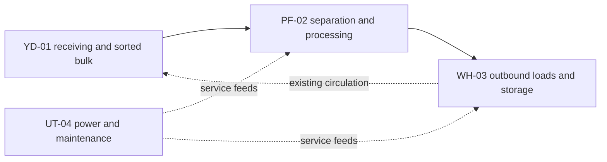

# Stage Y: world population and environmental storytelling

Prepared **2026-10-25**. **Base proposal approved, implemented and validated; Stage Y, including its refinement, accepted by the director on 2026-10-26.** The approved proposal is retained below for scope reference. See the [delivery report](../reports/stage_y_world_population.md) for actual placements, eight new exports, the necessary static GLB batch adapter, performance simplification and forty-suite validation. The optional roof-support geometry amendment remains excluded. Stage X was accepted on 2026-10-25. Prior uncommitted work is preserved; no commit, reset, discard or publication is authorized.

## Recommendation and scope

Develop the existing expanded complex as **RIVET RECLAMATION WORKS / SITE 07**, a proposed fictional facility identity. It received mixed industrial equipment, separated reusable assemblies, sorted bulk metal, and dispatched processed loads. Work stopped during a maintenance shutdown; subsequent scavengers stripped selected components. The story remains static evidence, compatible with any autonomous encounter outcome.

Use the existing processing bay as the pilot, then dress the yard, storage and service zones. Reuse the eight accepted environment models and six materials before adding up to eight small exports. Keep the current daylight, open yard, player scale and accepted grounded industrial direction. References inform material flow, machinery organization and composition; no reference image, brand, truck, excavator, artwork or new multi-storey layout is copied into the project.

The base proposal authorizes **presentation within existing collision envelopes**, surface markings and signs. It does not authorize collision/navigation changes. A measured roof-support issue has a separate optional amendment below. Compact Asset Recovery remains the default; expanded-world launch and scenario controls remain unchanged.

## Repository-grounded baseline

The expanded root is `scenes/levels/expanded_salvage_complex.tscn`, running the same `mission_arena.gd` / `raider_arena.gd` composition as compact missions. Its `Geometry` branch contains four inherited modules and supplies the existing static-collider navigation bake. There is no environmental controller that should acquire gameplay authority.

| Area | Actual accepted implementation and gap |
| --- | --- |
| World | 72 × 64 m floor; north is negative z. Thirty-three static box collision shapes across four modules; 41 visible Geometry meshes, 36 shadow-casting meshes and 11 distinct active Geometry materials (including primitives); one NavigationRegion3D, agent radius 0.5 m / height 2 m, static-collider parsing. |
| Processing | Ten bodies: segmented walls, partition, WorkBench and roof. Eighteen visible environment meshes: six imported instances and twelve primitives. Four unique exports are used: 2 m/4 m walls, cabinet, sorting-conveyor base. Only the southeast bay has production dressing. |
| Yard | Four bodies / four primitive meshes: two 2 × 3 × 6 m bays, one 5 × 1.2 × 2 m low-crate block and one 8 × 3 × 1 m north screen. No imported art instances. |
| Storage | Ten bodies / ten primitive meshes: three solid freight blocks, 1 m deck, two ramps and four ramp rails. Container volumes are 12 × 3 × 3, 3 × 3 × 12 and 3 × 3 × 8 m. No imported art instances. |
| Service/perimeter | Nine bodies / nine primitive meshes: floor, boundaries and screened routes. West/east service screens are 12/14 × 3 × 1 m. No imported art instances or convincing utility connections. |
| Landmarks | Four floating area Label3Ds, simple silhouettes, and `SORT / BAY 03` in the dressed bay. Recognizable operational signage is largely absent. |
| Lighting/audio | Accepted X `industrial_day.tres`, broad sun, two unshadowed processing lights. Three spatial environment beds at (-18,3,5), (24,2,-9), (0,4,15); first two have twelve-particle dust emitters. No need to add another ambience service or scatter more emitters. |
| Library | Eight original GLBs and editable Blender sources: **5,412 triangles**, six shared materials, two original 1024² textures. Beam, column, bin and utility-run exports exist but are not instanced in the mission. No accepted freight, pallet-load, scrap-infill, vent or maintenance-recess model exists yet. |
| Pipeline | Existing `build_asset.py`, `export_asset.py`, `configure_imports.gd`, `audit_assets.py`; metres, floor/start pivots, original UVs and external material remaps. Recorded Blender 4.5.10 LTS; actual runtime imports use GLB, not `.blend`. Environment auditing currently expects exactly eight exports. |

The [fresh audit evidence](../baselines/stage_y_environment_audit/README.md) contains collision sizes/transforms, visible-instance inventory, both layouts, before screenshots and validation. Inspection confirms that a convincing expanded facility requires composition across all four zones, rather than merely multiplying the existing processing-bay props.

### Preserve these live contracts

- Config: `expanded_asset_recovery.tres`; five Raiders at 0/0/35/70/105 s, 180-second deadline, five-live cap, two machines and two finite reinforcement tickets. No scheduling, profile, relationship or reward tuning.
- West seed 87017: Yard (1,0,0), Processing (-19,0,-7), Storage (22,1,0), quantities 6/3/3. East seed 87018: YardEast (3,0,-4), StorageEast (24,1,0), ProcessingSouth (-26,0,5), quantities 6/3/3. Three live stock IDs plus two installed machine components total fourteen material units. East's stock IDs change zone association; never attach contextual art by assuming Salvage2 always means Processing.
- Entries: (-20,.1,-20), (-24,.1,3), (12,.1,22), (12,.1,-22), (32,.1,8), with layout-defined order. Keep every entry and finite responder candidate clear.
- Raider exits: (-30,0,-25), (30,0,25); Recall/player start: (0,0,26). Cover and Peek children stay fixed. Both ramps, the deck, processing openings and service/perimeter alternatives remain open.
- Scout route: outdoor rectangle x 0..12, z -18..12, y 3.5. Guard route: x -10..11, z -6..12, near floor height. Machines are spawned by MachineEcosystem at their first route point; there are no separate new machine spawns to decorate around.
- All six alternative stock sites passed current navigation/support and capsule-clearance queries. Actor FSMs, hearing/visibility rays, ledgers, equipment, settlement, objectives, cameras and persistence remain authoritative and unmodified.

## Zone design and operational history



This depicts past industrial purpose, not a simulation, new route planner or prescribed encounter.

| Zone | Composition and landmark | Static evidence | Keep clear |
| --- | --- | --- | --- |
| **A / YD-01** central receiving yard | Dress WestBay/EastBay as tall, filled scrap-retaining bunkers using repeated panels and subdued sorted-metal infill. Dress LowCrates as five compact industrial pallet loads. Use NorthScreen as the receiving designation/scale landmark. Sparse painted circulation arrows connect existing approaches. | One bunker face has an incomplete sorting stencil and a missing service plate; compressed bulk remains, while valuable components have been removed. | Both layout sites, the center crossing, cover/peek lines, guard rectangle, processing approaches and extraction circulation. No new scrap pile on open ground. |
| **B / PF-02** western processing | Extend V wall/cabinet treatment through the existing solid facade and give WorkBench's existing 4 × 1.2 × 2 m machine a clear feed direction, guarded roller surface, stop station and output designation. Dress Partition as a closed-backed machinery/guarding enclosure. Existing bay identification becomes the processing landmark. | Seized belt/closed guards, a recessed missing-door maintenance panel, empty tool silhouettes and a disconnected service termination. No loose tool obstacle or live hazard. | North/south/east openings, both processing stock candidates, the partition bypass and existing cover/peek positions. No new conveyor across a walking lane. |
| **C / WH-03** eastern shipping/storage | Freight panels give the three existing solids recognizable sealed container sides, doors and shipment IDs. Existing deck/ramps become the loading area with edge markings, approach arrows and bay numbers. Existing solid freight forms may read as densely loaded storage, never empty walk-in racks. | Cancelled dispatch stencil, secured partial shipment and vacant pallet-location markings; the empty staging location communicates interruption without adding props there. | Both deck stock sites, deck top, ramp approaches/rails, east entry, scout corridor and southeast exit. No decorative rack/load on usable deck or ramps. |
| **D / UT-04** southern/perimeter service | Existing service screens become closed-backed switchgear/ventilation housings. Reuse cabinet/utility exports with recessed junctions and terminations. Surface-mounted diagrams and short utility segments within wall volumes connect to PF/WH identities. A numbered utility bank is the landmark. | A stripped panel and capped/disconnected feed show previous component removal. Existing vent sound has visible supporting equipment. | Recall Dock, robot deployment volume, both exits, west/east service routes and responder paths. No fence across a route, projecting door or free-standing transformer. |

Material handling follows the existing ground circulation between receiving, processing and loading. Markings stop at actual thresholds and follow validated clear surfaces; they do not point through cover or imply a new forklift lane. Keep human/machine silhouettes readable against a quieter background. Dense reference-image scrap fields, elevated catwalks and heavy equipment need different geometry and are outside the base proposal.

### Pilot delivery

First populate only the existing southeast processing bay, WorkBench, nearby closed-backed partition/facade and maintenance recess. Use the current 4 × 1.2 × 2 m machine envelope and existing lights. Build only `processor_guard_2m` and `maintenance_panel_1m` initially; reuse the four already instanced exports and utility run. Clearly label feed, guarded process and output without suggesting a working machine.

Validate imports, bounds, physical shot occlusion, navigation/stock access for both variants, player/spectator views, source edit/reimport and matched performance before dressing other zones. If the pilot is unclear or too expensive, revise this small area before creating the remaining six exports. Supply pilot evidence; pause expansion if it reveals a geometry need or requires a design departure. Full environmental acceptance remains Checkpoint Y.

## Proposed asset set and reuse

Reuse V walls, cabinet, sorting base, utility run, bin, beam and column where their silhouettes and full bounds fit. Do not insert an unused model merely to show it. A column or bin cannot replace a full solid wall with a visually open volume. Preserve original `.blend`/GLB identities; generate only new names, without `--rebuild` or material-reset commands.

Dimensions are maximum intended local Godot width/height/depth before placement; fitting the actual world envelope still requires transformed-bound and visual checks. Triangle values below are caps, not claims about unbuilt assets.

| New ID / category | Dimensions (m) | Tri cap / surfaces | Purpose |
| --- | --- | --- | --- |
| `processor_guard_2m` / machinery | 2 × 1.2 × .15 | 1,200 / 3 | Guard/stop detail on the existing solid machine, with opaque backing. Pilot. |
| `maintenance_panel_1m` / machinery | .8 × 1.6 × .35 | 2,000 / 3 | Recessed stripped control interior; no projecting door. Pilot. |
| `scrap_bunker_panel_2m` / props | 2 × 3 × .2 | 1,200 / 2 | Filled retaining-bay face, repeated along existing solids. |
| `scrap_infill_1m` / props | 1 × .15 × .8 | 1,200 / 2 | Batched, subdued crushed-metal surface detail; no pickup silhouette. |
| `pallet_load_1m` / props | 1 × 1.2 × 2 | 1,600 / 3 | Dense industrial palletized load, tiled across LowCrates. |
| `freight_panel_2m` / structures | 2 × 3 × .12 | 1,200 / 2 | Corrugation, secured-door variant and edge frame on sealed freight blocks. |
| `vent_panel_2m` / machinery | 2 × 2 × .2 | 1,000 / 2 | Recessed louvers with solid backing, matching existing vent ambience. |
| `utility_junction_0p4m` / props | .4 × .4 × .18 | 600 / 2 | Credible ends/junctions for reused utility segments. |

At most eight new GLBs, **10,000 additional library triangles**; combined reviewed library remains below 20,000. No new material family or texture set is initially needed. Retain the six V materials/two textures; use restrained steel, wear and safety accents. Pallets are industrial metal/polymer, avoiding a new wood workflow. Signs and floor paint use engine text/meshes and existing materials.

Use one shared mesh/material per asset and existing scene wrappers. Consider a MultiMesh only for truly repeated static panels/infill, grouped by one container or bunker for bounded culling; not one whole-world batch. Do not instantiate every scrap fragment independently. Large surfaces keep readable roughness/wear rather than texture noise.

## Placement and authority

Adapt the existing inherited modules rather than relocating their bodies or duplicating Geometry:

```text
ExpandedSalvageComplex                  existing mission owner
  Geometry / navigation_geometry       existing authoritative static colliders
    ProcessingFacility                 existing art wrapper, extended visual children
    SalvageYard                        inherited art wrapper, original bodies unchanged
    StorageArea                        inherited art wrapper, original bodies unchanged
    ServicePerimeter                   inherited art wrapper, original bodies unchanged
  EnvironmentalPresentation            signs and surface-only circulation/context
  Atmosphere                           accepted X beds/particles, unchanged ownership
  actors / markers / routes / HUD       unchanged
```

Reuse `environment_art_view.gd` for production/graybox visibility. No new runtime controller, gameplay autoload, per-frame placement script or second collision owner is planned. Asset children contain no physics, navigation, loot scripts or actor groups. Author placements deterministically; no gameplay RNG consumption.

1. Replace/dress existing solid visuals with opaque, filled equivalents inside the same transformed collision bounds. Retain the V 12 mm surface-detail tolerance, not permission for a new blocking footprint. Test rotated bounds and visually check that new holes/legs do not reveal apparently walkable/shootable empty space inside a solid box.
2. Recess cabinets, vents, utility segments and repair details into accepted wall/screen volumes. Extend utilities only where existing solid support exists. Do not justify non-colliding solid props merely because they are high up: jump, boost, scout flight, shots and spectator follow must be considered.
3. Ground markings/sign lettering are surface details. No added floor obstruction, hanging route blocker, open door, new walkable platform or sightline screen.
4. When replacing a simple mesh, retain its existing shadow silhouette with a cheap visual shadow proxy if needed; detailed duplicate shadow casters default off. Proxies never add collision. Do not remove relevant shadows simply to meet a draw count.
5. The explicit graybox variant disables all Y dressing and restores prior primitive visibility/area labels. It keeps the accepted X atmosphere, matching its present behavior. New dressing is scoped to the expanded mission, not compact/default or P/Q/R scenes.

### Salvage and signage

Use the six authored EncounterSites as the context map, not root-marker defaults or stock IDs. Put static residue/staging markings at both supported candidate sites, without adding raised props or following live ledger quantities. Only the existing selected stock marker/ring/label moves and reports quantities. MaterialLedger/EquipmentLedger alone own resources; decorative scrap never registers a source, drop, group, interaction or event.

Decorative bulk uses subdued crushed shapes and sealed loads, avoiding cyan pickup colors, glowing rings, component-sized focal pieces and fake E prompts. Existing marked stock remains Raider-only; player rewards still come from accepted drops/recovery. Do not advertise decorative material as player-collectable. Inactive staging pads look empty/industrial, not like missing pickups.

Facility signs use `YD-01 RECEIVING`, `PF-02 PROCESSING`, `WH-03 SHIPPING`, `UT-04 UTILITIES`, equipment IDs such as `PF-02 / CV-01`, and restrained short secondary notices. Identity signs attach to existing opaque faces. Replace the four large floating area labels only in production art mode; preserve mission-critical stock, exit and Recall presentation. Use recognizable symbols/arrows plus text rather than color alone. One landmark per zone is enough; no tall new landmark structure.

## Separate geometry issue: processing canopy support

Measured existing wall tops are y=4.0; roof underside is y=5.35. The **1.35 m support gap** is visible in current captures. This is an accepted-world plausibility limitation, not a Y regression. New non-colliding columns in that gap would violate the requested visual/physics correspondence.

**Base-plan approval excludes a geometry fix.** Keep the gap documented; do not disguise it using a solid-looking uncollidable support. If the director wants it corrected within Y, separately approve this bounded amendment first: four .4 × 1.35 × .4 m upper support volumes, centered at x/z (-30,-14), (-14,-14), (-30,10), (-14,10), y=4.675, joining wall tops to roof underside. Reuse visual column/beam foundations; author matching static collision and evaluate the existing bake. It adds high-level ray blockers and potentially changes baked mesh data, even though the ground footprints overlap existing walls.

That amendment requires exact placement review, elevated shot/scout/jump checks, roof/ground navigation comparison, physical conservation tests and its own documented source-contract exception. No wall, opening, roof height, ground route or encounter point would otherwise change. It is not implicitly included by approving this visual-only proposal.

## Performance proposal

Fresh accepted-X measurements use the same 1600 × 900 Forward+ bay/overview cameras, seed 87018, five initial Raiders/two machines and 30-second windows. RTX 4060 Laptop / i7-14700HX, Godot 4.7.2:

| Metric | Bay | Overview |
| --- | ---: | ---: |
| Median / p95 frame interval | 4.179 / 5.437 ms | 4.182 / 5.538 ms |
| Worst interval | 32.612 ms | 20.016 ms |
| Maximum draws / rendered primitives | 387 / 143,020 | 387 / 143,020 |
| Maximum texture memory | 120,538,624 B | 120,538,624 B |
| Static memory sample | 80,701,739 B | 80,723,131 B |
| Scene-ready sample | 440.645 ms | 451.682 ms |

These are local observations, not hardware guarantees. X's CPU-monitor caveats and accelerated WAV shutdown warnings remain open; a low median is not proof of hitch-free operation.

Proposed review limits, to be agreed with this design:

- Pilot: no more than **+30 maximum draws / +0.5 ms p95** over its matched accepted-X camera. Full dressing: **+80 draws / +1 ms p95**, at most 35,000 extra rendered primitives in the matched maximum-population view. These are review triggers; exceeding them means simplify/retest or present evidence for a scoped revision, not silently increase budgets.
- Up to 120 added mesh/MultiMesh nodes and 24 noninteractive signs/marking groups across the world. Count actual rendered surfaces/shadows as well as nodes; splitting one prop into many surfaces does not evade the budget.
- No new environment texture allocation by default; shared six-material library. Review static-memory increase beyond 16 MiB or repeated median scene-ready increase beyond 100 ms. Compare several launches, not one noisy sample.
- No extra shadowed light, ambient voice or emitter in the initial pass. Retain X's two local lights, three beds, ambient particles and combat limits. Only a concrete visual need may justify relocating an existing fixture/emitter, with before/after captures and listener/readability checks.
- Record average/p95/worst, >33 ms spikes, draw/primitive/material counts, texture/static memory, load time and retained resources on restart. Repeat suspicious worst-frame changes and distinguish actual intervals from cached CPU/GPU metrics. Test all-zone views, close bay, both layouts, seven discharges/eight deaths and post-death following.

## Exact proposed file scope

| Files | Intended change after approval |
| --- | --- |
| `tools/art_pipeline/build_asset.py` | Add only the eight IDs/dimensions above; keep original generators/sources unchanged. No `--rebuild` of accepted art. |
| `tools/art_pipeline/audit_assets.py`, `assets/environment/asset_manifest.json` | Extend the explicit reviewed inventory from 8 to 10 at pilot and 16 at full delivery. Preserve old hashes, UV/material/static-only checks; do not replace exact checks with an arbitrary scan/count. |
| `assets/environment/source/machinery/{processor_guard_2m,maintenance_panel_1m,vent_panel_2m}.blend` | New editable machinery sources. |
| `assets/environment/source/props/{scrap_bunker_panel_2m,scrap_infill_1m,pallet_load_1m,utility_junction_0p4m}.blend` | New editable props. |
| `assets/environment/source/structures/freight_panel_2m.blend` | New editable freight surface. |
| Matching `assets/environment/exports/<category>/<id>.glb` and `.glb.import` | Explicit reproducible exports/remaps using existing exporter/configuration script, not a second pipeline. |
| Matching `scenes/environment/props/<id>.tscn`, freight `modules/freight_panel_2m.tscn` | Thin static visual wrappers, reusing shared materials. |
| `scenes/levels/environment/processing_facility_art.tscn` | Pilot and full processing visuals only; preserve inherited colliders, markers and dimensions. |
| New `scenes/levels/environment/{salvage_yard_art,storage_area_art,service_perimeter_art}.tscn` | Inherit original geometry modules; hide/restore original Mesh visuals and add bounded dressing. |
| New `scenes/presentation/salvage_complex_dressing.tscn`, `scenes/environment/props/facility_sign.tscn` | Surface markings, signs, static site context; existing art visibility script. |
| `scenes/levels/{expanded_salvage_complex,expanded_salvage_complex_graybox}.tscn` | Reference art wrappers/dressing; preserve scene/controller/config identity and physical hierarchy; graybox restores primitives. |
| `scenes/environment/asset_inspection.tscn` | Expand the existing static inspection display to delivered modules with readable scale/labels. No actor-inspection replacement. |
| `tests/asset_pipeline_test.gd`, new `tests/world_population_test.gd` + UID | Update reviewed art inventory; meaningful physical/seed/visual-source coverage using existing helpers. No changes to AI-policy assertions. |
| `README.md`, art/architecture/test/development indexes, new Y delivery report/evidence | Actual inventory, placement contracts, provenance, validation, screenshots and director checklist. |

No change is planned to `project.godot`, original four geometry modules, mission config/layout resources, AI, physics masks, camera/spectator permissions, ledgers, persistence, X audio/effect scripts, audio library, actor Blender/GLB/rigs or shared material/texture foundations. Optional roof support changes are excluded from this list pending separate approval.

## Validation and checkpoint sequence

1. Preserve a source/physical baseline before authoring. Retain current 39 suites and all X presentation checks. Current audit already ran all 39, editor import, headless/Forward+ inventory, static asset audit and matched performance; details are in the evidence archive.
2. Pilot: export/import the two new models, validate UVs/remaps/bounds/shared resources, perform a protected source-edit/reimport round trip and verify old eight hashes. Inspect process direction, guarding, maintenance space and daylight/shade from player, free and actor-follow cameras. No need to create a new editor tool.
3. Physical regression: preserve all 33 collider shapes/transforms/masks, navigation inputs, cover/Peek/entry/patrol/extraction/Recall markers. Compare baked ground path/support/reachability for both layouts. Exercise real shots into opaque dressed cover and clear peek shots; keep no false empty passages inside solid proxies. Recheck actual player/ramp traversal and Raider travel/retreat/extraction, not only map connectivity.
4. Context/layout: inspect all six stock candidates and all entry/exit/responder volumes, both patrol paths and both loading ramps. Verify decorative art creates no ledger source or interaction group. Check fourteen-unit material conservation and equipment ownership after transfers, post-death continuation, restart and stash settlement.
5. Replay X/Y with fixed physics rate and both west/east seeds, plus repeat controls. Compare authoritative states/targets/shots/transfers/objectives/stash outcomes. Decoration must consume no gameplay RNG. Investigate first divergence; conservation alone is insufficient. Preserve X audio/non-interference tests and original diagnostic presets.
6. Full validation: clean Godot parsing/import, all prior suites plus targeted Y tests, bounded headless deployments, Forward+ inspection/performance, seven-shooter/eight-death stress, player death/follow and repeated restart. Inspect logs and warning types as well as exits. Use ignored isolated saves, never the player's stash.
7. Checkpoint Y: provide exact source/export inventory, zone/vignette summary, old/new matched captures, measured budgets, automated/physical/graphical results, known limits and manual matrix for all four zones, salvage, autonomous Raiders/machines, both layouts and both spectators. Stop for director review before Stage Z.

**Original approval gate, now resolved:** the director approved the facility identity, zone composition, bounded eight-asset set, inherited visual-only placement, processing-first pilot and performance review limits. The separately described roof-support amendment was not included. Implementation stops at Checkpoint Y for manual acceptance; Stage Z remains outside scope.
