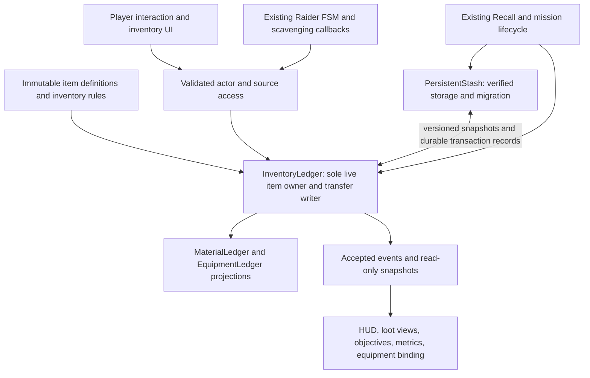

# Stage Z: hybrid inventory, shared ownership and extraction

Prepared **2026-10-26**. **Architecture approved by the director; implemented for Checkpoint Z manual review.** See the [delivery report](../reports/stage_z_hybrid_inventory.md) for final behavior, evidence and limitations. The approved proposal below is retained as the scope record. Stage Y and its refinement are accepted. The [repository audit and fresh baseline](../reports/stage_z_inventory_architecture_audit.md) establish what exists; the [director ledger](../ledgers/phase_7_stage_z_hybrid_inventory.md) and supplied equipment/cargo illustration define the requested scope. This plan proposes actual inventory changes, not an additional AI or mission framework.

## 1. Decision and authority

Extend the accepted accounting architecture with **one `InventoryLedger`**, shared by the player and Raiders. Retain `MaterialLedger` and `EquipmentLedger` as compatibility interfaces over that owner. They must stop storing independent authoritative quantities/items when adapted. Player UI and Raider decisions issue different requests, but both resolve through the same validation, capacity, identity and transfer operations.

| Approach | Benefit | Problem / decision |
| --- | --- | --- |
| Add item/slot dictionaries beside both existing ledgers | Small initial patch | Creates three balances to synchronize; cannot atomically transfer mixed actor cargo/equipment or safely debit persistent loadouts. Reject. |
| Expand MaterialLedger into every item/UI/persistence concern | Retains familiar name | Material-specific scalar API cannot express all requested operations cleanly; equipment and persistence responsibilities become misleading. Reject as the public design. |
| One item authority, existing ledgers as delegating projections | Preserves conservation APIs and observers while enabling shared operations | Requires explicit migration and narrow caller changes. **Recommend.** No dual writes or temporary shadow balance during rollout. |



`PersistentStash` remains the sole disk writer. Its serialized snapshots are durable representations of the same inventory state, not an independently spendable balance. UI, actor scripts, drops, receipts and accounting projections never own duplicate items. A receipt describes a completed transfer; it is not another inventory location.

## 2. Data model

Use Resources for definitions/configuration and ledger-owned records for runtime state. Follow existing typed GDScript and dictionary/snapshot conventions; separate mutable Item/Container node hierarchies are unnecessary.

| Data | Proposed fields and meaning |
| --- | --- |
| `ItemDefinition` Resource | Stable `definition_id`, display name/description, category enum, icon reference, integer `unit_weight_g`, `max_stack`, integer base value, compatible actor/mount tags, optional existing WeaponDefinition reference, `material_units`, bounded metadata. Definitions are immutable during deployment. |
| Runtime stack / unique item | Stable `record_id`, definition ID, positive integer quantity, exactly one `container_id` and cargo-slot/equipment-slot address, acquisition cohort, bounded instance metadata. Unique equipment always has quantity 1 and persistent identity. No durability simulation. |
| Container | Stable ID, owner kind/actor ID, cargo-slot limit, weight policy, compatible equipment slots, lifecycle/access status, revision. Contents are derived from the ledger's ownership index; no second item list with mutable quantities. |
| Ownership locations | World source, searchable container, actor cargo, actor equipment, safe stash, safe prepared loadout, deployment escrow, dropped loot, extracted Raider terminal, forfeited player terminal, unrecovered world terminal, explicit authorized destruction, unsupported-item quarantine. |
| Cohort | Current deployment-generated supply versus imported player loadout; preserve original persistent identity/provenance too. Never merge imported and newly found quantities into an indistinguishable stack. |

All arithmetic uses integer quantities/grams/value; kilogram display is presentation only. Validate IDs, bounds, definition references, positive stack limits, finite numeric input, overflow and serializable metadata. Runtime engine instance IDs are not persistent item IDs.

**Identity rules:** a stack ID identifies a stack record, not every underlying steel unit. Whole-stack moves retain it. Splitting creates a new monotonically allocated ID and reduces the parent by exactly the same quantity. Merging compatible stacks retains the destination ID and retires an emptied source; retired IDs are never reused. Merge only equal definition/metadata and compatible acquisition cohort. Unique equipment never merges. Persist the allocator and retired/operation identities needed to reject stale retries; no ID allocation on rejected commands.

## 3. Proposed catalog, capacities and equipment

These are **proposed initial constants**, not values already approved by the illustration. Centralize them in catalog/rules Resources and measure before tuning.

| Definition ID | Initial name | Weight | Stack | Value | Material units / equipment compatibility |
| --- | --- | ---: | ---: | ---: | --- |
| `scrap_steel` | Scrap steel | 3 kg | 10 | 1 | 1 per unit |
| `copper_winding` | Copper winding | 1 kg | 5 | 3 | 1 per unit |
| `servo_motor` | Servo motor | 4 kg | 2 | 4 | 1 per unit |
| `industrial_sensor` | Industrial sensor | 0.5 kg | 5 | 5 | 1 per unit |
| `control_pcb` | Control PCB | 0.2 kg | 5 | 6 | 1 per unit |
| `industrial_blaster` | Industrial blaster | 4 kg | 1 | 4 | Robot primary; existing prototype blaster definition |
| `raider_rifle` | Raider rifle | 3 kg | 1 | 4 | Human primary; existing Raider rifle definition |
| `worn_response_rifle` | Worn response rifle | 3 kg | 1 | 1 | Human primary; same existing firing definition, no new wear penalty |
| `electronics_kit` | Electronics kit | 1 kg | 1 | 2 | Utility mount, robot or human; data-only effect |
| `armor_plating` | Armor plating | 5 kg | 1 | 5 | Robot armor; data-only effect |
| `power_module` | Power module | 3 kg | 1 | 4 | Robot power; data-only effect |
| `mobility_actuator` | Mobility actuator | 4 kg | 1 | 4 | Robot mobility; data-only effect |

The first five definitions remain the existing aggregate material economy expressed as identifiable salvage; each contributes one material unit. Equipment contributes zero material units. This preserves the fourteen-unit material invariant while adding per-type conservation. Legacy material saves map to steel one-for-one. The three existing equipment names/values map exactly; the other items are explicit Stage Z additions. Values are comparison scores, not spendable currency.

| Owner | Cargo slots | Total carried mass | Equipment |
| --- | ---: | ---: | --- |
| Player robot | **12** (four columns × three rows) | **35 kg** | Primary weapon, armor, power, mobility, utility |
| Raider | **6** | **24 kg** | Human primary and utility; same validation engine |
| Safe stash | No gameplay slot/weight limit | No gameplay weight limit | Stored equipment is cargo until assigned to a prepared loadout |
| World/container/drop | Authored finite contents, no actor cargo limit | No actor mass limit | No mounted effects |

Weight includes equipped items and cargo, preventing equipment slots from bypassing the mass limit. Equipment slots do not consume cargo slots. A Greedy Raider can still carry six steel units plus its rifle/kit: **18 + 3 + 1 = 22 kg**. Player steel-only recovery of the entire fourteen-unit world pool would weigh 42 kg before equipment, so weight can matter. Twelve cargo slots also compete with individually recovered equipment; separate tests exercise slot exhaustion even when mass is low. No encumbrance movement penalty is proposed.

Only weapon presence/compatibility has a functional combat effect: equipping the existing blaster permits existing player fire; unequipping it permits unarmed deployment but disables firing. Initial human rifles retain their current behavior. Do not enable weapons merely by closing inventory or leaving spectator mode. Armor/power/mobility/utility mounts visibly state **“no stat effect in Stage Z”**. Damage, cadence, range, accuracy, health, movement, jump, boost and machine behavior stay at accepted values. Raiders collect found equipment as cargo; autonomous mid-mission re-equipping is excluded.

**Avoiding an empty-stash dead end:** one blaster is issued once per new/migrated profile through a named genesis receipt; it is at risk like other brought equipment. No refill on death, load or restart. Each new normal deployment also allocates one finite robot blaster in a reachable tool cache; an unarmed player can recover it through the same interaction rules. This is declared generation, not an invisible stash grant. Test the second deployment after losing the entire first loadout.

## 4. Common transfer boundary

All add/remove/transfer/merge/split/equip/unequip/drop/pickup/stash operations are ledger commands. “Add” means authorized initial supply, bounded actor admission or validated persistent import; “remove” means movement to an explicit terminal category with a reason. No public UI/AI command may mint or erase quantities.

For each request, validate requester identity and current lifecycle, source registration/access, expected source/destination revisions, record ownership/quantity, destination permissions, final slot assignments, maximum stacks, **combined equipment/cargo mass**, compatibility and any durable-write precondition. Commit one complete candidate mutation without an `await`; update ownership/revisions, then emit one accepted transaction with material/equipment projections. Observer callbacks cannot reenter a half-applied transaction. Return a structured result: accepted quantity, remainder, changed IDs/revisions and reason code/message.

- Exact transfers reject if the requested amount cannot all fit. **Take fitting** and Raider collection explicitly request partial mode and report accepted/remainder quantities. No silent disposal.
- **Take All** is a deterministic ordered series of these commands with a visible per-item result; it is not advertised as an all-or-nothing batch. Failed individual commands leave both sides unchanged.
- Splitting needs an available destination cargo slot. Equipping validates the entire swap, including returning old equipment to the vacated cargo slot; reject if the final assignment is invalid. Same-container rearrangement cannot alter weight.
- Duplicate command IDs return the prior accepted result only for identical payloads. Reusing an ID with different payload, stale revisions, zero/negative quantities, dead actors or vanished sources rejects without events or allocation.
- Actor death/extraction settles all that actor's containers atomically and closes its access epoch. Later queued/UI commands cannot succeed. The main-thread command order resolves two actors reaching the last unit; object deletion is only presentation cleanup.

`InventoryInteraction` supplies authoritative physical access checks for **both actors**: registered source, actor alive/active, legal mission phase, reachable interaction point, appropriate range/LOS and any completed dwell. Player range remains 1.8 m; Raider collection retains its 0.8 m approach and existing dwell. UI supplies selected IDs/quantities, not trusted ownership or eligibility facts. No multiplayer/RPC/token infrastructure is introduced.

## 5. World loot, containers and deterministic supply

Reuse existing stock/drop scenes and Stage Y art. World nodes hold a container ID, interaction point and presentation; quantity, item identity and empty state come from the ledger. Generalize the material/equipment drop views without retaining their own mutable counts.

Use two reusable searchable presentations—**salvage cache** and **tool/electrical cabinet**—at the existing three salvage anchors. Attach cabinet access points to existing visible faces where appropriate; retain current collision/nav geometry. An abstract stock marker can remain the recoverable cache cue rather than adding an uncollidable solid. Decorative cabinets/pallets/scrap do not become loot merely because they use the same art. Only the explicitly registered sources show a restrained nearby prompt/outline.

For normal and expanded Z-enabled missions:

- Redistribute the existing **12 stock units** among the five salvage definitions through bounded authored tables; preserve **two installed machine component units**, released once on destruction. Total material supply remains **14**, not fourteen plus replacement container loot.
- Allocate **four additional unique world equipment items**: one blaster and one each armor, power and mobility module, distributed across the three caches. Initial regular Raider gear remains two items per admitted actor; responders remain one. At most five regular + two responder admissions gives **12 NPC equipment items**, plus those four world pieces. Player imports/genesis are a separately declared cohort.
- Resolve each source manifest once before deployment. Use a dedicated loot RNG seeded from a stable digest of loot-table version / mission ID / scenario seed / resolved layout / source ID, sorted candidate definitions and declared bounds. Do not consume encounter, combat or cosmetic RNG streams. Revisiting/reopening a source never calls generation.
- Issue delayed actor equipment through a one-use admission permit for its existing initial/ticket ID. Templates are not accessible items; admission records the authorized addition once. Unused tickets cannot issue gear or repeat a loadout.
- Source/drop IDs and stable item ordinals derive from manifest/admission identity; deployment tokens namespace persistent uniqueness. Compare semantic manifests without the random token when checking seeded reproducibility.

Opening a container reveals current contents; no per-player cloned inventory or exclusive loot lock. Raiders can take stock while the UI is open, and the panel updates immediately on accepted events. Source disappearance, emptying or loss of range closes/revokes access. Player drops validate an accessible physical landing location, then move items into one world bundle; failed placement leaves cargo unchanged. Group contents per bundle, not one elaborate 3D item scene per stack. Propose a centralized **64 active world-loot-view limit**, reserving twelve places for three authored sources, seven possible Raider loot sources and two machine sources. Voluntary player-drop admission uses the remaining 52 places; reject Drop clearly if none is available. Mandatory finite actor/component release uses its reserved place and cannot lose contents because of a cosmetic admission limit.

## 6. Raider integration without decision churn

Retain Raider as the sole FSM/movement owner; Combat still owns aim/cover/local timing and Social still owns observed knowledge. New shared inventory queries supply `can_accept`, transferable quantity/value, `has_loot`, `loot_value` and `goal_reached`. They issue no movement or combat transitions.

- Keep current reachable route/risk/contention scoring and stable jitter. Substitute bounded **collectible value** for anonymous quantity, considering what fits, and ignore empty/unacceptable sources. An already committed combat/cover/pursuit task is not interrupted just because an item was inspected or a UI view changed.
- Preserve current goal thresholds **6 / 3 / 3** as initial newly acquired loot-value targets; legacy one-value steel reproduces existing behavior. Initial worn loadout value does not count toward scavenging goals. Full capacity or no reachable acceptable loot leads through existing exit selection rather than repeatedly retrying an impossible source.
- Update Greedy cargo-preservation and richer-ally comparisons to the same read-only acquired-loot value/has-loot queries. Preserve critical survival priority, Q timing, W action commitment, health thresholds, target eligibility, independent extraction and relationship policy. These are explicit item-awareness adaptations, not a new personality system.
- Extend observed-drop memory to registered loot/container sources with the same LOS/range/expiry. Equipment/source contents are evaluated only when known; no spectator position or global hidden-loot query may provide knowledge.
- Collection uses the same transfer engine as the player. Partial fits leave the remainder. Repeated capacity failures release/reselect the objective through the existing transition path.
- One accepted death moves cargo **and equipped gear** into a recoverable actor-loot container, then triggers the existing single flare/response edge. One accepted extraction moves those items to an extracted-Raider terminal, preserving the historical material `lost` projection. Relations and terminal actor eligibility retain existing cleanup.

## 7. Inventory UI, input and preparation

Follow the supplied layout: left equipment mounts, right four-column cargo, below selected item details and total carried weight/slot usage. Use Godot Controls, clear text/silhouette placeholders and existing industrial colors. No raster asset generation or major HUD framework is needed. Stack quantity, weight, value, mount compatibility and data-only effects remain readable without color alone.

**I** toggles inventory. Selecting a source uses **E**; retain the existing 1.5-second stationary/no-fire, damage-interruptible access for equipment/body/container looting. Loose material pickup can remain the quick existing action, routed through the same partial-capacity command. Source access opens the two-inventory view. Provide Take, Take fitting, Take All, Transfer, Split, Equip/Unequip and Drop with quantity controls and concrete disabled/failure explanations. Drag-and-drop is excluded from the initial delivery.

The simulation continues. Opening UI clears held intents/cancels boost and pickup/Recall channels, suppresses new movement/look/fire/recover commands and releases the cursor. Physical gravity/collisions/braking continue; do not freeze the robot in the air. Damage closes the overlay and returns control only to a living active player. Every transfer revalidates access; a panel is not permission to loot remotely.

One small `PlayerInteractionMode` owner resolves **briefing, gameplay, inventory/loot, developer view, post-death, results** permissions using explicit transitions. It derives `RobotInput.gameplay_enabled`, capture and allowed actions. Terminal state wins; leaving an overlay/spectator never restores stale weapon/input flags. Existing spectator classes retain camera ownership and their own permission distinction. Escape closes an overlay first; the same click cannot select an item and recapture/fire. I is unavailable in normal post-death follow; developer inventory inspection is read-only. Death, extraction, return and scene replacement unsubscribe the view and revoke source access.

Preparation extends the existing briefing with Stash / Prepared loadout / Deploy. Stash and safe prepared containers share the same ledger and transfers; prepared cargo/equipment already obey player rules. Moving items into preparation does not put them at deployment risk yet. At Deploy, durable escrow transfer commits before the arena enables simulation. Cancel preparation moves items back to stash. Stash has no gameplay capacity; use paging/event-driven updates rather than constructing every possible slot each frame.

## 8. Durable ownership, migration and settlement

### Version 2 persistence

Extend `PersistentStash`, preserving its path, verified writes, validation and deployment-token receipt concept. Version 2 stores profile ID, sequence, catalog/schema version, canonical safe/prepared/escrow item records, allocator state, committed-operation identities, deployment records and migration/genesis provenance. Receipts record imported and returned/lost manifests, outcome and payload digest. Current balances are validated against current ownership and transaction history, **not the sum of all historical rewards**.

There is one active player deployment per profile. Use a small append-only sequence of verified committed transaction snapshots for persistent boundary operations, alongside the current profile snapshot and backup. This journal is justified by loadout debits: silently restoring a pre-debit backup could duplicate spent gear. It contains no every-frame simulation or network machinery.

Persistent commit protocol: build/validate the ledger candidate; write/flush/read-verify a temporary transaction snapshot including prior sequence/hash and operation ID; rename it to its unique committed record. That verified committed record is the durability boundary. Install the corresponding live state, then replace the primary profile snapshot with the existing verified-temp/backup approach. If the primary cache write fails after the journal commit, the operation is already committed and reload must recover it; do not return a failure that would encourage a duplicate grant. If no commit exists, discard the candidate and leave ownership unchanged. Ambiguous/unverifiable I/O blocks dependent inventory/deployment actions and requests recovery; it must not be treated as a safe retry with a new ID.

On load, recover the latest valid committed sequence, repair the profile cache if needed, and deduplicate by operation ID/payload. A broken chain, unsupported version, malformed ownership or uncertain latest sequence blocks spending/migration and preserves files. Do not silently fall back to an older spendable balance. Serialized historical snapshots are evidence, not additional current owners. Journal compaction is unnecessary for the initial bounded test history; measure growth and document any later checkpoint/compaction proposal separately.

### Safe version-1 migration

1. Read/validate existing primary/backup using its accepted rules; no automatic “empty stash” replacement for corrupt/future data. Do not inspect or migrate the director's real save during development.
2. Preserve an immutable original-byte `.v1.bak` and hash before committing any version-2 state. Build/test migration only at isolated paths first.
3. Convert **the current material balance once** to steel stacks; do not also mint each receipt's material reward. Convert each current equipment key `<token>/<id>` into the same stable unique identity, mapping the three known names exactly and preserving values/metadata. Keep old receipts as nonspendable history and duplicate-settlement guards.
4. Preserve unknown names/obsolete definitions in an explicit quarantine container with original payload and a visible diagnostic; no silent deletion, guessed stats or capacity bypass. Disallow deployment/equipping of unresolved items until their definition is restored/mapped. Preserve missing-reference records through another save/load cycle.
5. Record migration version/source hash and the one-time starter issuance. Verify reconstructed per-type totals and unique identities, commit a version-2 genesis transaction, reload/compare and only then enable new operations. Reopening the same save never remigrates/reissues it.
6. Bound parsing/record expansion. An accepted but impractically large legacy scalar (v1 permits up to 1 billion) must not allocate millions of stack objects: report a blocking oversized migration and preserve all source data. No automatic truncation. Benchmark realistic large stashes and define tested safety limits in delivery.

### Lifecycle and crash policy

| Boundary | Proposed authoritative action |
| --- | --- |
| Before Deploy | Safe stash/prepared transfers persist through the same authority. No world simulation or loot generation on UI refresh. |
| Confirm Deploy | Commit `PREPARED → ACTIVE` with loadout moved to deployment escrow and a fixed token/import manifest. Only then instantiate/bind inventory and enable existing `start_deployment`. Failed debit leaves preparation intact. |
| Active deployment | Escrow represents risk, not a second copy in stash. Mission-local item ownership handles all world/cargo/equipment transfers; no per-frame disk writes. |
| Accepted Recall | Preserve five-second eligibility and current nonlethal-hit behavior. Lock that player's command epoch, validate one return manifest, atomically persist its stash transfer and settlement receipt, then install settled ownership, update both projections, evaluate objectives and close results. A failed pre-commit write leaves live cargo and mission active for retry. |
| Player death, timeout, abandon | Move all still-carried cargo/equipped items to explicit forfeiture, not stash; close player transfers exactly once. Persist the failure record, retrying the same ID if needed. Current post-death AI continuation remains active. |
| Raider death/extraction | One mission-local transaction, with the explicit drop/extracted destination policies above. It never writes player stash. |
| Crash / active process termination | No mid-mission resume is proposed. On next load an ACTIVE deployment without a durable success receipt resolves as failed; imported escrow is forfeited once. Successful committed returns survive a crash before the result screen. Uncommitted discovered loot is not banked. |
| Restart or scenario replacement | Settle an active player as abandoned before creating a **new deployment/token** and fresh finite world manifest. Reusing a scene or reopening containers in one deployment cannot regenerate items. Block a new persistent loadout if prior settlement durability is unresolved. |

At world shutdown, seal remaining world/actor containers in place with an unrecovered terminal status and retained last-location facts. Do not convert protected stock or ground loot into player forfeiture, Raider extraction or destruction. Legacy category projections and the closed deployment certificate must still describe those quantities truthfully.

Player death retains the accepted terminal-forfeiture policy; it does not add a recoverable player corpse bag. Raider drops and voluntarily dropped player cargo remain world-owned for surviving actors. This is an explicit mission outcome policy over the **same** transfer mechanism. Persistent stash/prepared items never enter the failure transfer. No insurance or secure container is introduced.

## 9. Conservation, objectives and compatibility

For each definition and current admission cohort:

```text
initial world allocation + one-use admitted gear + imported loadout
  = world/container/installed + actor cargo/equipment + ground drops
  + returned player inventory + extracted Raider terminal
  + forfeited/unrecovered/explicitly destroyed terminal inventory
```

Each record appears in exactly one current location. In whole-profile checks, returned items are simply in stash; the equation's “returned” category and receipt summaries must not be added again as owned items. Splits/merges change records, never type/cohort totals. Unique equipment IDs occur once across all active/terminal locations.

`MaterialLedger` retains its accepted aggregate invariant by projecting qualifying **deployment-generated salvage**, with imported loadout recorded separately. `EquipmentLedger` similarly projects original equipment operations and newly acquired versus imported equipment. Sealed deployment results/certificates preserve the as-settled accounting without retaining a spendable copy of banked items. Historical `lost` still means Raider extraction, distinct from player forfeiture.

Mission primary/optional banking credit counts newly acquired eligible deployment loot, **excluding imported/returned starting gear**. Repeatedly deploying and recalling three old steel units or the same starter weapon cannot complete a new recovery objective. Early Recall still banks eligible surviving inventory even with an incomplete primary. Results distinguish brought, found, returned, extracted value and lost inventory; observer events never drive ownership.

Normal Asset Recovery and expanded Salvage Complex opt into the new inventory rules/content after approval. Dedicated older presets retain legacy scalar goals/timings/content through compatibility configuration, **using the same ledger engine**. Standalone old ledger constructors may create an isolated backing ledger for unit fixtures; arena composition injects one common instance into both facades. Never run old mutable stores alongside the new one.

Retain all 41 existing suite entry points. Stronger persistence semantics require strengthening the old backup-recovery expectation to the latest committed transaction, while retaining separate version-1 backup/migration cases. Preserve historical source manifests; add explicit reviewed Z identities for authorized accounting/input/UI seams rather than weakening protected-source checks broadly.

## 10. Proposed file scope

Paths below are the intended implementation scope, not files created by this proposal. Track Godot-generated UIDs for every new script/resource identity where applicable.

| Create | Responsibility |
| --- | --- |
| `scripts/gameplay/item_definition.gd`, `item_catalog.gd`, `inventory_rules.gd` | Definition/configuration validation; no mutable ownership |
| `scripts/gameplay/inventory_ledger.gd` | Runtime stack/container records, indices, authoritative transactions, revisions, lifecycle, cohort conservation and read-only snapshots |
| `scripts/gameplay/loot_table.gd` | Finite deterministic source manifests using an isolated seed domain |
| `scripts/gameplay/world_loot.gd`, `inventory_interaction.gd` | Read-only world source views and shared actor access/dwell/command validation |
| `scripts/gameplay/equipment_binding.gd` | Accepted-event binding to existing weapon enable/definition; no stat progression |
| `scripts/player/player_interaction_mode.gd` | Explicit input permission transitions; camera remains in existing owners |
| `scripts/presentation/inventory_view.gd` | Shared inventory/loot/preparation presentation with selection/quantity controls |
| `resources/items/{scrap_steel,copper_winding,servo_motor,industrial_sensor,control_pcb,industrial_blaster,raider_rifle,worn_response_rifle,electronics_kit,armor_plating,power_module,mobility_actuator}.tres`, `catalog.tres` | The twelve proposed definitions and catalog |
| `resources/inventory/{player,raider,legacy}.tres`, `resources/loot/{asset_recovery,expanded_asset_recovery}.tres` | Central capacities/mount rules and finite source tables; stash unbounded policy in the shared rules |
| `scenes/ui/inventory_screen.tscn`, `inventory_slot.tscn`, `scenes/loot/world_loot.tscn`, `searchable_container.tscn` | Reusable controls and minimal source presentation; reuse existing art, no new GLBs |
| `tests/item_inventory_test.gd`, `inventory_world_test.gd`, `inventory_raider_test.gd`, `inventory_persistence_test.gd`, `inventory_ui_test.gd`, `inventory_integration_test.gd` | New meaningful foundation, physical, persistence, UI and multi-deployment checks |

| Modify | Narrow integration |
| --- | --- |
| `scripts/gameplay/material_ledger.gd`, `equipment_ledger.gd` | Compatibility facades; remove duplicate authoritative stores |
| `scripts/gameplay/persistent_stash.gd`, `recall_controller.gd` | Version 2 migration/durable transactions, debit/return/forfeit and existing Recall ordering |
| `scripts/gameplay/raider_arena.gd`, `mission_arena.gd`, `mission_config.gd`, `encounter_setup.gd` | Shared authority bootstrap, finite source initialization, actor callbacks, preparation/Deploy/restart seams |
| `scripts/gameplay/flare_director.gd`, `machine_ecosystem.gd`, `material_drop.gd`, `equipment_drop.gd` | One accepted inventory resolution; flares do not own a second equipment ledger; component/source views retain finite ownership |
| `scripts/ai/raider.gd`, `raider_social.gd`, `raider_betrayal.gd`, `raider_combat.gd` | Replace scalar cargo assumptions with shared fit/value queries at existing decisions; generalize observed loot without changing FSM/perception policy |
| `scripts/gameplay/mission_objectives.gd`, `scripts/presentation/mission_objectives_view.gd`, `mission_presentation.gd`, `scripts/debug/deployment_metrics.gd` | New-found-loot credit, truthful results, deduplicated confirmations and bounded read-only diagnostics |
| `scripts/player/robot_input.gd`, `scripts/debug/developer_spectator.gd`, `scripts/gameplay/post_death_spectator.gd` | Route permission/capture through the input-mode owner; close/revoke UI on terminal/view transitions |
| `project.godot`, `scenes/player/robot.tscn`, `scenes/raiders/raider.tscn`, `scenes/loot/material_drop.tscn` | I action, inventory/binding references and generalized source presentation; physical actor shapes/muzzles unchanged |
| `scenes/levels/{asset_recovery_arena,expanded_salvage_complex}.tscn`, `resources/missions/{asset_recovery,expanded_asset_recovery}.tres` | Enable approved item content/source references and truthful briefing/risk text; graybox inherits the same inventory with matching physical geometry |
| `tests/{extraction,mission_objectives,gameplay_integration,asset_pipeline,world_population}_test.gd`, `tests/README.md` | Stronger persistence/credit/integration assertions, narrowly reviewed source/config expectations and test index; retain every accepted suite |
| `docs/architecture/game_code_flow.md`, development/art/presentation indexes and new Z delivery evidence/report | Ownership, schema, tuning, validation and manual checklist |

Accepted weapon resources, RobotController movement, Health/damage authority, machine controllers, relationships, scene geometry and W–Y assets need no behavioral/art rewrite. Discoveries requiring additional scope must be reported rather than hidden in a cleanup.

## 11. Implementation order, risks and acceptance evidence

Proceed only after approval of this complete architecture and the explicit policies/constants above.

1. **Foundation and facade conversion.** Implement definitions, rules, records and common operations; inject one authority. Prove failed-command atomicity, integer mass/slots, cohort-preserving stacks, unique identities, exact legacy material behavior and mixed material/equipment actor settlement before adding UI.
2. **Persistence before exposing at-risk loadouts.** Implement isolated v1 migration, journal/recovery, prepared containers, debit and receipt boundaries. Inject failures before/after every write/rename, crash after debit/after success commit, corrupt primary/newer journal/stale backup, and repeated load/settlement. No production save migration during development.
3. **World and Raider integration.** Replace finite content once, generalize read-only source views and observed knowledge, adapt existing value/fit queries. Exercise actual pickup/partial rejection, two-actor contests, reachable loaded escape, death/equipment looting/extraction and flare bounds. Preserve Q/W commitment suites.
4. **Player UI, input and binding.** Add I/loot/preparation, exact messages, split/drop/equip and unchanged weapon behavior. Test click capture, held fire/E clearing, damage/death during transfer, out-of-range/occluded sources, Recall priority, focus loss and developer/post-death transitions. No per-frame UI rebuild.
5. **Full normal/expanded loop and controlled balance.** Two sequential deployments using returned gear, all-loadout loss/unarmed recovery, early and successful Recall, timeout/abandon/restart, both seeds and autonomous post-death simulation. Compare legacy presets separately; new inventory decisions legitimately change normal outcomes.
6. **Checkpoint Z delivery.** Editor/import, all 41 existing plus new suites, bounded headless, Forward+, screenshots, conservation/migration/failure evidence, performance measurements, exact tuning and director checklist. Stop before the next stage; no commit/publication.

| Risk | Required evidence |
| --- | --- |
| Duplicate authority or receipt counted as inventory | Per-type/cohort conservation after every accepted command; unique ownership across stash/prepared/escrow/actor/world/terminal; compatibility queries cannot mutate returned copies |
| Death/extraction races and contested last units | Deterministic command order, stale-revision rejection, actor access-epoch closure, no post-death UI transfer, repeated exact operation ID safety |
| Gear reappears after crash/backup or is lost on successful return | Fault-injection matrix across durable boundaries; active escrow forfeited once; latest committed success recovered before new deployment; broken history fails safely |
| Legacy save corruption, unknown definitions or enormous balances | Byte-preserved originals, deterministic migration counts/IDs, repeat migration no-op, quarantine round-trip, future version refusal and bounded parsing/expansion |
| AI sees hidden loot or oscillates at full capacity | Occlusion/memory tests, actual movement/collection/extraction with mixed items, stable engagement/cover commitment, no accepted-source retry loop when nothing fits |
| Imported items farm mission progress | Banked-new-loot objectives/results tested against direct return of old material/equipment, dropping/recollecting imported items and sequential deployments |
| UI or spectator restores an unarmed/dead player weapon | Input-mode/weapon-binding integration tests, real button/key events and physical fire checks, continuing world simulation with inventory open |
| New content changes the fourteen-unit economy or actor limits | Seeded manifests/per-type totals, five-live-Raider/two-machine/two-ticket bounds, component release/admission once, all original geometry contracts |
| Inventory exceeds current rendering/CPU budget | Profile representative 12-slot player, six-slot Raiders, three sources, capped drops and a paged 1,024-stack stash; operation throughput, memory, node count, UI refresh counts and save/load timings; compare matched 1600×900 Y views |

Retain Y's matched-view **487 draw / 188,020 primitive** and +1 ms p95 review guides; do not quietly increase them for icons or world-loot effects. Measure save/load independently from frame timing. Establish measured operation costs before setting a timing threshold; avoid invented performance guarantees in this proposal.

Manual acceptance follows the director's A–L matrix: preparation, deployment, identifiable pickups, partially looted/reopened containers, slot/weight pressure, Raider competition/death, Recall banking once, full loadout loss, second deployment, spectator integrity and performance. Exact encounter winners/loot outcomes are not prescribed.

**Approval checkpoint:** approve the single-authority/facade design, proposed catalog/capacities, finite content additions, functional weapon-presence binding, input policy, value-aware AI queries, at-risk loadouts, terminal player forfeiture and version-2 migration/journal/crash rules before implementation. As required by the director ledger: **“STOP after presenting the proposal.”**
