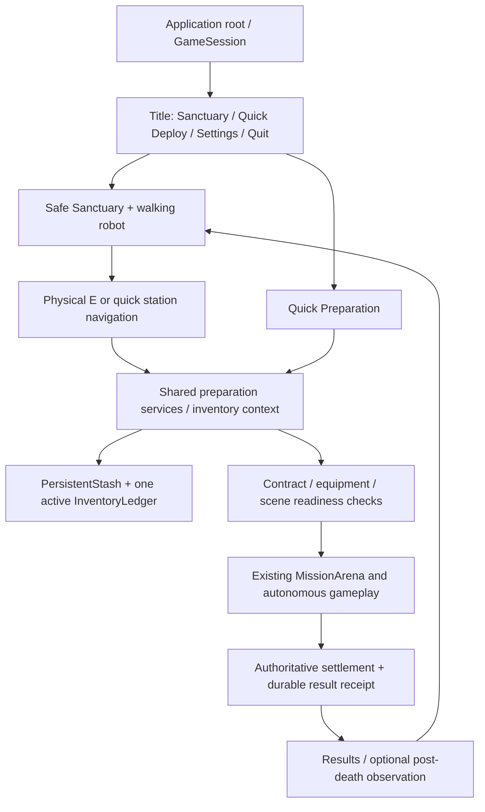

# Stage AA: Sanctuary and complete gameplay loop

Prepared **2026-10-27**. **Architecture approved by the director on 2026-10-27. AA-1 through AA-5 accepted by the director; continuation approved. AA-6 through AA-9 implemented for final review.** Checkpoint Z, including usability and scrolling, is accepted. The [director ledger](../ledgers/stage_aa_sanctuary_gameplay_loop.md) remains unchanged. The [repository audit](../reports/stage_aa_architecture_audit.md) and [fresh baseline](../baselines/stage_aa_architecture_audit/README.md) ground this proposal. No new phase number is inferred.

## 1. Recommended boundary and shortest path

Add one persistent **application scene root with a GameSession child**, using explicit dependencies and signals. Do not add an autoload. GameSession coordinates scenes and the active inventory binding; it does not simulate actors, resolve hits, evaluate objectives or hold another item balance. PersistentStash remains the sole profile writer, InventoryLedger the sole item writer, MissionRules the outcome owner and MissionObjectives the objective owner.

First deliver AA-1 through AA-5: title → home or quick preparation → an existing deployment → results → home, repeatable without restarting. Reuse existing art, items, missions and extraction code. **Stop there for mandatory director play-testing.** Recipes/upgrades and customization follow only after approval to continue.

| Option | Decision |
| --- | --- |
| Workshop inside MissionArena | Reject: creates hostile simulation and mission lifetime merely to access storage |
| Inventory singleton plus separate global scene manager | Reject: obscures dependencies/cleanup; no autoload is necessary |
| App root with explicit session/services, existing arena as a deployment child | Recommend: adds application lifetime while preserving accepted gameplay owners |

## 2. Entry, session and scene lifetime

`project.godot` will start `scenes/application/application.tscn`. Children are GameSession, a replaceable SceneSlot and shared overlay Controls. Title provides Enter Sanctuary, Quick Deploy, Settings and Quit. Initial Settings covers master volume and window/fullscreen mode, persisted as profile preferences; no extensive remapping menu. A failed profile open reports the problem and preserves files, with Retry/Quit rather than silently issuing another kit.

GameSession owns explicit transitions: `TITLE`, `SANCTUARY`, `QUICK_PREPARATION`, `LOADING`, `DEPLOYMENT`, `RESULTS`, `RETURNING`, `ERROR`. Only one transition runs; attempt/generation tokens reject double clicks and stale callbacks. Connect scene signals once, disconnect on disposal, clear camera/input ownership and free the previous scene before enabling its replacement. Home/title/quick preparation contain no Raiders, reinforcement schedulers, world-loot controllers or mission deadlines.

Keep explicit arena launch commands and diagnostic presets. App-managed Return/scenario/restart requests delegate to GameSession rather than removing a child as if it were SceneTree.root. Standalone arenas keep existing replacement behavior. Debug preset changes resolve the current deployment before replacement and cannot open a second writable profile.

## 3. One profile and one spendable inventory

Open PersistentStash once at application startup against an explicit profile path, with a home InventoryLedger containing persistent locations. Scene transitions do not reopen the profile or rerun abandoned-escrow recovery. Add a binding path for an already-open profile to a staged arena ledger.

Disable outgoing inventory commands, import the verified persistent projection into the target's unpublished ledger and validate it, then switch the profile/service binding and retire the old reference. Never expose two command-enabled copies of the same identities. Candidate ledgers remain transaction previews. The existing arena still constructs finite world stock and owns its world ledger during deployment.

On return, settle first, stop/dispose the arena and its subscriptions, then reconstruct a fresh home ledger from the committed persistent projection. Do not clear `sealed` or reuse a terminal world's player container. Preserve admission's imported cohort so the next mission cannot count old stash cargo as newly recovered loot.

## 4. Sanctuary and player/camera reuse

Build a modest approximately **20 × 16 m** enclosed workshop with accepted wall/beam, cabinet, utility, pallet and bin scenes. Six stations line the perimeter; keep a clear central walking loop and marked **6 × 4 m** customization area. Use quiet lighting/audio and no home deadlines, hostile actors, upkeep, theft or deterioration. No new Blender production is required for the playable loop.

Use an inherited sanctuary robot scene based on `robot.tscn`: same CharacterBody3D, movement, collision and visuals. Hide combat/deployment HUDs, disable weapon execution and aim/fire intents, and reject incoming damage through an opt-in Health permission whose default remains unchanged. A mounted weapon cannot re-enable home combat. The sanctuary controller centrally switches `WALKING`, `STATION`, `PLACEMENT`; station UI captures input without a global pause. Clear velocity and held inputs on mode/scene changes. Enclosed collision plus safe-spawn bounds recovery prevent walking out of the workshop.

Prototype a sanctuary-only RobotCamera preset: **48° downward**, centered pivot, arm around **10 m**, mouse-wheel zoom **7–14 m** and bounded tilt around **40–55°**. Reuse the collision spring arm and camera-relative walking. Add opt-in camera controls with deployment defaults unchanged. Closing a station returns to walking at that station. Placement reuses this camera. Director camera review belongs to AA-5.

## 5. Shared station framework

WorkshopStation exposes stable ID, display name, context, availability/unlock requirement and a safe anchor. StationRegistry validates unique IDs/anchors and supplies the same `open_station(id)` operation to physical interaction and quick navigation.

Physical E checks registration, range and line of sight. Quick navigation works only from sanctuary walking mode: validate availability, reachable anchor, standing capsule/floor clearance and layout occupancy, clear motion, move safely and open the identical context. Invalid anchors produce a refusal rather than clipping. Closing UI leaves the robot at the station. Neither path has station-specific item mutations.

Storage opens shared inventory/preparation. Maintenance opens loadouts and, after AA-5, upgrades. Contracts opens the shared selector. Deployment opens readiness/confirmation. Fabrication and Disassembly exist as visible stations by AA-5 but clearly report unavailable until AA-6; they must not pretend to execute unimplemented operations.

## 6. Shared preparation and item interfaces

Introduce PreparationService and a small InventoryContext adapter around accepted commands. Refactor InventoryView's direct `mode.arena` reads and preparation `_equip` logic into these services. Reuse the same view/context for storage, maintenance and Quick Deploy. The deployed context still uses InventoryInteraction for search, physical access, pickup and dropping. Views request operations and render results; preserve Z icons, shortcuts, quantities, source revisions, paging, scroll retention and damage/death closure.

PreparationService supplies inspection, stash/prepared transfers, equip/swap, splitting, capacity, template evaluation/application and contract readiness. Persistent changes use the existing validated candidate-and-commit path. Quick Deploy does not bypass validation, costs, ownership or progression.

**Compatibility remains explicit:** industrial blasters mount on the robot; Raider rifles remain carryable/extractable human-only cargo. No free replacement blaster or missing-item substitution. AA-6 adds a paid fabrication route. Data-only modules remain honestly labeled until a specifically implemented effect exists.

## 7. Templates, prepared kit and availability

Templates hold a freely named, bounded desired configuration using stable definition IDs: five mount requests and cargo definition/quantity rows, including consumable quantities if a supported definition exists. They contain no reserved item identities. Support create, rename, edit, duplicate and delete; retain unresolved IDs as visibly missing entries. Saving/selecting a template never equips or buys anything.

Start with **one reserved prepared kit**, using Z's `prepared` container. Reviewing another template reserves nothing. Multiple simultaneous kits are deferred to director-owned expansion; the UI must not imply several reservations exist.

Read-only evaluation counts stash and current prepared items, validates compatibility/unlocks, excludes displayed/installed reservations, aggregates quantities and simulates mass/slots through the real ledger on a candidate. Show required/available/missing quantities per definition and Ready, Partially available, Craftable or Unavailable status. Invalid definitions/slots stay visible. Preview consumes no items, live IDs or save writes.

One-action **Prepare** revalidates template and revision. Ready templates replace the old kit atomically: return its items to stash on the candidate, then allocate/equip exact requested definitions, choosing existing instances deterministically. An incomplete template shows shortages; a separate explicit **Prepare available items** choice may commit a partial kit after confirmation. Never silently substitute or partially spend. Capacity or save failure leaves live ownership unchanged. Explicit unarmed deployment remains allowed under Z's loss rules.

## 8. Contracts, deployment initialization and return

Two initial ContractDefinition resources wrap existing **compact Asset Recovery** and **expanded Salvage Complex**: stable contract ID, existing scene/MissionConfig/objectives and explicit reproducible seed. Both are repeatable. Both operations terminal and Quick Deploy use the same selection/readiness service. Persist completion history without inventing currency rewards, new maps, a quest framework or scripted encounter outcomes.

Deployment uses a fresh attempt token and these boundaries:

1. Validate contract, kit, compatibility, ownership, capacity and progression. Freeze preparation commands.
2. Instantiate the existing scene in a staging state. Validate required nodes/configuration/navigation/static collision and wiring with bounded readiness checks; actor simulation, interaction and damage stay disabled. Load/setup failure returns to preparation without a debit.
3. Bind the arena context as the sole command-enabled inventory owner. Commit prepared-kit debit using durable escrow, adding an explicit **committed-but-not-running** attempt phase.
4. Complete activation preconditions. Failure before the running boundary executes an idempotent **cancel unstarted deployment** transaction, returning the same imported kit identities/mounts to prepared ownership. It grants no scene loot and restores no stale snapshot.
5. Commit the running phase, then enable existing simulation and player controls. This durable boundary defines deployment start. Later death, timeout, abandonment or process termination uses Z's loss policy.

On application restart, new-schema unstarted escrow refunds once; running escrow forfeits once. **Existing v2 active entries migrate as running**, preserving accepted behavior. Test interruption on both sides of every boundary. If state cannot be reconciled, block another deployment and preserve files rather than compensating with new items.

Extend settlement to persist frozen authoritative results and contract completion with inventory under the **same deployment receipt**. Factor MissionObjectives' existing evaluator to preview the settlement candidate, then publish the committed result through its close path. PersistentStash invokes an explicit result builder; it does not become an objective engine. Banking and completion must not become independently repeatable rewards. Early extraction and failure retain accepted meanings.

Results exposes **Return to Sanctuary**. On death, restricted observation may continue until Return; settlement stays irreversible/frozen. Return stops and frees the remaining local world. Save failure keeps results and Retry available and blocks a transition that would discard pending state. Repeated Return/settlement callbacks are idempotent. Each subsequent deployment has fresh actors/objectives/stock/attempt ID, retaining safe inventory and progression.

## 9. Processing and one functional upgrade — AA-6 only

Use RecipeDefinition data and WorkshopService commands, with four proposed recipes over existing definitions:

| Recipe | Available safe-stash input | Safe-stash output |
| --- | --- | --- |
| Strip Raider rifle | 1 Raider rifle | 1 scrap steel |
| Strip worn response rifle | 1 worn response rifle | 1 scrap steel |
| Recover servo materials | 1 servo motor | 1 scrap steel + 1 copper winding |
| Fabricate industrial blaster | 1 scrap steel + 1 copper winding | 1 industrial blaster |

These are proposed tuning values. They preserve current mass for each recipe: 3 kg rifle/steel and 4 kg motor/blaster versus 3 kg steel + 1 kg winding. Process only available safe stash with explicit confirmation; equipped, prepared, displayed, quarantined and deployed items are excluded. Stable operation IDs prevent replay. No blaster recycling recipe is included, avoiding a free reversible production loop.

InventoryLedger gains an atomic recipe operation: validate approved recipe, exact input identities/quantities, output space and progression; consume inputs, create fresh output identities and record authorized definition/cohort debits/credits. Extend conservation evidence to **original supply + approved transformation deltas**. No unlogged issue calls, parallel resource balance or available inputs beside their outputs. Persist output/provenance/receipt and progression in one existing journal commit. Failure discards the candidate. Home processing cannot credit raid objectives as new world loot.

Propose permanent **Cargo Rack I**: consume **2 servo motors + 2 control PCBs** once for **16 cargo slots / 45 kg** instead of 12 / 35 kg. Persistent upgrade state derives a copied InventoryRules policy for prepared, escrow and deployed player containers. Do not mutate shared rules or Raider capacity. This is a real capacity effect, independent of furniture, with no weapon/AI-stat change or upkeep. Its cost/effect are part of the approval requested here.

Read-only fabrication preview aggregates supported missing-template requirements and shared ingredient shortages. No recursive tree; template selection never crafts. Execute individually confirmed recipes initially. Automatic whole-kit fabrication remains future work.

## 10. Placement and real item display — AA-7 only

Allow at most **8 placed instances**, chosen from **3 existing props**: cabinet, scrap bin and pallet load. Use the marked home area, 0.5 m snapping, 90° rotation, occupancy/collision/navigation checks. Move/rotate previews do not save until validated confirmation; cancellation preserves the saved layout. Protect spawn, station anchors, deployment access and a continuous walking loop. Fixed stations cannot move. These decorations add no currency, physics simulation or decay.

Provide one fixed display with ledger container `display:workshop`. Assigning an owned stash item transfers its exact identity there; the mesh is a view, with inspect/remove returning it to stash. Templates/recipes exclude displayed items. Persist its validated ownership/assignment without another item balance; reconcile metadata from ledger state rather than minting replacements. The first display is fixed so deleting a decorative prop cannot delete its item.

## 11. Persistence and migration

Extend PersistentStash to **schema v3**, retaining verified sequence/hash journal and rename commits. Establish the versioned metadata envelope and preferences in AA-1; implement each remaining metadata feature in its prescribed stage. Add templates, selected contract, station unlocks, upgrades, bounded layout and frozen results. Ownership remains in the inventory snapshot; templates reference definitions, display meshes reference reserved records, receipts are evidence rather than spendable copies.

Migrate v2 → v3 once with an original-byte backup and neutral defaults: no new starter, free loot, upgrade or completion reward. Support v1 through its accepted backed-up conversion then v3, retaining quarantine. Validate mixed-version journal history with version-specific validators rather than rewriting the old chain. Unknown future schemas, broken chains and malformed data preserve files and report errors. Never develop migrations against the real profile.

Generalize `persistent_command` to commit validated inventory and profile metadata together; keep journal writing private to PersistentStash. Explicitly extend the persistent-location allowlist for the fixed display. Validate bounded names/counts, coordinates, rotations and stable IDs at load and command time. Reconstruction applies upgrade limits consistently and cannot silently downgrade container capacity.

Retain known Z limits: synchronous large-stash writes, growing snapshots, bounded safety limits and no mid-raid resume. Batch each intent into one commit; never save furniture dragging per frame. Measure large isolated profiles. Compaction/background saves remain future work unless a measured blocker needs separate review.

## 12. Exact proposed source changes

New scripts include generated `.uid` files. These are proposed files, not an existing AA implementation. No AI/combat-policy rewrite is planned.

| Stage | Existing files to modify | New files/resources/scenes |
| --- | --- | --- |
| AA-1 | `project.godot`; `scripts/gameplay/mission_arena.gd`, `persistent_stash.gd`; `tests/post_death_spectator_test.gd` | `scenes/application/application.tscn`, `title_screen.tscn`; `scripts/application/game_session.gd`; `scripts/presentation/title_screen.gd`, `application_theme.gd` |
| AA-2 | `scripts/player/robot_camera.gd`, `robot_input.gd`; `scripts/components/health.gd` (opt-in safe permissions) | `scenes/sanctuary/sanctuary.tscn`, `sanctuary_robot.tscn`; `scripts/sanctuary/sanctuary.gd` |
| AA-3 | New sanctuary scene/controller | `scenes/sanctuary/workshop_station.tscn`; `scripts/sanctuary/workshop_station.gd`, `station_registry.gd`; `scripts/presentation/station_navigation.gd` |
| AA-4 | `scripts/gameplay/persistent_stash.gd`; `scripts/presentation/inventory_view.gd`; `scripts/player/player_interaction_mode.gd` | `scripts/gameplay/preparation_service.gd`, `inventory_context.gd`, `loadout_template.gd`, `contract_definition.gd`; `scripts/presentation/preparation_view.gd`, `loadout_view.gd`; `scenes/application/quick_preparation.tscn`; `resources/contracts/asset_recovery.tres`, `salvage_complex.tres` |
| AA-5 | `scripts/gameplay/raider_arena.gd`, `mission_arena.gd`, `recall_controller.gd`, `persistent_stash.gd`, `mission_objectives.gd`, `post_death_spectator.gd`; `scripts/presentation/mission_objectives_view.gd`; new app/service files | Readiness, cancellation and result seams in existing owners; no parallel settlement component |
| AA-6 | `scripts/gameplay/inventory_ledger.gd`, `persistent_stash.gd`, `preparation_service.gd`; player-rule setup in `raider_arena.gd`; new shared preparation views | `scripts/gameplay/workshop_service.gd`, `recipe_definition.gd`, `upgrade_definition.gd`; `scripts/presentation/workshop_view.gd`; `resources/workshop/recipes/{strip_raider_rifle,strip_response_rifle,recover_servo,fabricate_blaster}.tres`, `resources/workshop/cargo_rack_1.tres` |
| AA-7 | New sanctuary/registry/workshop files; persistent inventory allowlist | `scripts/sanctuary/sanctuary_layout.gd`, `placeable_definition.gd`, `item_display.gd`; `scenes/sanctuary/item_display.tscn`; `resources/sanctuary/{cabinet,scrap_bin,pallet_load}.tres` |
| AA-8 | New shared theme/views and sanctuary camera/scene | `scenes/presentation/sanctuary_atmosphere.tscn` reusing accepted resources |
| Tests | `tests/inventory_ui_test.gd`, `inventory_lifecycle_test.gd`, `inventory_persistence_test.gd`, `deployment_flow_test.gd`, `asset_pipeline_test.gd`; existing camera/controller/spectator tests only for explicit fixture-mode setup | `tests/application_lifecycle_test.gd`, `sanctuary_test.gd`, `preparation_test.gd`, `workshop_test.gd`, `sanctuary_layout_test.gd` |
| AA-9 | `README.md`, `tests/README.md`, `docs/architecture/game_code_flow.md`, development index/checkpoints; existing art/presentation guides as needed | `docs/architecture/extension_guide.md`, `technical_debt.md`; AA delivery report and separate evidence |

Retain runtime GLBs, Blender sources, extraction geometry, objective types, Raider FSMs, relationship/combat policies and weapon statistics. Historical source guards get a narrow reviewed AA change manifest for enumerated files, not deleted hashes, regenerated old evidence or broad exclusions. Existing suites/reference scenes stay active.

## 13. Implementation and validation gates

| Step | Deliverable / evidence |
| --- | --- |
| AA-1 | Title, session, fail-safe profile open; correct the reproduced spectator-fixture admission assumption using bounded readiness and explicit failure; runner rejects script errors even on exit zero and requires suite completion |
| AA-2 | Walkable safe workshop, permission tests and graphical camera/collision review |
| AA-3 | Six stations, identical physical/quick entry, blocked anchors and safe navigation coverage |
| AA-4 | Shared preparation, template CRUD/persistence, exact shortages, one reservation, contract/seed selection and retained scroll regression |
| AA-5 | Staged initialization, durable combined result/settlement, success/early extraction/death/timeout/abandonment, return and at least three consecutive deployments; compare both preparation paths |
| **Mandatory stop** | **Director play-tests AA-1–AA-5. No AA-6/7/8 production before explicit approval to continue.** |
| AA-6 | Recipe deltas/replay/fault/capacity rejection; no crafting on preview; one persistent functional upgrade |
| AA-7 | Placement cancel/blocked routes/reload; one displayed identity excluded from kit/crafting and reconstructable on load |
| AA-8 | Shared presentation, comfortable input, quiet atmosphere; representative screenshots reviewed separately |
| AA-9 | Full regression, performance/persistence measurements, playable demonstration and developer handoff; stop for acceptance |

Each milestone runs `godot --headless --path . --editor --quit`, meaningful affected tests, bounded runtime and graphical smoke with isolated ignored saves. Full final regression preserves 47 current suites plus approved additions, including actual movement/search/shots/settlement/spectating/accounting. Inspect completion markers and script errors; exit code alone is insufficient. Record WAV cleanup separately. Compare seeds **87017/87018**, both normal scenes and physical/Quick Deploy paths. Combat winners remain emergent.

Fault cases include double transition, cancelled preparation, missing scene/node, malformed profile, stale revision, invalid/overweight template, failed output placement, pre/post journal rename failure, cache failure, unstarted/running escrow interruption, repeat receipt, Return during observation and restart at each boundary. No test writes the actual player profile. Native screenshot approval is not inferred from headless assertions.

## 14. Handoff and approval

Extend the existing code-flow document with app/home lifetime, explicit contexts, profile/ledger handoffs, station registry, desired templates versus reserved items, results and teardown. Preserve its detailed AI/scene/asset sections. Provide exact extension examples for items, weapons, stations, recipes, loadout equipment, contracts, placeables, display visuals, Raider decisions and tests.

The technical-debt register separates measured limitations (synchronous saves, journal growth, observed spectator test exception, audio cleanup) from future preferences (multiple kits, recursive auto-fabrication, richer art/module effects). Review unused files by evidence; retain active tests and sources. Demonstrate the complete loop and suggest first director-owned work such as recipe tuning, workshop art and new contracts through the documented seams.

Approval requested covers this architecture, one prepared kit, two existing contracts, sanctuary-only camera, phase-aware escrow/refund and v3 migration, four proposed recipes, Cargo Rack I, bounded placement and one display. **AA-1–AA-5 was accepted and the director authorized continuation. AA-6–AA-9 is implemented for final director review.** The director ledger requires “STOP FOR DIRECTOR APPROVAL BEFORE IMPLEMENTATION” and another stop after AA-5. Plan approval permits AA-1 through AA-5 first; later scope remains behind that play-test gate. No commit, publication, Stage AB or unrelated expansion is included.
