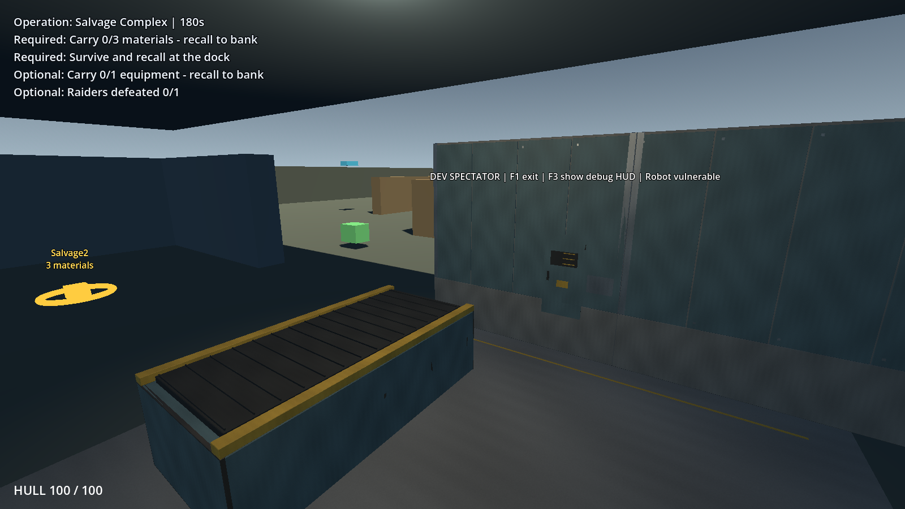

# Stage V: environment assets and processing-bay demonstration

Delivered **2026-10-22** against accepted Checkpoint U. The director approved the [proposal](../plans/phase_7_stage_v_environment_art_plan.md) before production. Implementation and validation are complete; **Checkpoint V was accepted by the director on 2026-10-22**. The director confirmed "previous approved" and requested the next ledger when the approved work was complete. This records acceptance without claiming additional automated or manual test observations. No Stage W work, Git commit or publication is included.

## Delivered result

Eight original Blender assets, six shared Godot materials and two original tileable 1K maps establish an explicit Blender 4.5.10 LTS → GLB → Godot 4.7.2 Standard / Forward+ pipeline. Editable `.blend` sources are included. Godot imports the GLBs; running the game does not require Blender. The [pipeline guide](../../art_pipeline/README.md) covers authoring conventions, export, material remapping, reimport, validation and recovery. The [asset manifest](../../../assets/environment/asset_manifest.json) records source/export hashes, dimensions, surfaces, triangles and provenance.

The expanded mission's processing building now has a limited dressed east/south bay: modular solid wall panels and plinths, an inset control cabinet, an enclosed sorting conveyor replacing the workbench visual, a shared concrete floor patch, restrained markings, bay identification and two modest non-shadowed task lights. The accepted outdoor lighting remains intact. The rest of the world is still graybox, deliberately.

The reference images informed construction, palette and wear. No reference textures, Rust meshes, third-party models or marketplace material packs were copied. All delivered geometry and maps are original; generation scripts and editable sources are retained. Characters and machines retain their accepted placeholder meshes.



[Entry and actor scale](../baselines/stage_v_delivery/screenshots/art_entry.png), [player-height view](../baselines/stage_v_delivery/screenshots/art_player_height.png) and [asset library](../baselines/stage_v_delivery/screenshots/asset_library.png) supplement the bay view. These are actual Forward+ captures, with developer spectator/UI context visible, rather than Blender preview renders.

## Inventory and ownership

Dimensions below are imported Godot width × height × depth in metres. Model origins are floor-centred except the beam and utility run, which use an end origin. Models have applied transforms, UV0, normals and shared external material resources.

| Asset | Dimensions | Triangles | Material surfaces | Use |
| --- | --- | ---: | ---: | --- |
| industrial_wall_2m | 2 × 4 × 1.0005 | 804 | 3 | Bay wall |
| industrial_wall_4m | 4 × 4 × 1.0005 | 1,332 | 3 | Bay wall, reusable pilot |
| steel_column_4m | 0.4 × 4 × 0.4 | 220 | 1 | Library |
| steel_edge_beam_4m | 4 × 0.3 × 0.3 | 132 | 1 | Library |
| control_cabinet | 0.8 × 1.6 × 0.393 | 344 | 3 | Inset bay cabinet |
| sorting_conveyor_base | 4 × 1.2 × 2 | 1,628 | 4 | Existing workbench envelope |
| utility_run_2m | 2 × 0.182 × 0.18 | 336 | 2 | Library |
| scrap_bin | 1 × 0.8 × 0.8 | 616 | 2 | Library |

Total **5,412 unique triangles**, well below the proposal's 25k review ceiling. The 4 m wall modestly exceeds its initial category guide because of bevelled panels/hardware; the conveyor has four material surfaces to distinguish paint, rubber, bare steel and safety edging. These are documented local exceptions, assessed against actual draw calls and frame times below. They do not establish a budget for larger production areas. Eight model sources plus the shared material source occupy about 5.36 MiB.

The six foundations are concrete, painted blue-gray steel, weathered steel, galvanized steel, rubber and safety yellow. Two shared 1024² maps provide original surface wear and roughness. Blender linear palette values are explicitly converted to Godot source-color values; the initially dark direct-numeric mapping was corrected before final review. Original Blender preview materials and external Godot resources have separate documented presentation roles.

The column, beam, utility assembly and bin remain usable assets in the inspection scene. They were not placed on routes without matching accepted solid geometry. A future placement requiring new collision needs its own structural review.

## Architecture and changed files

Only **one of the 232 protected U files changes**: `scenes/levels/expanded_salvage_complex.tscn` references the new inherited processing-art wrapper. The other 231 files, including AI, mission controllers, configuration, structural collision modules and earlier tests, remain byte-identical to the accepted U manifest. The work preserves the existing uncommitted P–U implementation.

New files are grouped as follows:

- `assets/environment/`: original editable sources, explicit GLBs/import settings, shared textures, provenance and inventory. Source `.gdignore` prevents automatic Blender imports without excluding editable sources from Git.
- `resources/materials/environment/`: six shared external resources.
- `scenes/environment/`: eight reusable visual wrappers and a standalone asset-inspection scene.
- `scenes/levels/environment/processing_facility_art.tscn`: visual-only inherited dressing. `expanded_salvage_complex_graybox.tscn` provides the comparison scene.
- `scripts/presentation/environment_art_view.gd`: one presentation flag switches old/new visuals. It has no simulation/input loop or actor authority.
- `tools/art_pipeline/`: guarded model/material builders, independent source exporter, import configuration and standard-library GLB audit.
- `tests/asset_pipeline_test.gd`: the additional regression suite, with its generated UID.
- Documentation and `.gitignore`: pipeline instructions, evidence, approval history, Blender backup/Python-cache exclusions.

Accepted BoxShape3D colliders remain the physical authority. No generated mesh collision, navigation regions, new markers, loot sources, actor hooks or extra navigation bake callbacks were introduced. Automated snapshots compare collision types, sizes, transforms, layers/masks, authored markers and navigation settings between art/graybox scenes. Solid model details remain within existing envelopes with a 12 mm surface-detail tolerance.

An initial comparison-scene attempt replaced an inherited packed instance; navigation setup exposed orphaned-node transform errors. That candidate was discarded. The delivered comparison scene changes only the presentation flag on the same hierarchy, and passes startup and structural checks.

## Pipeline proof

The representative 4 m wall passed before the remaining assets were built. Two Godot instances had identical unit transforms, bounds and external material paths. An actual edit of eight service-plate vertices in the `.blend`, export to the same GLB and Godot reimport changed both instances' geometry fingerprint from `9a48aaef…` to `3bc77ab9…`, retaining all three material bindings. The original source was then restored and re-exported for delivery. [Pilot logs](../baselines/stage_v_delivery/pipeline/pilot_before.log) and [edited import result](../baselines/stage_v_delivery/pipeline/pilot_edited.log) preserve both full fingerprints.

A repeated export from the restored source was byte-identical with this pinned exporter. That is observed evidence, not a cross-version guarantee. An intentionally unapplied x2 scale was rejected before export. Builders refuse existing sources unless explicitly invoked with `--rebuild`; normal artistic edits use the separate exporter.

All eight exports were also imported and inspected in a fresh isolated project with no Blender sources, pipeline scripts or existing import cache. Materials resolved and imports remained visual-only. [Clean import](../baselines/stage_v_delivery/pipeline/clean_all_import.log) and [inspection](../baselines/stage_v_delivery/pipeline/clean_all_check.log) are retained. The user's cache was not deleted. Import configuration invalidates only each owned GLB's generated checksum when required to apply external material settings.

## Validation

| Check | Final result |
| --- | --- |
| Fresh accepted-U baseline | Editor/import + all 32 existing suites passed |
| Full Stage V regression | Editor/import + all **33 suites passed**, ordinary timing |
| Asset audit | Eight valid source/export pairs; 5,412 triangles; six materials; two maps |
| Final visual-shadow adjustment | Editor/import and new asset suite passed again headlessly and in Forward+ |
| Physical expanded mission | Existing expanded-world suite passed again in Forward+ |
| Graphical gameplay fixture | Actual Deploy click → loaded Raider defeated by player hitscan → cargo recovery → Recall → three materials banked and completed primary |
| Bounded startup | Headless and Forward+ expanded mission; graphical inspection and graybox comparison passed |
| Source-edit/reimport | Both instances updated, materials and transforms preserved |
| Fresh isolated import | All eight GLBs passed without authoring sources/cache |

The new suite checks hashes, applied transforms, UVs, dimensions, material paths, shared repeated resources, forbidden physics/nav nodes, exact preserved structural contracts, visual envelope containment, actual blocked/clear firing paths, camera spring-arm clearance, developer input separation and conservation. Existing suites retain actual movement/ramp/retreat, cover, social combat, looting, equipment, extraction, persistence, player death, spectator and restart coverage. Policy-only checks are not used as proof of physical movement.

[Full-suite records](../baselines/stage_v_delivery/regression/validation.json), [final graphical/startup records](../baselines/stage_v_delivery/final_checks/validation.json) and their combined stdout/stderr logs are archived. **Final runs contain no errors or warnings.** Early accelerated exploratory runs emitted audio cleanup/ObjectDB warnings; ordinary-timing full regression and final checks did not reproduce them. Earlier failed import/probe attempts are not counted as successful validation.

Two read-only natural observations used accepted west/east seeds and the unchanged schedule; the stationary player remained vulnerable and post-death continuation was permitted. These are simulation observations, not director play-testing:

| Seed | World resolution | Total shots | Navigation recoveries | Raider exits | Machine deaths | Final materials |
| --- | ---: | ---: | ---: | ---: | ---: | --- |
| 87017 west | 152.35 s | 87 | 2 | 5 | 2 | 12 extracted, 1 ground, 1 stock |
| 87018 east | 118.52 s | 29 | 0 | 5 | 2 | 14 extracted |

Both retained population/equipment/material invariants and no unresolved objectives at world termination, reproducing the accepted U summary. These seeds do not prove every social interaction occurs naturally; existing constructed integration suites exercise those conditional paths. No outcome was scripted into the normal mission.

## Performance comparison

Matched sequential 30-second Forward+ windows used seed 87018, 1600 × 900, RTX 4060 Laptop / i7-14700HX and disabled optional metrics. The fixture admitted the existing five finite Raider IDs early to sample five Raiders/two machines, then let their actual physics/combat run. It did not increase limits or stock. Camera transforms were identical before/after for each view; no background Godot validation ran during measurement. Counters below are maxima over the window, including shadow/render passes; rendered primitives are not unique model triangles.

| Measurement | U bay | V bay | U overview | V overview |
| --- | ---: | ---: | ---: | ---: |
| Median frame interval (ms) | 4.164 | 4.186 | 4.165 | 4.181 |
| p95 frame interval (ms) | 5.625 | 5.692 | 5.786 | 5.741 |
| Maximum interval (ms) | 9.830 | 9.227 | 8.634 | 8.094 |
| Draw calls | 224 | 264 | 224 | 264 |
| Rendered primitives | 177,750 | 200,172 | 177,750 | 200,172 |
| Texture memory (MiB) | 105.95 | 114.95 | 105.95 | 114.95 |
| Load/ready time (ms) | 269.894 | 307.570 | 279.950 | 314.786 |
| Repeat static bake (ms) | 14.418 | 15.042 | 14.462 | 15.173 |

Initial art added 44 draw calls, triggering review. Disabling redundant shadow casting on the floor patch and two lamp housings reduced this to **+40** without removing useful wall/machinery shadows. Added texture memory is **9 MiB**, below the initial 16 MiB target. Bay p95 changes by about +1.2%; the overview changes by about −0.8%, within this single local comparison's noise. There were no >33 ms frames in these windows. Navigation input is unchanged; the roughly 0.6–0.7 ms repeat-bake difference is a local timing observation, not evidence of changed routes.

Raw measurements retain process/physics monitors, memory, peak-population sample counts and sync times: [performance evidence](../baselines/stage_v_delivery/performance/). Engine process-monitor values vary independently of the sampled frame intervals and should not be interpreted as GPU timings. These short local tests are not a cross-hardware production certification or permission to multiply the same cost across the map. Recheck draw calls/material surfaces and textures as the dressed area expands.

## Director review and next boundary

Launch the **expanded** mission explicitly; default startup remains compact Asset Recovery:

```powershell
godot --path . res://scenes/levels/expanded_salvage_complex.tscn
```

Click **Deploy**, then inspect the western processing building's dressed bay near **(−18, 0, 3)**. **F1** enables developer free camera; **F3** toggles diagnostics. In-game F5 selects an older reference scenario and is not the art demonstration selector. Compare with `res://scenes/levels/expanded_salvage_complex_graybox.tscn`; inspect all assets at `res://scenes/environment/asset_inspection.tscn`.

1. Judge industrial proportions, readable panel/steel/rubber differences, restrained wear and actor visibility under the roof, from both shoulder and spectator views.
2. Walk, jump and boost through the bay; orbit/aim near panels, roof and machine. Check apparent cover against bullets and the spring arm, including close peeks.
3. Observe Raiders scavenging, fighting, retreating and exiting through the same routes. Recover loot, Recall, die/spectate and restart; look for visual obstructions or stale presentation.
4. Open a `.blend`, make a small deliberate edit, export with the guide, reimport and confirm multiple instances/materials survive. Restore the source/export pair afterward.
5. Decide whether the palette, surface density and modular quality are suitable for further production. This checklist is retained for future refinement; acceptance is recorded above.

Known limits: one partial bay; simple shared UV/map treatment; baked mesh bevels rather than live modifier stacks; no LOD system needed at this size; four assets deliberately remain library-only; no character/animation production. The two lights are small unshadowed fills and need review if surrounding architecture changes. Existing debug text and gameplay markers remain accepted presentation.

Recommended follow-up is director feedback on this pipeline and bay before approving broader asset placement or Stage W. Future structural/art changes should keep the visual-versus-physical contract explicit and repeat matched performance checks. **Stop at Checkpoint V.**
