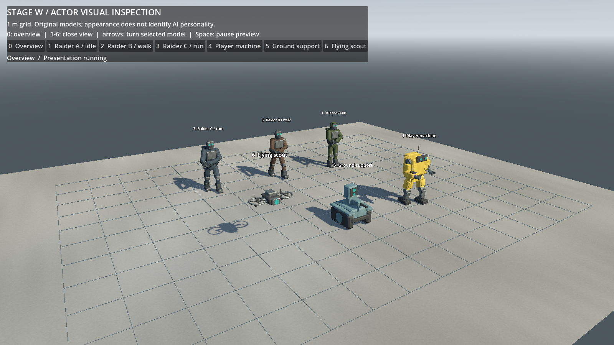

# Stage W: character and machine visual foundation

The director approved the [design/architecture proposal](../plans/phase_7_stage_w_actor_visual_production_plan.md) on **2026-10-22**. Implementation and validation are complete; **Checkpoint W was accepted by the director on 2026-10-23 in the Stage X ledger.** This delivers the approved actor foundation, not final cinematic character art. No Stage X work, Git commit or publication is included.

Director follow-up: the models and physics were positively reviewed, and frequent Raider action switching prompted a focused [action-commitment and steering correction](stage_w_raider_action_commitment.md). Its validation and remaining gameplay review are recorded separately below the original visual delivery baseline.

## Delivered identities

Four original editable Blender models now replace the principal placeholder visuals in normal and expanded deployments:

- Human Raiders: masked scavengers, protective workwear/plates, salvage packs and the existing rifle, using one humanoid rig with three bounded wardrobe/palette combinations.
- Player: an ochre industrial biped with articulated legs, durable torso, directional sensors, utility hand and fixed blaster housing.
- Ground support: compact tracked security platform with wheel hubs, front sensors and the existing pulse-emitter housing.
- Scout: lightweight protected twin-rotor observation drone with a distinct front sensor. It remains unarmed.

The director's four images informed broad design interests. No reference mesh, texture, branding or exact character was copied. All model geometry, rig and actions are original. Materials reuse original Stage V maps; there are **no new image textures**. Characters intentionally use simple angular construction and restrained detail at the current gameplay scale.



[Raider close view](../baselines/stage_w_delivery/screenshots/actor_view_1.png), [player](../baselines/stage_w_delivery/screenshots/actor_view_3.png), [ground support](../baselines/stage_w_delivery/screenshots/actor_view_4.png), [scout](../baselines/stage_w_delivery/screenshots/actor_view_5.png). These are actual Forward+ captures. The inspection scene also supplies a metre grid, independent previews, close-view controls, rotation and presentation pause.

## Inventory, rig and animation

Full source/export hashes, mesh/surface inventories, bounds, bones, clips and sockets are in [actor_manifest.json](../../../assets/characters/actor_manifest.json). Dimensions below are Godot width × height × depth, including cosmetic attachments.

| Actor | Imported dimensions (m) | Unique triangles | Meshes / total surfaces | Rig |
| --- | --- | ---: | --- | --- |
| Raider | 0.758 × 1.825 × 0.994 | 4,412 | 6 / 10, before optional visibility | One 20-bone skeleton; five skinned mesh nodes and separate rifle |
| Player | 1.215 × 1.78 × 1.04 | 2,432 | 11 / 17 | Named rigid articulation pivots |
| Ground support | 0.861 × 1.0645 × 1.09 | 2,000 | 6 / 9 | Named wheel/sensor/recoil pivots |
| Flying scout | 1.156 × 0.34 × 0.518 | 1,204 | 4 / 6 | Named rotor/sensor pivots |

Total **10,048 unique triangles** across four identities. Sources occupy approximately 3.75 MB and GLBs 0.82 MB. Models remain below the initial triangle guides because additional ornament was not necessary to establish identity/articulation. Shared materials and independently moving parts still cost draw calls; see the measured exception below.

Raider Blender actions are **idle, walk, run, aim, fire and death**. Godot import explicitly loops idle/walk/run/aim and keeps fire/death as one-shots. A manually advanced base player plus filtered upper-body aim/fire layer supports movement while armed. There is no animation root motion or parallel gameplay FSM. Initial clothing/armor uses simple rigid-segment weighting on the shared deform rig; detailed cloth, face/finger motion and IK are deferred.

Mechanical gait, airborne/boost leg posture, wheel motion, rotor/hover motion and recoil are visual-only transform animation. They read actual CharacterBody3D movement and accepted state/events. Destruction uses a short terminal visual clip inside the existing cosmetic tumble. Existing hit flashes, shot/audio feedback and damage HUD are preserved.

Three Raider appearances use an independent integer hash of seed, actor identity and a visual salt. They consume no gameplay RNG and do not reveal personality or relationships. Private cloth/cargo overrides keep one actor's changes from recoloring another; the loaded indicator reads ledger-backed cargo. Cosmetic rifles/packs cannot allocate or duplicate equipment.

## Architecture and integration

`ActorVisual` lives below the existing controller-facing `Visuals` root. It owns meshes, skins, local presentation, appearance and accepted-shot recoil. Existing CharacterBody3D controllers, Health, Raider FSM/combat/social policy, navigation, targeting, ledgers, mission rules, Recall, stash and camera permissions retain authority.

The accepted fixed muzzle paths/coordinates, camera rig, collision layers/shapes, navigation settings and aim positions remain unchanged. Visible barrels match the existing firing markers; animations do not drive those markers. Machine construction remains in `SupportMachine`: only its primitive-visual composition is extended. An arena `production_actor_visuals` flag supports existing primitive fixtures; normal deployments default to production visuals.

The original static-mesh death copier could not preserve skeleton deformation. Its optional visual factory now creates a clean model/skin/animation subtree, copies current pose and appearance with independent mutable materials, and plays the terminal clip after the actor is freed. The copy has **no actor controller, Health, navigation, input, weapon executor or accounting callbacks**. It uses the same single cosmetic rigid body, layer0/mask1, forces and four-second lifetime. Legacy primitive targets retain their original static fallback. Death/extraction/loot release never wait for a clip.

Changed accepted files comprise six presentation integration seams, three maintained tests and three extended pipeline tools: **12 of the 292 accepted V manifest files**. The other **280 remain byte-identical**, with none missing. Scene edits add visual wrappers; script edits add visual configuration/cargo routing and the optional death factory. Raider AI decision/combat policy files, materials/equipment authority, mission configuration/rules, persistence, camera controllers and environment assets are unchanged. [Source audit and diff](../baselines/stage_w_delivery/regression/source_changes.json) distinguish these changes from pre-existing user documentation work.

New files include `assets/characters/`, four shared actor materials, four wrapper scenes, the inspection scene, `actor_visual.gd`, `actor_inspection.gd`, two test suites and actor-authoring tools. Script UIDs and GLB import settings are retained. No active tests were retired.

## Pipeline and source iteration proof

The [actor production guide](../../art_pipeline/actors.md) extends the existing V workflow: Blender **4.5.10 LTS**, explicit GLB, Godot **4.7.2 Standard / Forward+**. Sources are editable `.blend` files under a `.gdignore`; runtime does not require Blender. Actor mode adds armatures/skins, explicit named actions and mechanical hierarchies to the existing exporter/import/audit tools. Static mode remains intact.

The Raider pilot passed before machine production. Two imported instances had real independent 20-bone skins and separate idle/walk playback. A real source edit moved 28 chest vertices by 10 mm, saved the `.blend`, exported to the same GLB and reimported. Both Godot instances updated to geometry fingerprint `7b3d94dc…`, retaining bones, clips and material bindings. Restoring and re-exporting the source returned both to `2ffeb275…`; the restored GLB was byte-identical to the original. The detached skinned death copy continued after source removal throughout this exercise. [Pilot evidence](../baselines/stage_w_delivery/pipeline/) retains full fingerprints and comparisons.

An accepted V wall was also re-exported through the unchanged static mode and remained byte-identical. Unapplied rig scale was deliberately rejected. Builders retain overwrite guards; artistic edits use the exporter, not `--rebuild`.

All four GLBs were freshly imported and instantiated in an isolated project **without Blender sources or the main import cache**. External materials resolved, skeletons/clips were usable and models introduced no gameplay physics/cameras. The user's cache was not deleted. This is separate evidence from loading resources in the full repository.

## Automated and graphical validation

| Check | Result |
| --- | --- |
| Fresh isolated accepted-V baseline | Editor/import + all 33 prior suites passed |
| Full W regression | Editor/import + all **35 suites passed**, ordinary timing; completion markers and logs inspected |
| Actor import suite | Actual skins, normalized weights, rig/clip loops, sockets, scale, UV/normals, shared materials, resource identity, visual-only nodes and unchanged V assets passed |
| Actor visual suite | Real player/Raider movement, independent skin poses, accepted physical shots/cooldown, fixed origin, cargo/appearance, death, loot, cameras, settlement and restart passed |
| Final render-only adjustment | Editor, both actor suites headlessly and production integration in Forward+ passed again |
| Graphical gameplay flow | Actual Deploy click → player weapon defeats loaded Raider → cargo recovery → Recall → three materials banked/completed primary passed |
| Startup | Bounded default and expanded headless/Forward+ startup; actor inspection passed |
| Fresh isolated import | All four models loaded with external materials; real Raider skin/clip playback without authoring sources/cache passed |
| Peak simultaneous death | Eight sources → exactly eight cosmetic bodies; terminal rigs survive source cleanup and expire; settlement/restart/conservation passed |

The retained primitive destruction and backpack tests explicitly select their supported primitive fixtures rather than losing their original assertions. New tests cover the production equivalents. V's historical blanket U-source hash assertion now has a reviewed presentation-change allowlist plus unchanged-source checks and physical contracts; original archived manifests are preserved.

[Full regression logs](../baselines/stage_w_delivery/regression/validation.json) and [final checks](../baselines/stage_w_delivery/final_checks/validation.json) contain combined output and exits. Final focused/graphical/clean-import checks are clean. Full regression emitted two **non-failing audio cleanup warnings**: extraction's two-instance ObjectDB warning also occurred in the fresh V baseline; flare/loot's warning was clean in that baseline but recurred in a verbose W rerun. The verbose leak types are `AudioStreamPlaybackWAV` and `AudioStreamWAV`, not Skeleton3D/AnimationPlayer/ActorVisual. A focused extraction rerun was clean. This audio cleanup debt remains documented rather than described as a warning-free full run.

Three read-only bounded headless observations retained a stationary vulnerable player, normal scheduling, independent actors and post-death continuation. These are automated observations, not director manual acceptance:

| Mission / seed | World resolution | Total shot counter | Raider extractions | Machine deaths | Conservation / population / frozen results |
| --- | ---: | ---: | ---: | ---: | --- |
| Expanded west / 87017 | 152.35 s | 87 | 5 | 2 | Passed |
| Expanded east / 87018 | 118.52 s | 29 | 5 | 2 | Passed |
| Default north / 87018 | 111.18 s | 32 | 5 | 2 | Passed |

Expanded outcomes reproduce accepted V timing/counters and material extraction (west 12 extracted, one ground, one stock; east all 14 extracted). Default north permitted conditional betrayal assessment and later independent extraction; no betrayal or winner was forced. The aggregate shot counter includes machine shots as well as Raider shots. Specific interactions remain conditional, with constructed integration fixtures exercising paths not guaranteed in every seed.

## Performance and reviewed draw-call exception

Fresh paired 30-second windows used identical seed 87018, resolution 1600×900, camera transforms, renderer, optional-metrics setting and finite peak fixture on RTX 4060 Laptop / i7-14700HX. The existing five Raider IDs were admitted early; their real physics/combat then ran. Initial production population was five skeletons/100 bones, ten living animation players, 15 visible skinned meshes and 41 total visible actor meshes. Natural admissions were observed separately. Measurements ran without competing Godot validation jobs.

| Metric | V bay | W bay | V overview | W overview |
| --- | ---: | ---: | ---: | ---: |
| Median interval (ms) | 4.168 | 4.179 | 4.170 | 4.178 |
| p95 interval (ms) | 5.702 | 5.654 | 5.714 | 5.534 |
| Maximum interval (ms) | 8.297 | 8.290 | 8.390 | 8.658 |
| Draw calls, maximum | 264 | 381 | 264 | 381 |
| Rendered primitives, maximum | 200,172 | 142,729 | 200,172 | 142,729 |
| Texture memory, bytes | 120,534,528 | 120,534,528 | 120,534,528 | 120,534,528 |
| Load/ready (ms) | 302.266 | 310.643 | 298.708 | 312.652 |
| Repeat static navigation bake (ms) | 15.381 | 16.102 | 15.800 | 15.493 |

Initial W bay cost was 415 draws. Review removed redundant shadows from wardrobe details, cargo indicator, wheel hubs and fast rotor blades; the chassis/protective ducts, main bodies, rifles, legs/feet and sensors retain shadows. Death copies preserve this policy. Final cost is **381 draws: +117 over V**, still above the proposal's approximate +80 **review trigger**. This is a documented exception, not a claimed budget pass. Independent moving parts and shared PBR surfaces account for the retained cost; eliminating these would reduce articulation or material readability. No new LOD, shader or mesh-batching framework was added just to satisfy a speculative count.

Local frame intervals stayed near baseline, there were no >33 ms intervals in these matched windows, imported texture memory did not increase, and rendered primitive count fell substantially as simple original models replaced relatively dense primitive meshes. Counters include shadow/render passes and are not unique source-triangle counts. Short local measurements and engine process monitors are not GPU timings or cross-hardware certification. Recheck the retained draw cost before growing actor populations or world art.

A separate matched eight-source death burst measured p95 **4.568 ms V / 4.510 ms W**, with maxima **5.110 / 4.787 ms**. It created exactly eight bodies in each version. Immediately after the death signals W briefly held live plus copied rigs before deferred source deletion; after deletion only five terminal skeletons/100 bones remained. After 4.5 seconds there were **zero** cosmetic bodies, skeletons or terminal players; replay rebuilt a fresh briefing without stale copies. The event/accounting audit stayed valid. This is a destruction/cleanup fixture, not the natural encounter window above. [Raw performance evidence](../baselines/stage_w_delivery/performance/) retains counts, samples, memory and restart data.

## Director review and remaining limits

Normal startup remains Asset Recovery:

```powershell
godot --path .
godot --path . res://scenes/characters/actor_inspection.tscn
godot --path . res://scenes/levels/expanded_salvage_complex.tscn
```

In the inspection scene, use **0** overview, **1–6** close views, **Left/Right** turn and **Space** pause. In gameplay, click **Deploy**; **F1** remains developer spectator and **F3** diagnostics. Existing post-death follow permissions are unchanged.

1. Judge human/machine silhouettes, scale, material consistency and readability in daylight and the processing-bay shade. Review the simple angular/rigid-weighted foundation against the supplied visual direction.
2. Move, turn, aim, jump and boost with the player. Check feet/gait, shoulder-camera visibility, weapon convergence and collision/cover alignment.
3. Observe Raiders walking/running, armed movement, aim/fire, carrying, retreat/extraction and death. Appearance should not identify personality or relationship state.
4. Observe ground patrol/hubs, sensors, pulse fire and destruction; scout travel/rotors/facing and destruction. The scout should remain visibly an observer.
5. Damage/kill several actors and inspect poses and attachments on the cosmetic copies. Recover finite loot, Recall, die/spectate, cycle targets and restart.
6. Open a source, make a small deliberate edit and follow the documented export/reimport cycle. Confirm multiple instances, rig/clip/socket/material integration survives; restore the source/export pair afterward.
7. Assess maximum-population smoothness on the director's actual play settings, beyond these short local measurements.

Known limits: initial production-direction models and minimal animation, simple clothing deformation, no face/finger/cloth/IK work, no ragdoll, no equipping, no cinematic destruction or root motion. Mechanical motion is intentionally simple; finer foot contact, aim/hand placement and additional unarmed poses remain future visual refinements. The full audio cleanup warning remains separate technical debt. No additional game capability is implied by decorative equipment.

The director subsequently accepted **Checkpoint W**, including the action-commitment follow-up, in the Stage X ledger. The [Stage X architecture proposal](../plans/phase_7_stage_x_combat_audio_atmosphere_plan.md) now awaits approval before implementation. Future refinement should preserve these ownership contracts and repeat matched rendering checks as complexity grows.
