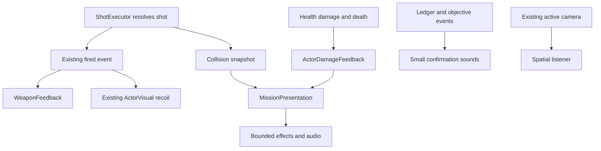

# Combat and atmosphere presentation

Stage X adds scene-local observers. `ShotExecutor` still owns permission, ray, cooldown and damage. Its original `fired` signal is unchanged; the additive `impact_resolved` snapshot describes actual collisions, including surface metadata captured before death callbacks. A miss has no impact event.

`RaiderArena` owns one `MissionPresentation`, registering each player, scheduled Raider and machine through the existing visual-setup seam. `WeaponFeedback` owns one muzzle cue, spatial sound and captured-endpoint trace per armed actor. `ActorVisual` retains recoil. `ActorDamageFeedback` reads Health and actual speed for machine flash, critical smoke and motor audio. The scout is unarmed. `HitReaction` flashes imported Raider geometry and deforms only static cosmetic fixtures, preserving physical muzzle/collider transforms.

The root owns independent transient lifetimes, twelve spatial one-shot players, two interface players and an AudioListener3D that follows the viewport's active camera. Six loop registrations cover three machines and three environment beds. Camera ownership remains with existing camera/spectator controllers. No presentation method calls AI hearing, actor transitions, damage, ledger transfers or settlement.

## Limits and controls

- One presenter per actual weapon, normally up to seven. Rejected fire stays silent. Hit markers retain actual-damage semantics.
- Four enabled unshadowed transient lights, sixteen traces, sixteen contact/destruction bursts and 256 transient particles. Old contact bursts expire first under pressure. Each burst batches ribbons in one ImmediateMesh; terminal smoke uses the original soft gradient. No collision or navigation geometry is created.
- Twelve reusable world voices, two interface voices, six machine/environment loops and seven weapon voices: 27 normal maximum, below the 32-voice review budget. Optional one-shots replace the oldest slot; terminal sounds share this pool. There is no reserved voice priority tier.
- Two twelve-particle ambient emitters and up to three eight-particle critical-machine emitters are separate from the transient budget. Arrival/flaring effects retain their prior independent bounds.
- `enhanced_presentation = false` on an arena disables new combat/audio emitters for diagnostic replay. Explicit main/expanded environment resources remain authored scene settings. Older reference presets retain their prior lighting resources.
- Existing bus volumes are editable in `default_bus_layout.tres`; Music is reserved and silent. Original WAV provenance and regeneration are in [assets/audio](../../assets/audio/README.md).

Launch `godot --path . res://scenes/characters/actor_inspection.tscn`. Existing 0?6, arrow and Space controls remain. Fire, Metal, Concrete, Armor, Damage, Destroy/Reset, Motor and Repeat audition shared presenters using preview inputs. The scout's Fire button is disabled. Motor loops stop with Reset or view selection. Repeat fires twice per second, or shows scout armor impacts. No Health, weapon executor, actor AI, ledger or mission is created. One terminal visual is retained until Reset/selection.

World shutdown stops voices and clears stream references immediately; no gameplay path waits for sound or effects. Source actor deletion does not delete already captured contact/destruction effects. Player death keeps world presentation active while the autonomous mission continues. Restart removes the old world/listener. Godot's accelerated WAV playback shutdown warning remains a documented backend limitation; see the [delivery report](../development/reports/stage_x_combat_audio_atmosphere.md).
